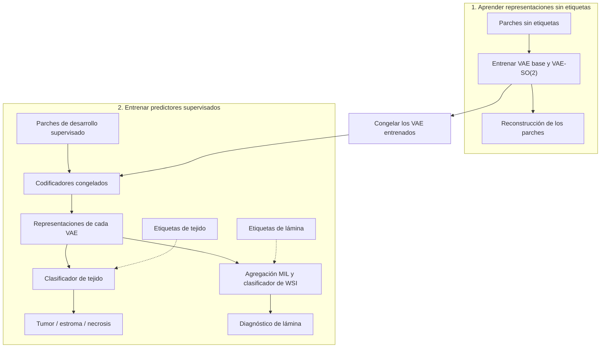

# Revisión integral de la tesis y puntos pendientes

Registro de la revisión completa del PDF de 109 páginas, con tres agentes que leyeron todo el texto e inspeccionaron individualmente todas las páginas y figuras. Audiencia: ciencias de la computación. Documento base: `artifacts/thesis.pdf`, SHA256 `c6355b8bc1bb2330f999bf99f1ed88627d0662c558f9d1aa290ab25afae703d2`.

La tesis tiene una base científica defendible. Las prioridades son claridad conceptual, precisión de interpretación y correcciones gráficas. Las recomendaciones de orden y pulido son propuestas, no requisitos institucionales comprobados. No se exigen entrenamientos nuevos para sostener el alcance limitado actual.

## Acuerdo de trabajo

Se presenta un solo punto por vez: objeción, explicación y recomendación concreta. El usuario aprueba, modifica o descarta; no se avanza al siguiente hasta resolver su decisión. Antes de cualquier cambio editorial se presenta una propuesta revisable. Las decisiones se registran aquí y las correcciones autorizadas se aplican únicamente dentro de su alcance.

Crear este registro no autoriza modificar el manuscrito, sus figuras, objetivos ni experimentos. Mantener resultados aceptados, SO(2) continuo, puntos de control congelados y separación de prueba. No sincronizar Overleaf ni publicar sin autorización específica.

**Recorrido de los56 puntos terminado.** Puntos01–10,12–20,22 y24–35 aprobados y aplicados;36 resuelto conservando tabla y figura;37–42,44–47,49–51,53 y55–56 aprobados y aplicados;43 ya resuelto en25;54 cerrado por el usuario, resuelto en33. El criterio del punto48 y el cambio de nombre del punto52 a «realineación del latente» están aprobados para la revisión terminológica final; las restantes definiciones del52 quedan propuestas para esa revisión. Puntos11 y23 descartados sin cambios;21 pospuesto hasta tener el código final del paper. La ampliación del test y la revisión terminológica integral siguen pendientes; no se iniciaron al cerrar el56. PDF actualizado:132 páginas. Las ubicaciones originales de la lista corresponden al PDF base de109 páginas.

## Orden de revisión

**Regla terminológica del usuario:** Primera mención en español seguida del nombre en inglés entre paréntesis. Después, elegir un único nombre —inglés o español según el uso habitual de la literatura— y mantenerlo en texto, pies, tablas y figuras. No alternar sinónimos/traducciones ni repetir las introducciones bilingües en cada capítulo. Los títulos bibliográficos originales se conservan. Para steerable, el Resumen ya presenta «convoluciones direccionables (steerable convolutions)»; el cuerpo usa mayoritariamente «direccionables» y en un caso «orientables» para filtros. Propuesta de uniformidad: esa presentación bilingüe y luego «convoluciones steerable», coherentemente también para núcleos, filtros y CNN. Regla guardada en AGENTS.md; sin sustitución global del manuscrito en esta consulta.

**Revisión terminológica integral pospuesta por el usuario (2026-10-03):** Revisar más adelante todos los términos de todo el documento, incluyendo primeras menciones, siglas, elección consistente de español/inglés, pies, figuras y tablas. No limitarla a steerable. No iniciar ahora la auditoría ni una sustitución global; la regla se aplica a las nuevas propuestas mientras continúa la revisión por puntos. Esta decisión no aprueba todavía el texto del punto27.

01. Introducción conceptual del VAE
02. Diferencias entre las pruebas rotacionales
03. Propiedad incorporada y propiedad aprendida
04. Interpretación de la RMS relativa de aristas
05. Expresión y reducción de KL
06. Hipótesis en discusión y conclusiones
07. Selección de puntos de control
08. Mapas de predicciones de segmentación
09. Salidas anunciadas y no presentadas
10. Inferencia sobre la familia de presupuestos
11. Esquema semisupervisado de la Figura 3.3
12. Índices de la atención por ventanas
13. Operaciones del bloque residual
14. Superposición de la sumatoria
15. Flechas del flujo MIL
16. Escalas de distribuciones por parche
17. Etiquetas recortadas de PCA espacial
18. Definición de métricas principales
19. Configuración de clasificadores
20. Normalización vectorial
21. Acceso a material reproducible
22. Composición y selección de poblaciones
23. Signos por WSI e intervalo de reconstrucción
24. Unidad del mayor presupuesto
25. Interpretación de curvas y resultados por clase
26. Brecha de investigación y apertura
27. Síntesis de trabajos relacionados
28. Vocabulario especializado en la apertura
29. Peso de la Bitter Lesson
30. Autoría y fuentes de figuras heredadas
31. Inicialización del listado y discretización continua
32. Orden del marco conceptual
33. Orden de campos y arquitecturas
34. Orden de tareas supervisadas
35. Detalle de implementación en apéndices
36. Selección de vistas de resultados
37. Continuidad y colocación de flotantes
38. Mención de Figura 3.2
39. Mención de Figura 3.13
40. Mención de Figura 4.2
41. Mención de Figura 4.11
42. Mención de Figura 4.13
43. Mención de Figura 5.13
44. Mención de Figura 5.17
45. Comparación numérica en resúmenes
46. Densidad y extensión de resúmenes
47. Puntuación de grado del director
48. Nombres e idioma de modelos
49. Rótulos internos de exportaciones
50. Alcance de razones poblacionales
51. Redundancia y concordancia de frases
52. Introducción de términos secundarios
53. Iluminación en Figura 3.8
54. Destino de la referencia de Figura 4.7
55. Objetivo de validación y evaluación final
56. Referencia estable de softmax

## Detalle de los puntos

### Punto 01 Introducción conceptual del VAE

- **Prioridad:** Necesario.
- **Ubicación:** Marco pp. 20–21; metodología p. 37.
- **Estado:** Aprobado y aplicado.
- **Objeción:** El marco explica brevemente el autoencodificador, pero no qué añade la variante variacional.
- **Explicación:** El lector llega a posterior, log-varianza y reparametrización sin comprender qué representan ni para qué sirven.
- **Recomendación:** Ampliar el marco con codificador, distribución latente, media y dispersión, muestreo, decodificador, prior y función conceptual de KL; explicar el uso de la media posterior congelada. Mantener dimensiones y protocolo concreto en metodología.
- **Decisión del usuario:** Solicitó incorporar tres anotaciones: representación usualmente comprimida o de menor dimensión; normal estándar de referencia; efecto de KL sobre las salidas del codificador. Aprobó el texto corregido y autorizó aplicarlo y pasar al siguiente punto. Los tres párrafos se incorporaron después de la explicación de las CNN, con citas a Goodfellow, Tellez y Kingma. Compilación y comprobación del documento correctas; inspección visual de las páginas 20–25 del PDF actualizado. Las anotaciones de figuras siguen pendientes en sus puntos respectivos.

#### Propuesta de redacción del punto 01

Un autoencodificador combina un codificador, que transforma una imagen en una representación latente, usualmente comprimida o de menor dimensión que la entrada, y un decodificador, que utiliza esa representación para reconstruirla. El entrenamiento busca conservar en el latente información suficiente para recuperar la entrada. Esa información puede utilizarse posteriormente en otras tareas mediante un predictor entrenado sobre las representaciones.

En un autoencodificador variacional, el codificador describe una distribución latente asociada a cada entrada, habitualmente gaussiana, mediante una media y una varianza aprendidas. Esta distribución se distingue de la distribución de referencia o distribución previa, para la cual suele elegirse una normal estándar, de media cero y varianza uno en cada coordenada. Durante el entrenamiento se obtiene una muestra de la distribución producida por el codificador y se entrega al decodificador. La reparametrización permite expresar ese muestreo mediante una transformación diferenciable de ruido aleatorio, de modo que los parámetros del codificador también puedan ajustarse a partir del error de reconstrucción.

El objetivo incorpora además una regularización que compara la distribución producida por el codificador con la distribución previa mediante la divergencia de Kullback–Leibler (KL). Este término favorece que el codificador ajuste sus salidas de media y varianza para acercar las distribuciones latentes a la distribución escogida, en equilibrio con la conservación de información necesaria para reconstruir la entrada. En esta tesis se utilizó una distribución normal estándar como referencia. Después del entrenamiento, los clasificadores recibieron la media de la distribución latente, manteniendo congelado el codificador; así, cada parche tuvo una representación determinista para las tareas supervisadas.

### Punto 02 Diferencias entre las pruebas rotacionales

- **Prioridad:** Necesario.
- **Ubicación:** Figuras 5.1 p. 70, 5.17 p. 92 y 5.18 p. 93.
- **Estado:** Aprobado y aplicado.
- **Objeción:** Los resultados favorables y desfavorables de distintas razones rotacionales no se conectan suficientemente.
- **Explicación:** La razón latente y el residual directo pueden parecer incompatibles con el error de acción casi nulo; falta definir la normalización del residual directo.
- **Recomendación:** Identificar qué operación evalúa cada medida, qué módulos incluye y su referencia; explicar los resultados desfavorables. Considerar una tabla breve de pruebas y sus interpretaciones.
- **Decisión del usuario:** Aprobó la corrección. Aplicadas las definiciones del seguimiento de desarrollo y del residual directo, la tabla comparativa 4.3 y el enlace interpretativo en resultados. Se conservaron todas las figuras y cifras existentes. Compilación, comprobación del documento y espacios en blanco correctas; inspección visual de las páginas 9, 64–72 y 90–96. Los 443 enlaces internos del PDF tienen destinos válidos, incluidas las nuevas ecuaciones y tabla.

#### Propuesta concreta del punto 02

En metodología, explicitar la fórmula y la normalización del residual directo del posterior: compara la media obtenida al codificar la entrada rotada con la rotación espacial de la media de la entrada original, sobre el disco central. Distinguir esa normalización de las razones calculadas sobre reconstrucciones RGB. Precisar también la definición y condiciones de la razón latente de seguimiento de la Figura 5.1, que actualmente solo se identifica como seguimiento del desarrollo.

Agregar una tabla breve que distinga cinco preguntas: seguimiento durante entrenamiento; cumplimiento de la transformación en el posterior; acción sobre un latente fijo y decodificación; canonización del latente de una entrada rotada y decodificación; composición completa de codificador y decodificador. Para cada prueba, indicar qué se compara, la referencia de normalización y el alcance de su interpretación. La geometría local de la órbita mide regularidad de la trayectoria y no sustituye el cumplimiento de una ley de transformación.

En resultados, interpretar explícitamente el control exacto del residual posterior de la Figura 5.18, que no favorece a la rama SO(2), y conectarlo con los resultados de acción, canonización y composición completa. Propuesta de párrafo de enlace: «Estas pruebas responden a preguntas distintas. El error de acción evalúa si el decodificador produce la rotación esperada al transformar un latente fijo, mientras que el residual directo evalúa si el codificador obtiene ese latente transformado al recibir una imagen rotada. Por ello, el acuerdo casi exacto del decodificador en cuartos de vuelta puede coexistir con un residual elevado del posterior. La composición completa evalúa conjuntamente ambos módulos; en las rotaciones interpoladas consideradas, esta medida favoreció al VAE base. La regularidad local de la órbita describe otra propiedad y no demuestra, por sí sola, equivarianza del codificador».

Propuesta aplicada. La fórmula de seguimiento usa normas L2 cuadradas sobre el mapa completo y el posterior de la entrada rotada como denominador; la curva promedia parches y cuartos de vuelta. El residual directo usa RMS sobre el disco central y el posterior esperado como denominador. Esta diferencia se documentó explícitamente. Las Figuras 5.1 (continuación), 5.17 y 5.18 están ahora en las páginas 72, 94 y 95.

Fuentes consultadas: repositorio `equivariant-vae`, revisión aceptada `bfed730a1559366841ebafa5f09edd6dbff43176`, `src/eqvae/artifacts/fixed25_equivariance.py` (funciones `_angle_pass` y `_per_image_sq_l2`) y `src/eqvae/evaluation/professor_metrics.py` (reducción de las tres medias por ángulo); `runs/local/professor_metrics_v1/manifest.json`; definición del residual y controles exactos en `docs/specs/0038-frozen-vae-rotation-orbit-visualization.md`; protocolo de razones RGB en `docs/specs/0051-decoded-latent-transform-consistency.md`. Se contrastó la representación de esos datos en `scripts/render_selected_paper_views.py` y `scripts/export_accepted_figure_views.py` de la tesis. No se modificó el repositorio experimental.

### Punto 03 Propiedad incorporada y propiedad aprendida

- **Prioridad:** Necesario.
- **Ubicación:** Conclusiones p. 100; chapters/07_conclusiones.tex:31–39.
- **Estado:** Aprobado y aplicado.
- **Objeción:** La conclusión afirma que la arquitectura aprendió una regularidad que la construcción ya restringe.
- **Explicación:** El resultado del decodificador entrenado no separa adquisición por entrenamiento de conservación de una propiedad arquitectónica.
- **Recomendación:** Distinguir restricción incorporada, compatibilidad numérica después del entrenamiento y utilidad predictiva. Proponer exhibió o conservó en el modelo entrenado, sin exigir experimentos nuevos.
- **Decisión del usuario:** Pidió eliminar la aclaración «no demuestra que el entrenamiento haya originado esa propiedad» y cerrar la interpretación en «incorporada en la arquitectura». Aprobó la versión ajustada. Aplicadas la nueva apertura y las dos frases de interpretación en conclusiones; cifras y resultado continuo conservados. Compilación, comprobación del documento y espacios en blanco correctas; inspección visual de las páginas 102–103. PDF de 111 páginas.

#### Propuesta concreta del punto 03

Antes: «Por otra parte, el resultado más claro apareció en la geometría del espacio latente» y «La arquitectura aprendió y conservó, por tanto, una regularidad rotacional controlable al transformar el latente y decodificar».

Después, para la apertura del párrafo: «Por otra parte, el resultado rotacional más claro se observó al transformar el latente y decodificarlo».

Después, para la interpretación aprobada: «El decodificador entrenado exhibió, por tanto, compatibilidad con la acción rotacional prescrita sobre el latente, especialmente en los cuartos de vuelta exactos. Este resultado es coherente con la restricción de simetría incorporada en la arquitectura».

Aplicado conservando las cifras y la comparación continua de extremo a extremo del párrafo.

### Punto 04 Interpretación de la RMS relativa de aristas

- **Prioridad:** Necesario.
- **Ubicación:** Metodología p. 63; ecuación 4.42; chapters/04_metodologia.tex:1701–1716.
- **Estado:** Aprobado y aplicado.
- **Objeción:** La afirmación de que la razón disminuye ante colapso no es válida en general.
- **Explicación:** Una contracción uniforme escala ambos términos por igual y deja la razón intacta; un mapa constante produce 0/0 en la expresión presentada.
- **Recomendación:** Precisar que mide rugosidad relativa, describir los comportamientos que permite detectar y comprobar/documentar el tratamiento del denominador nulo o casi nulo.
- **Decisión del usuario:** Solicitó explicar el contexto de la medida y luego aceptó la corrección. Aplicada la interpretación de rugosidad relativa y la definición por casos, con promedio sobre los 16 canales y umbral de RMS espacial centrada `1e-8`. Las cifras se conservan. Compilación, comprobación del documento y espacios en blanco correctas; sin referencias indefinidas ni desbordamientos de cajas. Inspección visual de las páginas 64–68; PDF de 111 páginas.

#### Propuesta concreta del punto 04

Texto actual: «La medida cuantifica rugosidad espacial y también disminuye ante suavizado o colapso».

Sustitución propuesta: «La medida cuantifica los cambios entre posiciones vecinas en relación con la variación espacial del mismo parche. Valores menores indican menor rugosidad relativa».

Documentar además el tratamiento computacional: la implementación calcula la RMS espacial centrada sobre las posiciones del disco y los 16 canales. Si esa RMS es menor o igual a `1e-8`, registra la razón como cero e identifica el mapa como degenerado. La expresión de la ecuación debe incluir esta convención y la normalización por canales al definir el umbral, sin modificar los resultados.

La objeción se explica con una contracción uniforme: si todos los valores latentes se multiplican por 0,5, las magnitudes del numerador y del denominador se reducen por igual y la razón se conserva, mientras el denominador supere el umbral. Un mapa constante carece de variación espacial y requiere el tratamiento especial confirmado en el código.

Fuente: revisión aceptada `bfed730a1559366841ebafa5f09edd6dbff43176` de `equivariant-vae`, `src/eqvae/artifacts/rotation_orbits.py`, función `spatial_latent_pca_diagnostic` y constante `_EPS`. El archivo `runs/local/frozen_vae_rotation_orbits/manifest.json` registra cero mapas degenerados entre los 25 parches de cada rama. Propuesta aplicada.

### Punto 05 Expresión y reducción de KL

- **Prioridad:** Necesario.
- **Ubicación:** Metodología p. 51; ecuación 4.22; chapters/04_metodologia.tex:991–1000.
- **Estado:** Aprobado y aplicado.
- **Objeción:** No se explicita la KL gaussiana diagonal ni sus ejes de reducción.
- **Explicación:** Sumar o promediar las 16×32×32 coordenadas modifica la escala efectiva del peso de regularización.
- **Recomendación:** Consultar la implementación aceptada y documentar expresión, sumas o medias por coordenada y lote. El hallazgo es una omisión documental, no un error experimental demostrado.
- **Decisión del usuario:** Aprobó la incorporación. Aplicadas la fórmula gaussiana diagonal normalizada, la explicación de la media sobre lote y coordenadas y el símbolo `L_KL` en el objetivo. Compilación, comprobación del documento y espacios en blanco correctas; sin referencias indefinidas ni desbordamientos de cajas. Inspección visual de las páginas 51–55; 444 enlaces internos con destinos válidos. La definición nueva aparece como ecuación 4.23 en la página 52. PDF de 112 páginas.

#### Propuesta concreta del punto 05

La función objetivo presenta la KL como una divergencia entre distribuciones, pero falta precisar cómo se obtuvo el escalar que se multiplicó por el peso beta. El código aceptado calcula la expresión gaussiana diagonal por coordenada y toma la media sobre lote, canales, alto y ancho. Cada latente tiene 16 × 32 × 32 = 16 384 coordenadas. La log-varianza usada está restringida a [-8,4], como ya se explica al definir el posterior.

Proponer el símbolo `L_KL` para este término normalizado en la función objetivo, con la definición:

\[
\mathcal L_{\mathrm{KL}}=\frac{1}{2BL}\sum_{i=1}^{B}\sum_{j=1}^{L}
\left(\mu_{ij}^{2}+\exp(\ell_{ij})-1-\ell_{ij}\right),
\qquad L=16\,384.
\]

Introducir B como número de imágenes del lote, j como coordenada del latente aplanado y ell como log-varianza restringida. Redacción propuesta: «La regularización variacional se calculó frente a una distribución normal estándar. Para cada imagen se obtuvo una contribución por coordenada latente y se promediaron las contribuciones sobre las 16 384 coordenadas y las imágenes del lote. Esta media se multiplicó por el peso beta de la función objetivo».

Fuente: revisión aceptada `bfed730a1559366841ebafa5f09edd6dbff43176` de `equivariant-vae`, `src/eqvae/losses/vae.py`, funciones `kl_divergence_loss` y `compute_vae_loss_tensors`; `src/eqvae/models/non_equivariant_vae.py`, función `clamp_logvar`. La fórmula equivale a la expresión por coordenada seguida de `mean()` del código. Propuesta aplicada; entrenamiento y cifras conservados.

### Punto 06 Hipótesis en discusión y conclusiones

- **Prioridad:** Necesario.
- **Ubicación:** Discusión p. 97 y conclusiones p. 100.
- **Estado:** Aprobado y aplicado.
- **Objeción:** El cierre introduce una hipótesis inicial de superioridad estadística general que no está formulada así al comienzo.
- **Explicación:** La pregunta plantea utilidad y los objetivos desarrollo/evaluación; la formulación retrospectiva puede confundir ausencia de superioridad con incumplimiento de objetivos.
- **Recomendación:** Responder la pregunta efectivamente planteada y describir ausencia de evidencia para una mejora general, conservando los hallazgos mixtos.
- **Decisión del usuario:** Aprobó las dos sustituciones. Aplicadas en discusión y conclusiones, conservando cifras, intervalos y detalle favorable y desfavorable. Compilación, comprobación del documento y espacios en blanco correctas; sin referencias indefinidas ni desbordamientos de cajas. Inspección visual de las páginas 100–101 y 103–104. PDF de 112 páginas.

#### Propuesta concreta del punto 06

La pregunta del capítulo 1 examina en qué medida las representaciones resultan útiles para clasificación y segmentación cuando hay anotaciones limitadas. Los objetivos establecen seleccionar datos, implementar el modelo y evaluar su desempeño. No se formula allí la hipótesis de una mejora estadísticamente concluyente que aparece en el cierre. La discusión la denomina «hipótesis inicial» y las conclusiones presentan su falta de validación al responder el tercer objetivo.

En discusión, sustituir «Por tanto, la hipótesis inicial de una mejora estadísticamente concluyente en las tareas posteriores no quedó validada» por «En conjunto, los resultados no mostraron una mejora general estadísticamente concluyente en las tareas posteriores».

En conclusiones, sustituir «En relación con el tercer objetivo, la hipótesis de que la representación equivariante produciría una mejora general en reconstrucción, clasificación y segmentación no pudo validarse con evidencia estadística concluyente» por «En relación con el tercer objetivo, se evaluó el desempeño de ambas representaciones en reconstrucción, clasificación y segmentación. La comparación produjo resultados mixtos».

Se conservaron las cifras, los intervalos y el detalle favorable y desfavorable que siguen a esas frases. Ubicación actual: páginas 100 y 103. Propuesta basada en la lectura de introducción, planteamiento, objetivos, discusión y conclusiones; aplicada.

### Punto 07 Selección de puntos de control

- **Prioridad:** Necesario.
- **Ubicación:** Metodología pp. 53 y 66; chapters/04_metodologia.tex:1110–1114 y 1886–1890.
- **Estado:** Aprobado y aplicado.
- **Objeción:** La elección fija del VAE en 60.000 pasos se mezcla con una afirmación general de selección por validación.
- **Explicación:** La frase puede atribuir dos políticas distintas a los mismos modelos.
- **Recomendación:** Distinguir elección fija de los puntos de control VAE y selección por validación de las cabezas supervisadas.
- **Decisión del usuario:** Aprobó la sustitución. Aplicada en «Reproducibilidad y trazabilidad». Compilación, comprobación del documento y espacios en blanco correctas; sin referencias indefinidas ni desbordamientos de cajas. Inspección visual de las páginas 68–70. PDF de 112 páginas.

#### Propuesta concreta del punto 07

En «Reproducibilidad y trazabilidad», la frase «La selección del punto de control dependió solo del conjunto de validación» no identifica qué modelos se seleccionaron de ese modo. En el protocolo de entrenamiento se especifica que ambos VAE se evaluaron en la actualización 60 000; en los protocolos de clasificación se describe selección por macro-F1 de validación.

Sustituir la frase general por: «Para ambos VAE se utilizó el punto de control de la actualización 60 000. Los puntos de control de los clasificadores de WSI y de tejido se seleccionaron por macro-F1 en el conjunto de validación».

La corrección delimita las dos reglas ya descritas en el documento. Se conservaron las explicaciones específicas de entrenamiento, selección y desempate de cada tarea. Fuente: `thesis/chapters/04_metodologia.tex`, «Protocolo de entrenamiento», «Clasificación a nivel de WSI», protocolo de tejido y «Reproducibilidad y trazabilidad». Propuesta aplicada.

### Punto 08 Mapas de predicciones de segmentación

- **Prioridad:** Necesario.
- **Ubicación:** Metodología pp. 61–63; resultados pp. 84–87; Figura 4.17.
- **Estado:** Aprobado y aplicado.
- **Objeción:** La descripción afirma que los mapas muestran comportamiento espacial, pero resultados no presenta mapas de predicciones.
- **Explicación:** La figura de máscara y elegibilidad no demuestra una salida espacial del clasificador.
- **Recomendación:** Si predicciones y coordenadas existentes permiten hacerlo, proponer un ejemplo real pareado. Si no existe ese producto, ajustar la descripción al alcance evaluado; no confundir anotaciones con predicciones.
- **Decisión del usuario:** Aprobó incorporar la comparación espacial real de la WSI 10246 con el presupuesto completo. Figura 5.15 incorporada en resultados, página 91, con referencias desde metodología, resultados y lista de figuras. Se verificaron hashes archivados, identidades y coordenadas pareadas, y la concordancia de todas las predicciones con el argmax de los logits almacenados. El script de la tesis conserva las 1 407 celdas y sus posiciones nativas sin interpolar. Compilación, comprobación del documento y espacios en blanco correctas; sin referencias indefinidas ni desbordamientos. PDF de 113 páginas; 447 enlaces internos válidos y 53 hashes de figuras correctos. Inspección visual de la figura y páginas finales 8, 64, 87 y 91. Fuentes, figura, manifiesto y QA registrados; repositorio de experimentos intacto.

#### Propuesta concreta del punto 08

La Figura 4.17 muestra la miniatura de una WSI, su máscara anotada y la cuadrícula de celdas elegibles. En resultados se presentan puntuaciones y curvas de eficiencia de etiquetas, pero falta una comparación espacial entre referencia y clases predichas. La frase «Los mapas sobre la lámina muestran la resolución y el comportamiento espacial del método en las posiciones evaluadas» anuncia un resultado visual que todavía no aparece.

La incorporación es factible con las predicciones archivadas del presupuesto completo de 5 671 etiquetas por clase. Los dos CSV contienen `wsi_id`, `x`, `y`, `prediction` y `truth`, además de identificadores y logits. Se comprobó que cada rama tiene 31 572 coordenadas únicas en 23 WSI, alineadas en la cuadrícula de 256 píxeles, con los mismos identificadores, coordenadas y clases de referencia en el mismo orden. La WSI 11557 de metodología no forma parte de estas predicciones de prueba.

Proponer una figura en resultados con tres mapas de una misma WSI y a la misma escala: clases de referencia por celda, predicciones del clasificador sobre el VAE base y predicciones del clasificador sobre el VAE-SO(2). Usar las mismas posiciones y leyenda de tumor, estroma y necrosis. Fijar como ejemplo la WSI 10246: es la de menor identificador numérico entre las cinco con las tres clases anotadas y contiene 1 407 celdas evaluadas. Esta regla usa cobertura de clases e identificador, independientemente del desempeño comparativo. Las zonas fuera de las celdas evaluadas permanecen sin asignación de clase.

La figura cuenta con una referencia narrativa, una explicación de lectura, un pie que identifica el presupuesto completo y la resolución, y un registro de fuentes/hashes en el manifiesto de la tesis. No requirió entrenamiento ni inferencia nueva. Fuentes: `equivariant-vae/runs/local/tissue_test_scored_v1/branches/normal_vae/budget_5671_per_class/scored_predictions.csv.gz` y el archivo correspondiente de `so2_vae`. Figura generada por `scripts/render_tissue_prediction_maps.py` e incorporada como `thesis/figures/experiments/tissue_prediction_maps_wsi_10246.png`. QA en `build/thesis/revision-punto-08/`. Propuesta aprobada y aplicada.

### Punto 09 Salidas anunciadas y no presentadas

- **Prioridad:** Necesario.
- **Ubicación:** Metodología de tejido y órbitas; resultados; trabajo futuro.
- **Estado:** Aprobado y aplicado.
- **Objeción:** Se anuncian métricas y descriptores que no quedan presentados o desarrollados, y algunos reaparecen como trabajo futuro.
- **Explicación:** No queda claro qué análisis se hizo, qué resultado se utiliza y qué ampliación falta.
- **Recomendación adoptada:** Completar resultados con las salidas aceptadas existentes y explicar sus definiciones; presentar el detalle complementario en un apéndice.
- **Decisión del usuario:** Preguntó si los datos existían y prefirió «completar resultados». La propuesta anterior de recortar enumeraciones quedó sustituida; no se aplicó.

#### Cambio aplicado y verificado

Se incorporaron exactitud, exactitud balanceada y entropía cruzada para ambos modelos en los cinco presupuestos; precisión, sensibilidad, F1 y soporte por clase; las cinco matrices de confusión pareadas. El capítulo desarrolla el presupuesto completo y las diferencias principales. El Apéndice A contiene las otras tablas por clase, los intervalos secundarios exploratorios y las cuatro matrices restantes. Todas las tablas y figuras tienen referencias narrativas y enlaces internos.

En órbitas se añadieron definiciones y resultados de longitud RMS, diferencias de primer y segundo orden, curvatura, energía armónica, frecuencia efectiva y dimensión de subespacios tangentes. La tabla reúne 13 descriptores del análisis corregido sobre los 25 parches fijos de validación. Se conserva la linealidad local previamente desarrollada; trabajo futuro propone extender el análisis tangente a más parches y contenidos.

Fuentes: `equivariant-vae/runs/local/tissue_test_scored_v1/overall_status.json` y sus diez CSV de predicciones; `runs/local/corrected_rotation_geometry_v1/corrected_rotation_geometry_v1/rotation_geometry_summary.json`, SHA256 `aab68ca5b7cbe989ea1cd79740a64d83784441f85ffde09a6ee6ebebe7faf43c`. Definiciones contrastadas con `src/eqvae/evaluation/rotation_geometry.py` de la revisión aceptada `bfed730a1559366841ebafa5f09edd6dbff43176`. Exportación reproducible en `scripts/render_additional_results.py`; fuentes y hashes en el manifiesto. No se entrenaron modelos ni se generó inferencia nueva; repositorio experimental intacto.

Verificación: reconstrucción independiente de métricas, argmax y confusiones de los diez CSV, con 31 572 filas cada uno y diferencia máxima cero; hashes de fuentes y salidas correctos. PDF de 125 páginas, compilación y comprobación correctas, sin referencias indefinidas ni desbordamientos; 479 enlaces internos válidos y 64 hashes de activos coincidentes. Inspección visual de las cinco matrices y 27 páginas nuevas o adyacentes, más la revisión final del párrafo sobre mapas. QA y datos sin redondear en `build/thesis/revision-punto-09/`.

Ubicaciones finales: definición de curvatura p. 69; tablas de tejido p. 90; matriz completa p. 96; descriptores de órbita p. 100; trabajo futuro p. 111; Apéndice A pp. 120–125.

#### Consulta sobre los huecos blancos en la figura del punto 08

La WSI 10246 contiene 1 000 celdas evaluadas de tumor, 134 de estroma y 273 de necrosis. El muestreo previo a la clasificación limita cada combinación WSI/clase a 1 000 celdas elegibles, ordenadas por fila y columna y seleccionadas mediante índices sistemáticos centrados. Si la clase supera el límite, las posiciones intermedias quedan sin evaluar y se dibujan en blanco; los huecos también aparecen en el panel de referencia. No representan predicciones negativas de tumor. El presupuesto completo de 5 671 etiquetas por clase corresponde al entrenamiento y es distinto de ese límite de evaluación. En la consulta posterior al punto 10 se recuperó el atlas original: la WSI tiene 4 620 parches elegibles de tumor, de los que se seleccionaron 1 000, dejando 3 620 sin evaluar. Estroma y necrosis se conservaron completos. El conjunto previo al límite tenía 100 048 parches elegibles de test (89 920 tumor, 8 852 estroma y 1 276 necrosis), frente a los 31 572 evaluados. El hash del atlas y ambos recuentos fueron reconstruidos y coinciden con las auditorías aceptadas. Coordenadas y anotaciones disponibles; ampliar evaluación requiere representaciones faltantes e inferencia nueva con modelos congelados. Esta consulta no lanzó un experimento ni cambió los resultados vigentes. Auditoría en `build/thesis/revision-punto-10/test_candidate_audit.json`.

Regla contrastada con `docs/specs/0019-task-consumption-manifests-and-kaggle-work-plan.md`, `src/eqvae/cli/generate_ubc_consumption_manifests.py` y `docs/data/ubc_ocean_eval_consumption_audit.json` en la revisión aceptada. No se alteraron los mapas ni se rellenaron posiciones sin evaluación.

### Punto 10 Inferencia sobre la familia de presupuestos

- **Prioridad:** Necesario.
- **Ubicación:** Resultados p. 89; chapters/05_resultados.tex, sección de segmentación.
- **Estado:** Aprobado y aplicado.
- **Objeción:** La frase sobre ausencia de ventaja en la familia completa puede parecer que niega la evidencia del presupuesto 500.
- **Explicación:** El intervalo simultáneo de ese presupuesto excluye cero, mientras el intervalo del área agregada contiene cero.
- **Recomendación:** Separar evidencia favorable en 500 etiquetas por clase y ausencia de ventaja concluyente en el resumen agregado.
- **Decisión del usuario:** Aprobó la redacción propuesta. Aplicada solo la sustitución del cierre, manteniendo todas las cifras e intervalos. Compilación, comprobación y revisión de espacios correctas; sin referencias indefinidas ni desbordamientos. Página 89 inspeccionada visualmente. PDF de 125 páginas y 479 enlaces internos válidos; QA en `build/thesis/revision-punto-10/`.

#### Propuesta concreta del punto 10

En el párrafo que ya informa que el intervalo simultáneo del presupuesto 500 excluyó cero, cambiar únicamente el cierre de la interpretación del área agregada:

Antes: «por consiguiente, la familia completa no demostró una ventaja concluyente».

Después: «por consiguiente, el resumen agregado de la curva no mostró una ventaja concluyente».

Se mantienen las cifras, los intervalos y la evidencia favorable con 500 etiquetas por clase. Propuesta aprobada y aplicada.

### Punto 11 Esquema semisupervisado de la Figura 3.3

- **Prioridad:** Necesario.
- **Ubicación:** Figura 3.3 p. 23 del PDF actual.
- **Estado:** Descartado; resuelto sin cambios.
- **Objeción:** El dibujo no representa las dos etapas que su pie y texto describen.
- **Explicación:** Agrupaciones entran a una caja y aparecen salidas de segmentación celular; faltan representación, congelación y predictor posterior.
- **Recomendación:** Representar el esquema empleado, o identificar explícitamente la figura como ejemplo de otro esquema y ajustar su pie.
- **Decisión del usuario:** Conserva la figura por su función introductoria: muchos parches de alta definición, proceso semisupervisado presentado como caja negra y salida supervisada. No pretende detallar el VAE + MIL. El diagrama propuesto corresponde a la explicación posterior de la implementación, en metodología. No se modifica la figura, el pie ni el texto.

#### Propuesta concreta del punto 11

Reemplazar el esquema raster genérico por un diagrama vectorial en español, con dos etapas: (1) parches sin etiquetas → entrenamiento del VAE mediante reconstrucción; (2) parches con etiquetas → codificador congelado → representación latente → predictor supervisado. Mostrar las salidas propias del trabajo: clase de tejido por parche y diagnóstico de WSI, con agregación para esta última. El pie dirá: «Esquema de aprendizaje en dos etapas: representación mediante reconstrucción sin etiquetas y ajuste de predictores supervisados sobre el codificador congelado».

La figura actual muestra segmentación de estructuras celulares como salida de una caja única y agrupaciones sin identificación; no muestra las dos etapas descritas en el texto. La nueva figura conservará el número, la etiqueta y la referencia narrativa. Se inspeccionaron tanto el archivo original `thesis/figures/plan/semi_supervised_model.jpg` como la página completa 23. Propuesta de reemplazo descartada por el usuario; figura, pie y texto intactos.

#### Consulta posterior: vista general de las dos etapas en metodología

El usuario preguntó si ya existe el diagrama propuesto para metodología y consideró útil esa vista. La Figura 4.5 (p. 40) muestra el flujo del VAE por reconstrucción y su conexión con los clasificadores; la Figura 4.18 (p. 65) muestra el codificador congelado y ambas arquitecturas supervisadas. El contenido existe distribuido entre esas figuras, pero no hay una única vista breve de las dos etapas al comienzo de metodología. El usuario posteriormente aprobó la vista conjunta descrita a continuación, ya incorporada como Figura 4.1 (p. 35). Las dos figuras detalladas son ahora 4.6 (p. 41) y 4.19 (p. 66). La Figura 3.3 permanece intacta como ilustración introductoria.

#### Propuesta solicitada: esquema general al comienzo de metodología

**Estado:** Aprobada y aplicada. El usuario aceptó el esquema propuesto. Se incorporó el diagrama vectorial `thesis/figures/architecture/experimental_overview.tex`, citado en el texto, como Figura 4.1 (p. 35), antes de comenzar los conjuntos de datos. La procedencia del esquema quedó registrada en el manifiesto de figuras.

**Ubicación propuesta:** Al cierre de «Diseño y alcance experimental», antes de «Conjuntos de datos». Figura vectorial en español con dos franjas: aprendizaje de representaciones sin etiquetas y ajuste de predictores supervisados con los VAE congelados. Aplicar el mismo recorrido por separado a VAE base y VAE-SO(2). Las etiquetas de tejido y lámina entran únicamente a sus respectivos predictores. Añadir al pie de la figura una franja de evaluación comparativa de reconstrucción, tejido, diagnóstico y respuesta rotacional; el detalle de particiones y arquitecturas permanece en las figuras posteriores.



**Pie propuesto:** «Vista general del esquema experimental. Los VAE aprendieron representaciones mediante reconstrucción sin usar etiquetas. Con sus pesos congelados, se entrenaron predictores de tejido y diagnóstico de lámina sobre las representaciones. El mismo recorrido se aplicó a cada modelo».

**Respuesta sobre el orden de índices de la Figura 3.7:** La cuadrícula está numerada por filas (1,2,3,4 / 5,6,7,8). La ventana izquierda reúne 1,2,5,6 y la derecha 3,4,7,8. Agruparlas en los ejes produce dos bloques de cuatro; se permutan filas y columnas, manteniendo fijas las coordenadas de los parches. El usuario solicitó después separar la secuencia como «1,2,5,6 | 3,4,7,8» y dirigir al lector a los subíndices de los tokens x_i. Esa aclaración se aplicó al pie, incluida la explicación de que la barra separa las ventanas.

**Verificación de ambos cambios:** Compilación y comprobación correctas; PDF de 126 páginas, 485 enlaces internos válidos y 64 hashes coincidentes. Sin referencias indefinidas ni desbordamientos. Inspección visual de las páginas 6–7, 28–29 y 34–38, más las páginas 40 y 56 para la consulta de precisión. Evidencia en `build/thesis/revision-esquema-general/`.

#### Consulta sobre AMP y almacenamiento latente

El entrenamiento sí utilizó precisión mixta automática (AMP), con autocast FP16 y GradScaler; la pérdida y las reducciones sensibles se conservaron en FP32. La tesis ya describe ese uso en p. 56, aunque no emplea la sigla AMP. Se contrastó con la configuración aceptada `configs/spec0001/non_eq_vae_selected_runtime.json` y los contratos de las tareas supervisadas. El usuario aprobó nombrarlo explícitamente; el párrafo ahora dice «precisión mixta automática (automatic mixed precision, AMP)». Se conservaron FP16 para propagación y FP32 para la pérdida y las reducciones sensibles. Páginas 56–57 inspeccionadas después de compilar.

Los conjuntos latentes generados con los VAE congelados se almacenaron en **FP32**, como ya indican pp. 38 y 40. Los diez archivos de metadatos (cinco partes por modelo) registran `float32_le`, forma 16×32×32 y 65 536 bytes por parche. Las especificaciones 0020 y 0021 también fijan esa precisión. Por tanto, no corresponde afirmar almacenamiento FP16. Las optimizaciones documentadas son la extracción previa de representaciones, su reutilización entre tareas y la lectura de archivos binarios mediante mapas de memoria. Auditoría de fuentes: `build/thesis/revision-esquema-general/precision_source_audit.json`.

### Punto 12 Índices de la atención por ventanas

- **Prioridad:** Necesario.
- **Ubicación:** Figura 3.7 p. 28 del PDF actual; figures/architecture/transformer_window_attention.tex.
- **Estado:** Aprobado y aplicado.
- **Objeción:** La matriz de bloques no explica el reordenamiento respecto de los índices de la cuadrícula.
- **Explicación:** Las ventanas son {1,2,5,6} y {3,4,7,8}; dos bloques consecutivos requieren permutar filas y columnas.
- **Recomendación:** Indicar el orden de ejes o numerar por ventana y precisar en prosa que la forma diagonal por bloques corresponde a esa agrupación.
- **Decisión del usuario:** Aprobó la aclaración. Añadidos los índices legibles en ambos ejes de ambas matrices, el orden en el pie y la condición de agrupación en la frase previa. Compilación, comprobación y espacios correctos; sin referencias indefinidas ni desbordamientos. Páginas 27–28 inspeccionadas visualmente; PDF de 125 páginas, 481 enlaces internos válidos y 64 hashes de activos coincidentes. QA en `build/thesis/revision-punto-12/`.

#### Propuesta concreta del punto 12

Conservar la cuadrícula y las matrices. Añadir índices legibles a las filas y columnas de ambas matrices, usando el mismo orden por ventana: 1, 2, 5, 6 | 3, 4, 7, 8. Así los dos bloques de cuatro corresponden a las regiones azul y naranja de la cuadrícula, y la primera fila marcada sigue siendo la consulta x₁.

En el párrafo previo, sustituir «Por tanto, la matriz de atención es diagonal por bloques» por «Al agrupar los índices por ventana, la matriz de atención es diagonal por bloques». En el pie, añadir: «En ambas matrices, las filas y columnas siguen el orden 1, 2, 5, 6, 3, 4, 7, 8, agrupado por ventana».

El problema consiste en una correspondencia de índices no explicada, no en el concepto ilustrado de atención local. Se leyó el contexto completo de la máscara y se inspeccionó la página 28 y el código TikZ. Propuesta aprobada y aplicada. Figura y texto conservan los conceptos y la numeración.

**Ajuste posterior aprobado del pie:** El usuario consideró poco natural «véanse los subíndices en las regiones izquierda y derecha de la cuadrícula». Se sustituyó por «En ambas matrices, estos índices siguen el orden 1,2,5,6 | 3,4,7,8, que agrupa primero los tokens de la ventana izquierda y después los de la derecha». Se conserva la relación con los subíndices de x_i y la explicación de la barra. Página 28 inspeccionada; QA en `build/thesis/revision-punto-14/`.

### Punto 13 Operaciones del bloque residual

- **Prioridad:** Importante.
- **Ubicación:** Figura 4.6 p. 41 del PDF actual; figures/architecture/residual_block.tex.
- **Estado:** Aprobado y aplicado.
- **Objeción:** El esquema omite la compuerta posterior a la suma y sitúa F(x) entre las convoluciones.
- **Explicación:** La implementación escrita tiene una operación adicional y F(x) representa el resultado de toda la rama.
- **Recomendación:** Mostrar la compuerta y ubicar la etiqueta después de la segunda convolución; alternativamente explicitar la simplificación conceptual.
- **Decisión del usuario:** Aprobó la corrección. Añadida la compuerta de salida, movida la etiqueta F(x) a la salida de la rama residual, alineada la Ecuación 4.2 y actualizado el pie y la explicación. Compilación, comprobación y espacios correctos, sin referencias indefinidas ni desbordamientos. Inspección visual de las páginas 40–42. PDF de 125 páginas, 481 enlaces internos válidos y 64 hashes coincidentes; QA en `build/thesis/revision-punto-13/`.

#### Propuesta concreta del punto 13

La figura se presenta como adaptación a la implementación del trabajo. Añadir una caja «Compuerta de salida» entre la suma y la salida; mover F(x) al enlace entre la segunda convolución normalizada y la suma. Esta etiqueta designará así la rama aprendida completa.

Alinear la Ecuación 4.2 con el flujo real: y = Φ(F(x) + Wₛx), explicando que Φ es la compuerta de salida descrita en la subsección siguiente. El pie indicará que la suma de las ramas pasa por esa compuerta antes de producir la salida. Se conservarán los dos caminos, la numeración y las referencias.

Fuente: revisión aceptada `bfed730` de `equivariant-vae`, bloques residuales de `src/eqvae/models/non_equivariant_vae.py` y `src/eqvae/models/so2_vae.py`: ambas ramas retornan `output_gate(main + skip)`. La prosa metodológica también registra una activación después de la suma en cada bloque. Se inspeccionaron las páginas 40–41 y el código TikZ. Propuesta aprobada y aplicada.

### Punto 14 Superposición de la sumatoria

- **Prioridad:** Necesario.
- **Ubicación:** Figura 4.12 p. 49 del PDF actual (4.11 p. 46 en el original); figures/architecture/kernel_parameter_sharing.tex:27–28.
- **Estado:** Aprobado y aplicado.
- **Objeción:** La sumatoria invade el término siguiente.
- **Explicación:** La fórmula central de compartición resulta difícil de leer.
- **Recomendación:** Mantener K_ba(u) en una línea superior y reunir la sumatoria y su producto en una misma expresión debajo, con separación vertical suficiente. El salto con espaciado negativo separa actualmente la sumatoria de α_ba,m B_m(u), causando la superposición. Conservar la fórmula y el resto del diagrama.
- **Decisión del usuario:** Aprobó la corrección. La sumatoria y el producto se reunieron en la misma expresión debajo de K_ba(u), con separaciones positivas de 2 y 3 mm. Fórmula, tamaño de la caja y resto del diagrama conservados. Inspección visual de la Figura 4.12 en p. 49 confirma que no hay superposición. Compilación, comprobación y espacios correctos; PDF de 126 páginas, 485 enlaces internos válidos y 64 hashes coincidentes. También inspeccionadas pp. 28 y 56–58. QA: `build/thesis/revision-punto-14/`.

### Punto 15 Flechas del flujo MIL

- **Prioridad:** Necesario.
- **Ubicación:** Figura 4.16 p. 58 del PDF actual (4.15 p. 55 en el original); figures/architecture/mil_local_global_detail.tex:50 y 79–88.
- **Estado:** Aprobado y aplicado.
- **Objeción:** Hay flechas visualmente invertidas y cajas contiguas o solapadas.
- **Explicación:** En (a), las puntas de las conexiones vecindario → consulta y consulta → atención local parecen apuntar en sentido contrario. En (c), la caja «CLS consulta los 17 tokens» toca o invade la caja c, y la punta parece volver hacia CLS. La inspección del PDF y del TikZ confirma que el espaciado y las anclas automáticas generan estos problemas.
- **Recomendación:** Separar las cajas y conectar sus bordes explícitamente. En (a), vecindario → consulta → atención local → contexto, de izquierda a derecha. En (c), CLS → c → LayerNorm + lineal → logits, de derecha a izquierda. Mantener las tres etapas, operaciones, etiquetas y explicación; comprobar los tres paneles después de compilar.
- **Decisión del usuario:** Aprobó la corrección y autorizó ampliar la figura para priorizar claridad y legibilidad. Se redistribuyeron las tres etapas con más espacio vertical y horizontal, anchos de texto definidos, cajas y notas separadas y conexiones explícitas entre bordes. El flujo local es de izquierda a derecha y el de CLS hacia los logits de derecha a izquierda. Se conservan las operaciones, dimensiones, pie y explicación; el diagrama usa interlineado sencillo dentro de su grupo. La revisión visual detectó y corrigió una nota que tapaba la leyenda de la cuadrícula y algunos cortes de palabras en cajas. Figura 4.16 en p. 58; inspección final de pp. 57–59 confirma flechas legibles y ausencia de solapamientos. Compilación, comprobación y espacios correctos; 126 páginas, 485 enlaces internos válidos y 64 hashes coincidentes. Procedencia actualizada en el manifiesto; QA en `build/thesis/revision-punto-15/`.

### Punto 16 Escalas de distribuciones por parche

- **Prioridad:** Necesario.
- **Ubicación:** Figura 5.7 pp. 81–82 del PDF actual (pp. 75–76 en el original).
- **Estado:** Aprobado y aplicado.
- **Objeción:** Los cuatro gráficos carecen de eje cuantitativo visible.
- **Explicación:** Las cajas sin valores ni unidades no permiten leer magnitud ni dispersión.
- **Recomendación:** Conservar los cuatro paneles (MAE, MSE, PSNR y SSIM) y redibujarlos con ejes horizontales numéricos, misma escala entre los dos modelos dentro de cada panel y nombres «VAE base» y «VAE-SO(2)». Indicar MAE y MSE en el dominio normalizado, PSNR en dB y SSIM adimensional. Explicar caja Q1–Q3, línea central mediana y extremos mínimo–máximo, usando los resúmenes aceptados. Mantener el carácter descriptivo por parche y los valores existentes.
- **Decisión del usuario:** Aprobó la corrección. Los cuatro paneles se redibujaron a 360 dpi desde los resúmenes aceptados, con escala numérica compartida entre modelos dentro de cada métrica, nombres en español, unidades, mediana y extremos mínimo–máximo. El pie de ambas páginas explica caja Q1–Q3 (50 % central), mediana y extremos; se conserva el carácter descriptivo y la correlación intralámina. Se actualizó el exportador existente para reproducir las nuevas vistas y se registraron fuente JSON, SHA y hashes de las cuatro salidas en el manifiesto. La reconstrucción independiente desde los 67 138 registros pareados coincide exactamente en los 40 valores dibujados; no hay valores no finitos. Inspección visual de pp. 7–8 y 80–83, compilación y comprobación correctas, sin referencias indefinidas ni desbordamientos. PDF de 126 páginas, 487 enlaces internos válidos y 64 hashes coincidentes. La primera compilación se interrumpió y dejó tres archivos auxiliares truncados; solo esos archivos se preservaron en QA y regeneraron. El PDF final está compilado y verificado. Evidencia: `build/thesis/revision-punto-16/`.

**Comprobación previa de fuentes:** Se inspeccionaron las páginas completas 81–82, los paneles y el raster original; este último tampoco tiene marcas numéricas, por lo que no es un problema de recorte. `equivariant-vae/runs/local/vae_test_reconstruction_scored_v1/metrics/overall_summary.json` conserva mínimo, Q1, mediana, Q3, máximo y n para cada métrica y modelo; también está disponible `per_patch_metrics_joined.csv.gz`. Se leyó la especificación 0045. Hay información suficiente para redibujar las distribuciones sin nueva inferencia. Las fuentes y hashes quedaron registrados en `build/thesis/revision-punto-15/point16_source_audit.json`; los gráficos se actualizaron después de la aprobación registrada arriba.

### Punto 17 Etiquetas recortadas de PCA espacial

- **Prioridad:** Necesario.
- **Ubicación:** Figura 5.21 p. 105 del PDF actual (5.19 p. 94 en el original).
- **Estado:** Aprobado y aplicado.
- **Objeción:** Los identificadores de parche quedan recortados y los encabezados son pequeños.
- **Explicación:** Se pierde trazabilidad de los ejemplos y resulta difícil interpretar el montaje.
- **Recomendación:** Recomponer el montaje con rótulos completos «Parche 0», «Parche 8», «Parche 12» y «Parche 24», fuera de las imágenes; ampliar la figura y los encabezados «Entrada», «VAE base» y «VAE-SO(2)». Conservar las imágenes RGB, los mapas de color y los ajustes PCA existentes. Aclarar en el pie que cada modelo usa su propia base PCA y escala de color, para interpretar la organización espacial de sus mapas.
- **Decisión del usuario:** Aprobó la recomposición. Aplicado un montaje nativo LaTeX con los doce paneles ampliados, encabezados en español y etiquetas completas de los parches 0, 8, 12 y 24 fuera de las imágenes. El pie explicita la base PCA y escala de color propias de cada modelo. Se conservan el raster original y los ajustes PCA; las doce regiones recortadas coinciden exactamente con los píxeles de la fuente aceptada. Registrada la composición y sus fuentes en el manifiesto. Inspección visual de las páginas 8–9 y 104–107, incluida la Figura 5.21 ampliada en p. 105. Compilación, comprobación y espacios correctos, sin referencias indefinidas ni desbordamientos. PDF de 126 páginas; 488 enlaces internos válidos y 64 hashes coincidentes. Evidencia en `build/thesis/revision-punto-17/`.

**Comprobación previa:** Se inspeccionaron p. 105, el montaje activo y la imagen original `equivariant-vae/runs/local/frozen_vae_rotation_orbits/04-spatial-latent-pca.png`: los números ya están tapados por las imágenes en el original. No basta con ampliar el margen del recorte. Los cuatro índices [0,8,12,24] constan en la especificación 0040 y en `manifest.json`, campo `spatial_pca.display_indices`. La recomposición conserva los doce recuadros y cambia su disposición y rotulado, sin recalcular PCA. Aplicada después de la aprobación.

### Punto 18 Definición de métricas principales

- **Prioridad:** Importante.
- **Ubicación:** Protocolos pp. 57 y 65, análisis estadístico p. 71 del PDF actual (pp. 53 y 61–65 del original).
- **Estado:** Aprobado y aplicado.
- **Objeción:** Macro-F1, exactitud balanceada, PSNR y área normalizada reciben menos explicación que SSIM.
- **Explicación:** La audiencia necesita interpretar las medidas que sostienen las conclusiones y sus dominios.
- **Recomendación:** Dar definiciones compactas, dirección favorable, escala y regla del área sobre log10 del presupuesto; indicar presupuesto por clase y diferencias de recorte/dominio de reconstrucción.
- **Decisión del usuario:** Aprobó las definiciones y pidió evitar aclaraciones innecesarias y fórmulas retóricas. Incorporadas la definición y fórmula de PSNR por imagen, su dominio [0,1] y unidad dB; precisión, sensibilidad, F1 y su convención cero, macro-F1 y exactitud balanceada; y la integración trapezoidal normalizada sobre log10 de las etiquetas por clase. Se indican rangos y dirección favorable dentro de los protocolos existentes. Contrastadas con el código y las especificaciones de la revisión aceptada bfed730. Un espacio de no separación corrige un «Si» aislado al final de p. 68, causado por la nueva distribución del texto. Inspección visual de pp. 56–60 y 64–74; la Figura 4.16 queda en p. 59. Compilación, comprobación y espacios correctos, sin referencias indefinidas ni desbordamientos. PDF de 126 páginas, 488 enlaces internos válidos y 64 hashes coincidentes. Evidencia en `build/thesis/revision-punto-18/`.

#### Propuesta concreta del punto 18

Ampliar brevemente las definiciones dentro de los protocolos existentes. Macro-F1 ya se presenta como promedio no ponderado, pero falta explicar el F1 por clase y su relación con precisión y sensibilidad: precisión es la proporción de predicciones de una clase que son correctas; sensibilidad es la proporción de casos reales de esa clase recuperados. F1 es su media armónica y macro-F1 promedia las cinco clases de diagnóstico o las tres de tejido con el mismo peso. La exactitud balanceada promedia la sensibilidad por clase. Ambas métricas varían entre 0 y 1 y valores mayores indican mejor desempeño.

Para PSNR, explicar que expresa en decibelios la relación entre el rango de intensidad y el error cuadrático medio de cada imagen: valores mayores corresponden a menor error. Explicitar que se calcula después del recorte y proyección a [0,1], mientras MAE/MSE utilizan la salida cruda en el dominio normalizado; ya existe esa distinción y se conserva. PSNR se calcula por imagen y luego se promedia, conforme a la especificación 0045.

Para el área normalizada, explicar que se unen los cinco puntos mediante trapecios sobre log10 de las etiquetas por clase y se divide por la longitud total de ese intervalo logarítmico. Así resume el macro-F1 medio sobre el rango estudiado, entre 0 y 1, con valores mayores favorables. Los presupuestos son 250, 500, 1000, 2500 y 5671 por clase. La regla está disponible en la especificación 0043, apartado de inferencia (AULC=trapz(macro_f1_i,x_i)/(x_5-x_1)). Propuesta aprobada y aplicada.

### Punto 19 Configuración de clasificadores

- **Prioridad:** Importante.
- **Ubicación:** Metodología pp. 64–67, Tabla 4.3 p. 67 del PDF actual (pp. 61–62 del original).
- **Estado:** Aprobado y aplicado.
- **Objeción:** Faltan hiperparámetros MIL y detalles de lote y parada de tejido.
- **Explicación:** AdamW y un máximo de épocas no fijan un entrenamiento reproducible; ponderación por frecuencia es ambigua.
- **Recomendación:** Consultar configuraciones existentes y resumir tasa, calendario, decaimiento, ponderación, lote y paciencia/criterio en tabla o referencia estable.
- **Decisión del usuario:** Solicitó nombres en inglés junto a los nombres en español y aprobó la tabla. Corrigió los rótulos a «tasa máxima de aprendizaje» y «tasa de aprendizaje final». Aplicada la Tabla 4.3 con esos rótulos y peak learning rate, warmup, learning rate schedule, cosine decay, final learning rate, weight decay, batch size, maximum epochs, early stopping y class weights. Los dos protocolos remiten a ella; el texto define el multiplicador de entropía cruzada por WSI, AdamW y sus grupos de decaimiento y el criterio de selección de tejido. Se retiraron los valores duplicados de los párrafos anteriores. Se contrastó con las fuentes aceptadas ya registradas. Inspección visual de pp. 10 y 64–75; compilación, comprobación y espacios correctos, sin referencias indefinidas ni desbordamientos. PDF de 127 páginas, 491 enlaces internos válidos y 64 hashes coincidentes. QA en `build/thesis/revision-punto-19/`.

#### Propuesta concreta del punto 19

Completar la descripción del entrenamiento supervisado con una tabla comparativa de MIL y tejido. Las configuraciones aceptadas ya contienen los valores:

| Parámetro | Clasificador MIL | Clasificador de tejido |
| --- | --- | --- |
| Optimizador | AdamW, betas (0,9;0,999), epsilon 1e-8 | AdamW, betas (0,9;0,999), epsilon 1e-8 |
| Tasa máxima de aprendizaje (peak learning rate) | 2e-4 | 1,5e-3 |
| Calentamiento | 5 épocas, 530 actualizaciones, desde 2e-5 | ceil(0,1S) actualizaciones desde cero: 1,2,3,6,11 según presupuesto |
| Decaimiento coseno | Hasta 2e-6 en el máximo de 150 épocas | Hasta 1,5e-5 en el máximo de 30 épocas |
| Lote | Una WSI completa | 125 parches en los cuatro primeros presupuestos; 159 en el de 5671 por clase |
| Decaimiento de pesos | 5e-3 en matrices convolucionales y lineales; cero en los grupos excluidos | 5e-3 en parámetros de dimensión >=2; cero en los demás |
| Parada temprana | 40 validaciones consecutivas sin mejora después de completar 50 épocas | 10 validaciones sin mejora, con un mínimo de 10 épocas completas |
| Pérdida | Entropía cruzada por WSI multiplicada por 106/(5n_c), donde n_c es el número de WSI de entrenamiento de su clase | Entropía cruzada sin ponderación, con entrenamiento balanceado |

Explicar los grupos excluidos del decaimiento MIL: sesgos, parámetros de normalización, tokens CLS/REG, claves nulas y tablas de sesgo relativo. La selección usa mayor macro-F1, desempate por menor entropía cruzada y conservación del punto anterior ante empate exacto. La validación se ejecuta dos veces por época. Esos detalles se pueden reunir en la tabla y las frases correspondientes de los dos protocolos, evitando repetirlos.

Fuentes leídas: revisión aceptada `bfed730a1559366841ebafa5f09edd6dbff43176`, especificaciones `0036-local-global-mil-training.md` y `0039-tissue-label-efficiency-training.md`; código `src/eqvae/training/mil_training.py`, `src/eqvae/models/local_global_mil.py` y `kaggle/kernels/tissue_training/run_template.py`. Contraste con `runs/kaggle/ubc_ocean_mil_training_v7/spec0036_mil_training/run_contract.json` y los cinco `result.json` de tejido v3: lotes 125/125/125/125/159 y mínimo de diez épocas confirmados. La paciencia de tejido evalúa la distancia al último punto mejorado, con la restricción de diez épocas; no se debe afirmar que se reinicia ese contador al llegar a la época diez. Rutas y hashes en `build/thesis/revision-punto-19/source_audit.json`. Propuesta aprobada y aplicada.

### Punto 20 Normalización vectorial

- **Prioridad:** Importante.
- **Ubicación:** Tabla 4.2 p. 54; modelo SO(2) p. 48 del PDF actual (pp. 51 y 45 del original).
- **Estado:** Aprobado y aplicado.
- **Objeción:** El rótulo RMS, 4 grupos ofrece poca información sobre una operación central.
- **Explicación:** La conservación de la ley vectorial depende de qué componentes y posiciones comparten el factor.
- **Recomendación:** Explicar agrupación, reducción, parámetros aprendidos y factor compartido por ambas componentes.
- **Decisión del usuario:** Aprobó la explicación; pidió verificar la fórmula del paper INCISCOS, prefirió su notación por componentes y autorizó separar el denominador como r_g para mayor claridad. Aplicadas las Ecuaciones 4.21 y 4.22 en p. 48, con definiciones de campos, componentes, posiciones, grupo y escala aprendida. Se explica que el cuadrado se aplica a cada componente antes del promedio. Compilación, comprobación y espacios correctos, sin referencias indefinidas ni cajas desbordadas. PDF de 127 páginas y 493 enlaces internos válidos. Se renderizaron y vieron pp. 48–54 y p. 72 para el siguiente punto. Evidencia en `build/thesis/revision-punto-20/`.

#### Propuesta concreta del punto 20

Añadir un párrafo breve en la descripción del modelo SO(2), junto a las disposiciones de campos. Explicar que F1 se distribuye en cuatro grupos de copias vectoriales completas; que, para cada imagen y grupo, se promedian los cuadrados sobre las copias, las dos componentes y todas las posiciones espaciales; que se suma 1e-5 y se toma la raíz para obtener el divisor; y que todos los valores del grupo comparten ese divisor. Cada copia tiene una escala aprendida compartida por sus dos componentes. Introducir RMS con su nombre español e inglés en ese párrafo. Mantener GroupNorm de ocho grupos para F0.

Fuente leída e inspeccionada: revisión aceptada `bfed730a1559366841ebafa5f09edd6dbff43176`, `src/eqvae/models/so2_architecture_probe.py`, `FixedF01FieldNorm.forward`, líneas 541–626. Sus reducciones vectoriales son (copias por grupo, componentes, alto, ancho), por imagen; el cálculo usa FP32, epsilon 1e-5 y gamma por copia, sin beta vectorial. No es una RMS por posición ni una estadística de todo el lote. Las etapas A/B/C/D tienen 16/24/32/48 copias vectoriales, distribuidas en 4/6/8/12 copias por grupo. Se inspeccionaron las páginas completas 48 y 54. Detalles y hash del código fuente en `build/thesis/revision-punto-19/source_audit.json`. Explicación y ecuaciones aprobadas y aplicadas. La notación por componentes procede de `equivariant-vae/paper/inciscos2026/main.tex`, líneas 690–698, etiqueta `eq:vector-norm`. Se divide la fórmula del paper en el factor r_g y la normalización N_1(v_j,p), manteniendo su promedio, epsilon y escala. No se modificó el paper. Los hashes del manuscrito fuente y código aceptado están en `build/thesis/revision-punto-20/source_audit.json`.

### Punto 21 Acceso a material reproducible

- **Prioridad:** Importante.
- **Ubicación:** Reproducibilidad y trazabilidad, Sección 4.8 p. 72 del PDF actual (p. 66 original).
- **Estado:** Pospuesto por decisión del usuario.
- **Objeción:** Se afirma que artefactos están versionados, sin una vía concreta de acceso.
- **Explicación:** La práctica interna no permite al lector localizar o auditar la versión utilizada.
- **Recomendación:** Identificar repositorio o depósito, versión estable y material realmente disponible; no publicar credenciales ni datos restringidos.
- **Decisión del usuario:** Dejar para el final, cuando se incorpore el código final del paper. Entonces identificar repositorio, versión concreta y material disponible. Sin cambios en el manuscrito ni publicaciones.

### Punto 22 Composición y selección de poblaciones

- **Prioridad:** Importante.
- **Ubicación:** Conjuntos de datos pp. 36–37, conjunto fijo p. 56 y rotaciones p. 68 del PDF actual (pp. 33–34, 53 y 63 del original).
- **Estado:** Aprobado y aplicado.
- **Objeción:** Los tamaños globales están claros, pero faltan detalles de composición por clase y selección inicial.
- **Explicación:** El lector no conoce bien los estratos ni la representatividad de las visualizaciones.
- **Recomendación:** Añadir composición existente por partición y clase; describir selección de 300.000/30.000 parches y de los 25 fijos, y confirmar si se reutilizan los mismos.
- **Decisión del usuario:** Solicitó revisar el texto exacto antes de aplicarlo, aprobó la tabla y pidió un flujo más natural para el conjunto VAE. Rechazó los detalles de SHA-256, semilla y ordenación; pidió explicar únicamente la reutilización de los mismos parches con el mismo procedimiento. Aprobó la redacción corregida. Incorporadas la tabla y las frases aprobadas; definición TMA preservada en la primera mención y referencia clicable a la tabla añadida. Compilación, comprobación y espacios correctos; sin cajas desbordadas ni referencias indefinidas. PDF de 127 páginas, 495 enlaces internos válidos. Inspección visual de pp. 10, 36–39, 56–57, 68–69 y 79–80/84 para el siguiente punto. Evidencia en `build/thesis/revision-punto-22/`.

#### Propuesta concreta del punto 22

Aplicada la tabla de WSI por diagnóstico y partición: VAE entrenamiento 54/74/144/24/26; VAE validación 7/9/17/3/3; supervisado entrenamiento 23/24/40/11/8; supervisado validación y prueba 5/6/8/2/2, en orden CC/EC/HGSC/LGSC/MC. Los conjuntos VAE tienen 60.000/6.000 parches por diagnóstico. El conjunto fijo consta de 25 parches, cinco por diagnóstico, de 16 WSI, compartido entre modelos y análisis. No se añadió el algoritmo del selector ni su semilla.

Fuentes: `equivariant-vae/paper/inciscos2026/main.tex` (poblaciones por tarea); `docs/data/ubc_ocean_eval_wsi_split.csv`; `configs/spec0001/fixed_25_validation_patches.json`; manifiestos fixed25 de ambas ramas; `docs/data/spec0050_rotation_geometry_contract.json`; código aceptado `bfed730`, `src/eqvae/data/fixed_selectors.py`. Hashes y correspondencia de los selectores en `build/thesis/revision-punto-22/source_audit.json`.

### Punto 23 Signos por WSI e intervalo de reconstrucción

- **Prioridad:** Importante.
- **Ubicación:** Prueba sellada de reconstrucción pp. 79–80 y Figura 5.8 p. 84 del PDF actual (pp. 73 y 77 del original).
- **Estado:** Descartado; resuelto sin cambios.
- **Objeción:** 22 de 23 WSI favorecen al modelo base y el intervalo incluye cero, sin explicación cercana.
- **Explicación:** Conteo de signos, magnitudes y ponderación por parches son estadísticas diferentes.
- **Recomendación:** Explicar el papel de magnitudes y ponderación; presentar el promedio no ponderado anunciado si existe en las salidas aceptadas.
- **Decisión del usuario:** Después de revisar el contexto y la explicación del bootstrap, prefirió conservar el original. Consideró excesiva la ampliación, que no modifica la conclusión de que el intervalo incluye cero. No se añadió la explicación de la WSI 1252 ni el promedio suplementario. Manuscrito y análisis originales intactos.

#### Propuesta descartada del punto 23

Se propuso añadir junto al resultado primario una explicación breve de frecuencia, magnitudes y multiplicidad en el bootstrap, seguida del promedio no ponderado por WSI que ya existe en las salidas aceptadas. Borrador para aprobación:

> El conteo por lámina describe la frecuencia de una ventaja; el intervalo considera también su magnitud. En la WSI 1252, la única que favoreció al VAE-SO(2), la MAE fue 0,0911 para el VAE base y 0,0788 para el modelo equivariante. Esta diferencia fue mayor que las ventajas individuales del VAE base en las demás láminas. En el bootstrap, cada WSI puede aparecer varias veces, por lo que la frecuencia con que se incluye esta lámina afecta el promedio de cada réplica. Al dar el mismo peso a cada WSI, la MAE media fue 0,062853 para el VAE base y 0,064212 para el VAE-SO(2).

Fuente: `equivariant-vae/runs/local/vae_test_reconstruction_scored_v1/metrics/overall_summary.json` y `per_wsi_metrics.csv`, con definición de remuestreo en la especificación 0045. Se verificaron los 23 pares y la única diferencia positiva; cifras y hash en `build/thesis/revision-punto-22/point23_source_audit.json`. No se alteró el manuscrito del punto 23.

### Punto 24 Unidad del mayor presupuesto

- **Prioridad:** Importante.
- **Ubicación:** Resultados p. 84; discusión p. 98; conclusiones p. 100.
- **Estado:** Aprobado y aplicado.
- **Objeción:** Algunas frases omiten por clase y llaman al mayor presupuesto todas las etiquetas disponibles.
- **Explicación:** 5.671 por clase corresponde a 17.013 parches balanceados, sin implicar todas las anotaciones fuente.
- **Recomendación:** Usar mayor presupuesto balanceado de 5.671 etiquetas por clase; precisar cinco presupuestos cuando el último ya no es reducido dentro de ese esquema.
- **Decisión del usuario:** Aprobó el párrafo con cantidades explícitas y pidió referencias a las tablas de resultados.

#### Propuesta concreta del punto 24

Se sustituyeron las expresiones «todas las etiquetas disponibles» por la cantidad explícita de 5.671 etiquetas por clase en Resultados y Discusión. Conclusiones enumera 250, 500, 1.000 y 2.500 etiquetas por clase y distingue el caso de 5.671, conservando la interpretación de los intervalos. El usuario aprobó el párrafo y pidió referencias: se añadieron enlaces a las Tablas 5.1 (reconstrucción), 5.2 (diagnóstico) y 5.3 (tejido), mediante sus etiquetas LaTeX. El mayor conjunto balanceado contiene 17.013 parches; las métricas no cambiaron.

Compilación, comprobación documental y `git diff --check` correctos; 127 páginas y 498 enlaces internos con destinos válidos. Inspección visual de pp.91,109–110,112, sin problemas de disposición. Auditoría y registros: `build/thesis/revision-punto-24/`.

### Punto 25 Interpretación de curvas y resultados por clase

- **Prioridad:** Importante.
- **Ubicación:** Figuras 5.9 y 5.13–5.14; pp. 77–78 y 85–87.
- **Estado:** Aprobado y aplicado, incluido el complemento de ecuación en Metodología.
- **Objeción:** Se muestran oscilaciones y diferencias entre validación/prueba con poca interpretación.
- **Explicación:** El lector necesita relacionarlas con selección y tamaño de muestra; macro-F1 oculta qué clases impulsan la inversión final.
- **Recomendación:** Describir comportamientos y diferencias por clase, especialmente necrosis, sin atribuir causalidad u overfitting automáticamente.
- **Decisión del usuario:** Aprobó ambos comentarios después de revisar sus contextos y la interpretación de la curva de tejido. Pidió no añadir la explicación de log-likelihood en Resultados; propuso definir brevemente las pérdidas en Metodología.

#### Propuesta concreta del punto 25

El análisis por clase, incluida la menor precisión en necrosis y los conteos de confusión que explican la inversión final, ya se incorporó en el punto 09 (p.91, Tabla 5.5 y Figura 5.16). Quedan dos adiciones breves junto a las curvas. Se inspeccionaron las tres figuras originales de macro-F1 MIL, entropía cruzada MIL y mejor macro-F1 de tejido.

Después del párrafo introductorio de clasificación WSI:

> El macro-F1 de validación osciló durante el entrenamiento, mientras la entropía cruzada de entrenamiento tendió a disminuir. Los mejores valores de macro-F1 fueron 0,448 para el VAE base y 0,591 para el VAE-SO(2). En prueba, los modelos seleccionados alcanzaron 0,389 y 0,483, respectivamente (Tabla 5.2).

Antes del resumen de macro-F1 de tejido:

> Al entrenar con más parches etiquetados por clase, ambos clasificadores alcanzaron valores mayores de macro-F1 en validación, con pequeñas diferencias entre ellos (Figura 5.13).

Ambas adiciones están aplicadas, con enlaces LaTeX a Tabla 5.2 y Figura 5.13. La segunda introduce la comparación con los resultados de prueba que ya desarrolla el párrafo siguiente. Sin nuevas atribuciones causales ni explicación adicional de log-likelihood en Resultados. Compilación, comprobación documental y `git diff --check` correctos; 126 páginas, 500 enlaces internos válidos, sin cajas desbordadas ni referencias sin resolver. Se inspeccionaron visualmente pp.80–81,91–92,111–112. Registros y auditoría: `build/thesis/revision-punto-25/`.

#### Complemento solicitado: pérdidas en Metodología

MAE ya está definido en la Ecuación 4.26 (p.54), KL en 4.25 (p.54) y SSIM en 4.27 (p.55); se conservaron. El usuario aprobó añadir la definición de entropía cruzada tras explicar su uso para entrenar el MIL. Se aplicó la Ecuación 4.45 (p.64), L_CE(p,y) = -log p_y, sobre el vector p=softmax(logits) y el índice de la clase real. El texto explica la selección computacional `p[y]`, conecta con «Cabe notar» que softmax usa todo el vector y con «De esta manera» la intervención de las otras clases. Se identifica la log-verosimilitud negativa en español e inglés. La explicación de los pesos de clase distingue las 106 WSI de entrenamiento, las cinco clases y n_c, con referencia a Tabla 4.1. El entrenamiento de tejido referencia la misma ecuación sin ponderación. No se añadió esta explicación en Resultados.

Compilación, comprobación documental y `git diff --check` correctos; 126 páginas y 503 enlaces internos válidos, sin cajas desbordadas ni referencias sin resolver. Se inspeccionaron pp.64–69, y pp.15–18 para el siguiente punto. Auditoría y registros: `build/thesis/revision-punto-25/perdida/`.

### Punto 26 Brecha de investigación y apertura

- **Prioridad:** Importante.
- **Ubicación:** Introducción pp. 14–15; problema pp. 16–17.
- **Estado:** Eliminación del ejemplo repetido y ajuste del rango en Introducción aprobados y aplicados.
- **Objeción:** Las dos partes repiten contexto y costo de anotación sin delimitar suficientemente la brecha.
- **Explicación:** Se usa espacio en motivación repetida y queda menos clara la contribución específica.
- **Recomendación:** Diferenciar funciones: introducción con contexto, aportes y recorrido; problema con conocimiento faltante y pregunta. Reducir repetición del ejemplo de anotación.
- **Decisión del usuario:** Aprobó eliminar el ejemplo repetido del planteamiento y preguntó si «más de 360 minutos» era correcto.

#### Propuesta concreta del punto 26

Se releyeron ambos capítulos completos y se inspeccionaron pp.15–18. La pregunta final del planteamiento ya delimita VAE base/SO(2), clasificación/segmentación y anotaciones limitadas. No se propone ampliar su formulación ni añadir una afirmación de ausencia general en la literatura. El ajuste se limita a retirar del segundo párrafo del planteamiento el rango de 45 segundos a más de 360 minutos, ya desarrollado en Introducción, conservando la cita de Lindman [11].

Párrafo propuesto:

> Una dificultad central es la disponibilidad de etiquetas. Las anotaciones histológicas detalladas requieren tiempo de especialistas y su costo aumenta con el tamaño de la lámina, la complejidad de la estructura y la resolución espacial solicitada [11]. En consecuencia, es común disponer de muchas regiones de tejido que pueden utilizarse para aprender una representación, pero de un número menor de regiones con etiquetas apropiadas para entrenar y evaluar un clasificador.

Se aplicó el párrafo anterior, conservando la cita. La Introducción mantiene por ahora el ejemplo cuantitativo original. Compilación, comprobación documental y `git diff --check` correctos; 126 páginas y 503 enlaces internos válidos, sin cajas desbordadas ni referencias sin resolver. Se inspeccionaron visualmente pp.15–18. Registros y auditoría: `build/thesis/revision-punto-26/`.

#### Verificación del rango de tiempos

Se consultó el artículo publicado de Lindman et al., DOI 10.4103/jpi.jpi_81_18, desde el repositorio de la Universidad de Leeds: https://eprints.whiterose.ac.uk/id/eprint/158268/1/JPatholInform10122-511607_141240.pdf . El resumen (p.1 del PDF) indica de 45 segundos a más de 360 minutos por WSI; la sección de Resultados (p.5) indica de 45 segundos a 360 minutos. Corresponde a la anotación manual exhaustiva de láminas de colon y piel. El tiempo total de unas 360 horas para las 200 WSI es otra cantidad. La diferencia entre resumen y cuerpo se conservó en `build/thesis/revision-punto-26/lindman_source_audit.json`.

Se propone retirar «más de» de la frase de Introducción para seguir el rango descrito en Resultados. Texto exacto:

> Su costo depende de la tarea y del nivel de detalle; en un proyecto de anotación exhaustiva de 200 WSI de colon y piel se registraron tiempos desde 45 segundos hasta 360 minutos por lámina [11].

El usuario aprobó este ajuste adicional. Aplicado «hasta 360 minutos» en Introducción. Compilación, comprobación documental y `git diff --check` correctos; 126 páginas y 503 enlaces internos válidos, sin cajas desbordadas ni referencias sin resolver. Inspección visual de pp.15–16. Registros y auditoría: `build/thesis/revision-punto-26/rango/`.

### Punto 27 Síntesis de trabajos relacionados

- **Prioridad:** Importante.
- **Ubicación:** Marco pp. 30–31.
- **Estado:** Aprobado y aplicado.
- **Objeción:** La sección intercala líneas generales, teoría, EQ-VAE y aplicaciones, y predomina el resumen por autor.
- **Explicación:** La conexión con la comparación concreta queda implícita.
- **Recomendación:** Agrupar las líneas y contrastar EQ-VAE, TARGET-VAE y O2-VAE respecto de regularización, arquitectura, invariancia, mapa espacial y tareas posteriores.
- **Decisión del usuario:** Aprobó el borrador conjunto tras las correcciones de las anotaciones y el último ajuste de la motivación rotacional (2026-10-03).

#### Propuesta concreta del punto 27

Se releyó toda la sección y se inspeccionaron pp.32–34 del PDF actual. La apertura anuncia tres líneas, pero el párrafo de EQ-VAE interrumpe los fundamentos generales; TARGET-VAE y O2-VAE aparecen separados de él. Mover el párrafo existente de EQ-VAE después de las aplicaciones médicas y antes de TARGET-VAE/O2-VAE reúne los autoencodificadores. El resto de los párrafos se conserva. Las fuentes primarias consultadas son https://proceedings.mlr.press/v267/kouzelis25a.html , https://proceedings.neurips.cc/paper_files/paper/2022/hash/624fa2f9200f3df11a4a80f6d880ccc2-Abstract-Conference.html y https://pmc.ncbi.nlm.nih.gov/articles/PMC10838319/ .

Orden propuesto: fundamentos generales (Cohen, Elesedy, Weiler y Cesa); aplicaciones médicas (Bekkers, Veeling y Li); autoencodificadores (EQ-VAE, TARGET-VAE y O2-VAE); conexión con esta tesis.

Apertura exacta propuesta:

> Los trabajos relacionados pueden agruparse en tres líneas: convoluciones equivariantes generales, aplicaciones en imágenes médicas y autoencodificadores con simetrías.

Párrafo final exacto propuesto:

> Los tres autoencodificadores incorporan la simetría con propósitos distintos: EQ-VAE regulariza el latente para facilitar la generación, TARGET-VAE separa contenido y pose, y O2-VAE obtiene una representación invariante a la orientación. En esta tesis se incorporó la equivarianza a SO(2) en las convoluciones del VAE, conservando un mapa latente espacial. Su utilidad se estudió mediante reconstrucción, segmentación a resolución de parche, diagnóstico de WSI y análisis de su respuesta a rotaciones. Las tareas supervisadas utilizaron las representaciones de los VAE con sus pesos congelados.

#### Búsqueda adicional solicitada por el usuario: pérdida y prioridad arquitectónica

El usuario pidió distinguir la pérdida de EQ-VAE de la incorporación de equivarianza en las capas y solicitó dos subagentes para investigar si esta tesis construye el primer VAE con capas equivariantes en ambas ramas. Trabajaron `literatura_vae_arquitectura` y `literatura_vae_prioridad`, además de la comprobación independiente del agente principal. Se buscaron variantes de group-equivariant VAE, steerable VAE, rotation-equivariant encoder/decoder, SO(2)/SE(2)/O(2), spatial latent y computational pathology, y se siguieron referencias de los artículos. Se leyeron métodos, arquitecturas, pérdidas y apéndices relevantes; las excepciones de acceso se indican abajo. Fecha de búsqueda: 2026-10-02.

**Resultado:** La prioridad amplia queda refutada. Hay VAE con codificador y decodificador equivariantes, incluso en histopatología desde 2020. No se encontró un antecedente idéntico de la combinación convoluciones direccionables SO(2) continuo en ambas ramas + mapa latente espacial plano + evaluación de representaciones congeladas en diagnóstico MIL y segmentación de tejido bajo cantidades variables de etiquetas. La ausencia de un resultado idéntico en esta búsqueda no prueba prioridad absoluta; proponer la contribución concreta sin «primer».

| Trabajo | Evidencia primaria inspeccionada | Comparación con la tesis |
|---|---|---|
| Lafarge, Pluim y Veta, 2020, Orientation-Disentangled Unsupervised Representation Learning for Computational Pathology | https://arxiv.org/pdf/2008.11673 , §4.2 pp.5–6, Fig.4 p.6, §5.1 p.9 y arquitectura de apéndice. Reemplaza convoluciones del codificador y decodificador por convoluciones SE(2,N); usa lifting inicial y proyección final. El agente principal descargó el PDF y vio completas pp.5–7 y Fig.4. | Antecedente directo en histopatología. N=8 orientaciones (45°), bottleneck N×M indexado por orientación, sin mapa espacial H×W. Extensión separa variables isotrópicas y angulares. La arquitectura incorpora la simetría; la reconstrucción perceptual añadida en los experimentos no es una penalización de equivarianza. |
| Kuzina et al., ICML 2022, Equivariant Priors for Compressed Sensing with Unknown Orientation | https://proceedings.mlr.press/v162/kuzina22a/kuzina22a.pdf , §3.2, §4.3, apéndices C.1 y D.1.1. Encoder de convoluciones de grupo y decoder de convoluciones transpuestas equivariantes. El agente principal comprobó D.1.1 en el PDF descargado. | C4/C8/C16, seleccionan C16. Latente de 128 dimensiones con covarianza estructurada. MNIST y tomografía MAYO, recuperación desde mediciones incompletas. Otro contraejemplo a prioridad de ambas ramas. |
| Visani et al., Holographic-(V)AE, preprint 2022 / Phys. Rev. Research 2024 | https://pmc.ncbi.nlm.nih.gov/articles/PMC11661850/ , sección III y Fig.1, ecuación6 y apéndices A.2.e/A.3. Ambos lados usan bloques Clebsch–Gordan equivariantes; pérdida MSE + beta KL. | SO(3) continuo, coeficientes Fourier esféricos de datos3D; latente invariante y marco de orientación. No mapa plano espacial. Refuta que no existan VAE arquitectónicamente equivariantes de extremo a extremo. |
| Walker et al., VENI, CVPR 2026 | https://arxiv.org/html/2601.14079v1 , métodos completos y apéndices. Encoder VN-ViT, decoder neural field RENI++; muestreo normal isotrópico3D y pérdidas de reconstrucción + KL. https://eprints.whiterose.ac.uk/id/eprint/239548/ confirma aceptación21febrero2026/publicación7junio2026. | SO(2) por arquitectura para iluminación esférica. Código global de vectores3D, no mapa de tejido plano; decoder mediante coordenadas relativas/invariantes, no pila de convoluciones direccionables. |
| Vadgama, Tomczak y Bekkers, KS-VAE, 2022 | https://openreview.net/references/pdf?id=U7a0hrdeHW , §6.2 p.7. Versión de revisión con encoder y decoder de siete capas de convoluciones de grupo C8. | Latente hiperesférico con landmarks y pose canónica; encoder reduce imagen a un píxel. Implementación discreta. |
| Continuous Kendall Shape VAE, 2023 | https://link.springer.com/chapter/10.1007/978-3-031-38271-0_8 , abstract editorial. Texto completo cerrado; no se confirmó la arquitectura exacta. | Declara encoder/decoder equivariantes. «Continuous» en el título alude a generalizar las formas/landmarks; no sirve como prueba de SO(2) continuo. |
| van Veldhuizen et al., Barrett, 2023 | https://pure.amsterdamumc.nl/ws/portalfiles/portal/141511343/Modeling-barretts-esophagus-progression-using-geometric-variational-autoencoders.pdf , §2.3 y§3.2. Variantes KS-VAE para biopsias H&E y clasificación sobre latentes. | Latente vectorial y pose canónica; otra aplicación previa de VAE geométricos en histopatología. |
| Nasiri y Bepler, TARGET-VAE, NeurIPS 2022 | https://proceedings.neurips.cc/paper_files/paper/2022/file/624fa2f9200f3df11a4a80f6d880ccc2-Paper-Conference.pdf , §3.3.1/3.3.2 y§4.1. | Encoder P4/P8/P16; decoder MLP sobre coordenadas transformadas con expansión Fourier. Separa pose, posición y contenido. No dos pilas de convoluciones direccionables ni mapa latente espacial como el nuestro. |
| Shokry y Norelli, S-GVAE, ICLR Tiny Papers 2023 | https://openreview.net/pdf?id=jbNqgEJf0EI y versión accesible https://openreview.net/references/pdf?id=y0qIVA7aKi , métodos/apéndice. | Encoder SO(2) direccionable; decoder con capa totalmente conectada y tres convoluciones transpuestas convencionales. No ambas ramas equivariantes. |
| Burgess et al., O2-VAE, Nature Communications 2024 | https://www.nature.com/articles/s41467-024-45362-4 , Results y Methods; https://pmc.ncbi.nlm.nih.gov/articles/PMC10838319/ . | Encoder O(2) seguido de pooling espacial, latente invariante; decoder convencional, reconstrucción alineada por orientación/reflexión. |
| Winter et al., NeurIPS 2022 | https://papers.neurips.cc/paper_files/paper/2022/file/cf3d7d8e79703fe947deffb587a83639-Paper-Conference.pdf , §2–3. | Embedding invariante y estimación equivariante de acción de grupo; decoder libre que reconstruye una forma canónica. No exige decoder equivariante. |

**Precisar EQ-VAE:** https://arxiv.org/html/2502.09509 , §3.3, ecuaciones4–7. La penalización directa de discrepancia entre latentes se ensaya y descarta por colapso. El método modifica el objetivo de reconstrucción para comparar la imagen transformada con la reconstrucción del latente transformado y alterna ese objetivo con el original. Explicitar la diferencia entre actuar sobre la pérdida y sobre las capas; no describirlo como suma de una penalización directa de discrepancia.

La propuesta anterior de cierre queda sustituida por esta propuesta pendiente de aprobación. Mantener el orden temático propuesto. Revisar el párrafo de EQ-VAE y añadir los dos antecedentes planos más cercanos; Holographic-(V)AE y VENI documentan por qué no se afirma prioridad amplia y pueden incorporarse como contexto si el usuario lo pide.

Párrafo de EQ-VAE propuesto (abreviado a petición del usuario):

> Otra estrategia es modificar el entrenamiento. Kouzelis et al. propusieron EQ-VAE, que favorece la equivarianza mediante una modificación de la función de pérdida de un autoencodificador preentrenado, sin incorporarla directamente en sus capas.

Párrafo de antecedentes propuesto:

> En histopatología, Lafarge et al. incorporaron convoluciones de grupo en el codificador y el decodificador de un VAE. Su implementación utilizó ocho orientaciones discretas y un latente organizado por orientación; además, estudiaron la separación entre variables isotrópicas y angulares. Kuzina et al. también construyeron un VAE con ambas ramas equivariantes a rotaciones discretas, utilizado como modelo generativo para recuperar imágenes a partir de mediciones incompletas.

Cierre propuesto (sustituye los borradores anteriores; pendiente de aprobación):

> En esta tesis se estudió un VAE con convoluciones equivariantes a rotaciones continuas de SO(2) en el codificador y el decodificador. El modelo conserva un mapa latente espacial de cada parche. Estas representaciones se compararon con las de un VAE convencional para estudiar su utilidad en dos tareas de histopatología: segmentación de tejido a resolución de parche, con distintas cantidades de etiquetas, y diagnóstico de láminas completas mediante MIL. La comparación también incluyó reconstrucción y respuesta a rotaciones.

El usuario encontró confuso el cierre anterior y pidió ver su contexto completo. Presentar la parte completa dedicada a autoencodificadores al final de la sección3.6: Lafarge/Kuzina → EQ-VAE → TARGET-VAE/O2-VAE → cierre anterior. Va después de las aplicaciones médicas y antes del capítulo4, Metodología. Conservar los detalles de congelamiento en la apertura metodológica, donde ya se explican, en lugar de repetirlos en el cierre de literatura. El nuevo cierre evita «el aporte consiste en», explicita primero el modelo y su mapa y luego la comparación de sus representaciones mediante las dos tareas. No afirma prioridad. No se han aplicado cambios al manuscrito.

No se modificó el manuscrito ni el PDF en esta búsqueda. Punto27 sigue pendiente de aprobación; no pasar al28.

#### Ubicación de los aportes: propuesta pendiente de aprobación

El usuario destacó que la implementación fue completamente propia y preguntó si existe una sección de contribuciones, cuestionando que la descripción principal quede en trabajos relacionados. Se comprobaron Introducción, Metodología, Conclusiones y el documento de estructura. No existe sección explícita de aportes; Introducción resume la comparación y Conclusiones se organiza por objetivos. Metodología explica el código, pero no destaca claramente su autoría.

Proponer una subsección sin numerar «Aportes del trabajo» en Introducción, después del párrafo que presenta los VAE y la motivación rotacional y antes del resumen final de resultados. Sustituir el párrafo actual que resume el protocolo por los dos párrafos siguientes, preservando su frase sobre segmentación no exhaustiva. Los detalles del congelamiento ya están en Metodología. Mantener una conexión breve con la tesis al cerrar trabajos relacionados, sin concentrar allí la presentación de sus aportes.

Texto propuesto:

> Este trabajo aporta una implementación propia, en PyTorch, de un VAE con convoluciones equivariantes a rotaciones continuas de SO(2) en el codificador y el decodificador. Se implementaron las convoluciones direccionables y las operaciones de normalización y activación compatibles con los campos escalares y vectoriales. El modelo conserva un mapa latente espacial de cada parche.

> Sobre las representaciones aprendidas se entrenaron clasificadores para el diagnóstico de láminas completas mediante MIL y para la segmentación de tejido a resolución de parche. Esta evaluación permitió comparar el VAE equivariante con un VAE convencional y estudiar cómo cambia el desempeño al variar la cantidad de etiquetas de tejido. La comparación se completó con medidas de reconstrucción y un análisis de la respuesta del espacio latente a rotaciones.

El usuario todavía no ha aprobado la nueva ubicación ni estos párrafos. No modificar el manuscrito hasta resolver el punto27.

**Corrección posterior del usuario:** No quiere una sección grande/separada de aportes y señala que lo importante es evaluar si el VAE equivariante genera mejores representaciones para tareas posteriores, no variar el número de etiquetas. La propuesta de subsección anterior queda sustituida: integrar un párrafo sin título nuevo dentro de Introducción. Va después del párrafo que presenta la comparación base/SO(2) y la motivación de la simetría, reemplaza las dos primeras frases del actual párrafo «Los dos modelos se implementaron…», conserva la aclaración de segmentación no exhaustiva y precede al resumen de resultados.

Texto exacto pendiente de aprobación:

> Para realizar esta comparación, se desarrolló una implementación propia de ambos VAE en PyTorch, incluidas las convoluciones direccionables, la normalización y las activaciones del modelo equivariante. Sus mapas latentes se utilizaron para entrenar clasificadores para el diagnóstico de láminas completas mediante MIL y la segmentación de tejido a resolución de parche. El propósito fue evaluar si el VAE equivariante aprendía representaciones más útiles para estas tareas que el VAE convencional. La comparación también incluyó reconstrucción y respuesta del espacio latente a rotaciones.

Presentar junto con el final del párrafo anterior y las frases siguientes conservadas para que el usuario vea la conexión en Introducción. Sin cambios en el manuscrito ni nuevas secciones.

**Nueva corrección solicitada:** El usuario pide quitar de esta apertura la aclaración sobre segmentación no exhaustiva, pregunta si el resumen cuantitativo de resultados se repite y prefiere explicar que se hizo clasificación sobre embeddings de ambos VAE para comparar la utilidad de sus representaciones. La eliminación de la aclaración en Introducción está autorizada explícitamente; la propuesta global sigue pendiente. Proponer retirar también el párrafo final de cifras de Introducción. Estos cambios no eliminan la descripción de límites de evaluación ni los resultados de los capítulos correspondientes.

La redacción anterior queda sustituida por los siguientes dos párrafos sin encabezado, después del párrafo que presenta los modelos y la motivación rotacional:

> Se desarrolló una implementación propia de ambos VAE en PyTorch, incluidas las convoluciones direccionables y las operaciones de normalización y activación del modelo equivariante.

> Para evaluar si la equivarianza favorecía el aprendizaje de representaciones más útiles para tareas posteriores, se comparó el desempeño de clasificadores entrenados sobre las representaciones latentes (embeddings) generadas por ambos VAE. La comparación incluyó el diagnóstico de láminas completas mediante MIL y la segmentación de tejido a resolución de parche. También se evaluaron la reconstrucción y la respuesta del espacio latente a rotaciones.

Este borrador reemplaza el párrafo actual del protocolo pareado y el resumen final de resultados de Introducción; no lleva sección de aportes. No se aplicó todavía al manuscrito: presentar el texto exacto para que el usuario resuelva el punto27.

**Presentación conjunta solicitada (2026-10-03):** Mostrar al usuario el cierre completo de Introducción y toda la sección3.6 con el orden final. En la primera mención del cuerpo introducir «convoluciones direccionables (steerable convolutions)» y después usar «steerable» en las dos partes propuestas; la revisión global de términos sigue pospuesta. La oración de implementación propia queda «Se desarrolló una implementación propia de ambos VAE en PyTorch, incluidas las convoluciones steerable y las operaciones de normalización y activación del modelo equivariante». Se conserva la formulación aprobable de comparación de clasificadores sobre embeddings, sin números de resultados ni aclaración de cobertura en Introducción.

Orden completo de trabajos relacionados para esta presentación: apertura de tres líneas, Cohen/Freeman → Elesedy → Weiler/Cesa → aplicaciones médicas → Lafarge/Kuzina → EQ-VAE abreviado → TARGET-VAE/O2-VAE → cierre breve. Los párrafos de fundamentos y aplicaciones médicas conservan su contenido y citas; solo se actualiza steerable dentro de esta propuesta. Incorporar las referencias primarias de Lafarge y Kuzina al aplicar, no Holographic ni VENI en esta versión.

Cierre exacto breve de trabajos relacionados para la propuesta conjunta:

> En esta tesis se incorporaron convoluciones steerable equivariantes a SO(2) en el codificador y el decodificador de un VAE, conservando un mapa latente espacial. La comparación con un VAE convencional evaluó la utilidad de los embeddings de ambos modelos para el diagnóstico de WSI mediante MIL y la segmentación de tejido a resolución de parche.

Estos son borradores para aprobación. Todavía no se modifica el manuscrito ni el PDF, y no se avanza al punto28.

**Correcciones al borrador conjunto solicitadas por anotaciones:** Se comprobó que VAE y steerable convolutions ya están definidos en Resumen (líneas29–31). El usuario quiere que esa primera mención cuente y no repetir sus nombres bilingües en Introducción. Usar VAE y convoluciones steerable. Prefiere kernel/kernels en el texto; la introducción «núcleo (kernel)» en la primera mención se revisará en la pasada terminológica global pospuesta. Al nombrar un grupo, usar «equivariante al grupo…» (incluidos E(2) y SO(2)). No modificar los títulos de las referencias. El contraste entre bajo/alto aumento se consideró desconectado; sustituirlo por una explicación directa de la motivación rotacional.

Nuevo primer párrafo del cierre de Introducción, que reemplaza el borrador anterior:

> En los parches histopatológicos, rotar la imagen cambia la orientación de las estructuras celulares, pero conserva el tipo de tejido. Esta propiedad motiva el uso de la simetría rotacional como sesgo inductivo en el aprendizaje de representaciones. Para estudiar su utilidad, se comparó un VAE convolucional convencional con otro que emplea convoluciones steerable equivariantes al grupo SO(2), que describe las rotaciones continuas del plano.

Los dos párrafos siguientes conservan la implementación propia y la comparación de clasificadores sobre embeddings. La sección3.6 conserva el orden y el contenido del borrador conjunto, cambiando núcleos por kernels y usando «al grupo» cuando se nombra un grupo. Sin cambios en el manuscrito; la propuesta global del punto27 sigue pendiente de aprobación.

#### Aprobación y aplicación final (2026-10-03)

El usuario aprobó la última formulación con «sí mejor». El primer párrafo aplicado en el cierre de Introducción es:

> A bajo aumento, la orientación puede ser relevante para interpretar la arquitectura del tejido. A escala celular, las mismas estructuras pueden observarse en distintas orientaciones conservando su morfología. Como los parches utilizados contienen detalle celular, se estudió si aprovechar esta simetría rotacional favorecía el aprendizaje de representaciones útiles. Para ello, se comparó un VAE convolucional convencional con otro que emplea convoluciones steerable equivariantes al grupo SO(2), que describe las rotaciones continuas del plano.

Le siguen los dos párrafos aprobados de implementación propia y evaluación de clasificadores sobre embeddings. Sin nueva sección de aportes ni resumen numérico repetido. Se aplicó también el orden final de trabajos relacionados: Cohen/Freeman → Elesedy → Weiler/Cesa → aplicaciones médicas → Lafarge/Kuzina → EQ-VAE abreviado → TARGET-VAE/O2-VAE → conexión breve con la tesis. Se añadieron las dos referencias verificadas en arXiv/PMLR. No se afirma prioridad. Los borradores anteriores de este registro quedan sustituidos por esta decisión.

Compilación, comprobación documental y `git diff --check` correctos; 126 páginas y 505 enlaces internos válidos, sin cajas desbordadas ni referencias sin resolver. Inspección visual completa de pp.15–16,32–34,113–120. Se evitó que una sola línea del nuevo párrafo quedara al final de p.15 mediante una penalización local de línea inicial aislada. Evidencia en `build/thesis/revision-punto-27/`.

### Punto 28 Vocabulario especializado en la apertura

- **Prioridad:** Importante.
- **Ubicación:** Resumen/abstract pp. 10–13; introducción p. 14.
- **Estado:** Aprobado y aplicado.
- **Objeción:** Acción, canonización y extremo a extremo aparecen sin contexto; kappa y Gleason tampoco se explican suficientemente.
- **Explicación:** Un lector de computación puede perder el argumento principal entre términos especializados.
- **Recomendación:** Explicar brevemente o reducir ejemplos; mantener precisión y sentido de las métricas sin convertir la apertura en metodología.
- **Decisión del usuario:** Aprobó las explicaciones y pidió omitir los nombres de las pruebas en Resumen y Abstract: «mejor así sin los nombres».

#### Propuesta concreta del punto 28 (2026-10-03)

Se releyeron Resumen, Abstract e Introducción, y las definiciones metodológicas de las tres pruebas rotacionales. Proponer explicaciones breves en la primera aparición, sin desarrollar fórmulas adicionales. Kappa: «una medida de concordancia que descuenta el acuerdo esperado por azar»; Gleason: «una escala que gradúa el cáncer de próstata según su aspecto microscópico». Fuentes primarias de comprobación: Cohen, https://garfield.library.upenn.edu/classics1986/A1986AXF2600001.pdf ; NCI, https://www.cancer.gov/espanol/publicaciones/diccionarios/diccionario-cancer/def/puntaje-de-gleason .

Primera oración propuesta para el último párrafo del Resumen:

> El análisis latente utilizó 25 parches fijos de validación y distinguió tres pruebas: rotar el latente y decodificarlo (acción); codificar una imagen rotada, deshacer la rotación en el latente y decodificarlo (canonización); y reconstruir una imagen rotada con el codificador y el decodificador en conjunto (extremo a extremo).

Mantener las cifras y el resto del párrafo; dar la explicación equivalente en Abstract. Propuesta pendiente de aprobación. No se han aplicado cambios del punto28.

#### Aplicación final (2026-10-03)

Se describen las tres operaciones sin las etiquetas acción, canonización o extremo a extremo. Las frases de resultados se ajustaron también para referir las operaciones o «las dos primeras pruebas», sin reintroducir los nombres. La traducción inglesa conserva el mismo sentido y las cifras originales. En Introducción se añadieron las explicaciones breves de kappa y Gleason propuestas. Los nombres y definiciones metodológicas permanecen donde se desarrollan las pruebas.

El texto aplicado al inicio del párrafo latente es:

> El análisis latente utilizó 25 parches fijos de validación y distinguió tres pruebas: rotar el latente y decodificarlo; codificar una imagen rotada, deshacer la rotación en el latente y decodificarlo; y reconstruir una imagen rotada con el codificador y el decodificador en conjunto.

Compilación, comprobación documental y enlaces correctos: 126 páginas, 505 enlaces internos válidos. Revisión visual de pp.11–16; se evita una última línea aislada del párrafo sobre anotaciones mediante una penalización local. Evidencia en `build/thesis/revision-punto-28/`.

### Punto 29 Peso de la Bitter Lesson

- **Prioridad:** Importante.
- **Ubicación:** Discusión, sección6.2, p.109.
- **Estado:** Aprobado y aplicado.
- **Objeción:** El argumento de escalamiento recibe un peso amplio frente a las comparaciones directas.
- **Explicación:** Una inversión en un presupuesto y una inicialización no constituye evidencia de escalamiento, aunque el texto lo matice.
- **Recomendación:** Conservarlo como contexto/futuro y fortalecer la relación con trabajos próximos; tratar este cambio como decisión editorial.
- **Decisión del usuario:** Aprobó el párrafo abreviado con «sí».

#### Propuesta concreta del punto 29

Se releyó el capítulo de Discusión y Trabajo futuro, y se inspeccionaron completas pp.109–110. El párrafo de Bitter Lesson ya reconoce la escala fija, pero vincula expresamente la inversión puntual en 5.671 etiquetas con esa tensión y ocupa unas 170 palabras. Es una decisión editorial de peso y foco: proponer reducir ese párrafo y conservar el estudio del escalamiento como motivación de investigación futura. Trabajo futuro ya incluye curvas que varían WSI, etiquetas, tamaño y cómputo; no añadir otro párrafo allí. Las comparaciones con trabajos directos permanecen en6.3.

Texto propuesto para sustituir únicamente el párrafo de Bitter Lesson al final de6.2:

> La lección amarga (Bitter Lesson) de Sutton plantea que, a largo plazo, los métodos generales capaces de aprovechar más cómputo tienden a superar las soluciones basadas en conocimiento específico. Esta perspectiva motiva estudiar cómo cambia la utilidad de la equivarianza al aumentar los datos, el tamaño del modelo y el cómputo de entrenamiento. En histopatología, este análisis debe considerar también el costo de las etiquetas expertas.

Sin cambios del punto29 en el manuscrito; pendiente de decisión del usuario.

#### Aplicación final (2026-10-03)

Se sustituyó únicamente el párrafo de Bitter Lesson al final de6.2 por el texto aprobado. Se mantiene como motivación breve de estudios de escalamiento y se conserva su cita. La interpretación de los presupuestos de etiquetas sigue en el párrafo previo; Trabajo futuro ya desarrolla las curvas propuestas y no se modificó. Compilación, comprobación documental y `git diff --check` correctos; 126 páginas y 505 enlaces internos válidos, sin cajas desbordadas ni referencias sin resolver. Inspección visual completa de pp.108–110. Evidencia en `build/thesis/revision-punto-29/`.

### Punto 30 Autoría y fuentes de figuras heredadas

- **Prioridad:** Importante.
- **Ubicación:** Marco: figuras 3.1–3.5, 3.8–3.10 y 3.12–3.13.
- **Estado:** Aprobado y aplicado.
- **Objeción:** Los pies no permiten establecer fuente, adaptación o elaboración propia.
- **Explicación:** El origen del montaje puede ser diferente del origen de los recortes histológicos; no se ha demostrado autoría externa.
- **Recomendación:** Verificar procedencia y declarar autoría y fuentes según corresponda, sin inventar atribuciones.
- **Decisión del usuario:** Seguir la guía UIS: citar las imágenes externas y omitir créditos repetitivos de elaboración propia.

#### Comprobación y propuesta del punto 30 (2026-10-03)

Se leyeron todos los pies y sus contextos en Marco de referencia y en el plan de Tesis I. Se vieron completas las catorce imágenes que componen las diez figuras señaladas: labelled; cluster_A/B; semi_supervised_model; neural_nets.drawio; convolution_classical; transformaciones_gato_wsi; fig2/fig3; 6/9; aplicacion_en_f/fg; hexagono. Cada archivo es idéntico al correspondiente en plan/figures. Git registra su incorporación en70f5f4d (2026-09-11); no documenta un creador anterior. Los metadatos no atribuyen autoría y el manifiesto no registra estas fuentes. No se deduce autoría propia o externa a partir del aspecto de los dibujos.

Proponer completar los pies con «Fuente: elaboración propia» para diagramas propios, «Elaboración propia a partir de [cita]» para montajes propios con imágenes externas o «Adaptado de [cita]» si se adaptó una figura externa. Debe distinguirse la autoría del montaje y la procedencia de fotos, recortes y anotaciones. Preguntar al usuario si elaboró los diagramas/montajes y de dónde proceden las imágenes histológicas y la fotografía del gato. Grupos:3.1–3.3 (montajes histológicos);3.4–3.5 (red y convolución);3.8–3.9 (gato/transformaciones);3.10,3.12–3.13 (dígitos/hexágonos).

Auditoría de identidades en `build/thesis/revision-punto-29/point30_provenance_audit.json`. No se han añadido atribuciones ni cambiado las figuras del punto30; pendiente de los datos de procedencia.

#### Confirmación de autoría del usuario (2026-10-03)

El usuario confirmó: «todo lo que viene de tesis1 es de mi autoría» y que el gato fotografiado es suyo. Registrar como propia la elaboración de todas las figuras heredadas; no inferir autores externos para dibujos, montajes o fotografías del gato. La única distinción pendiente es la procedencia de los recortes histológicos y sus anotaciones: si se obtuvieron de un dataset/artículo, citar esa fuente además de atribuir el montaje al autor; si también fueron producidos por el autor, basta elaboración propia. No se han cambiado pies ni PDF en este turno; aclarar esta distinción al responder su pregunta.

#### Identificación del dataset (2026-10-03)

El usuario confirmó que realizó los montajes y las anotaciones coloreadas de manera ilustrativa, pero obtuvo los parches de un dataset de Warwick con segmentaciones. Se buscó la fuente y se descargó la copia pública de GlaS/Warwick-QU para comparar sus imágenes, sin acceder a credenciales. Se revisaron visualmente las galerías y los seis originales a resolución completa: `testA_25.bmp`, `testA_5.bmp` y `testA_43.bmp` coinciden con los tres parches de `labelled.jpg`, de arriba abajo; `testA_24.bmp`, `testA_17.bmp` y `testA_15.bmp` coinciden con los parches izquierdo, superior e inferior de `cluster_B.jpg`. `testA_15.bmp` también corresponde al parche transformado de la Figura3.8. Las Figuras3.1–3.3 reutilizan estos parches. No atribuir las anotaciones ilustrativas del autor al patólogo que anotó el dataset original.

Artículo original del desafío: Sirinukunwattana et al., *Gland Segmentation in Colon Histology Images: The GlaS Challenge Contest*, Medical Image Analysis35 (2017),489–502, DOI10.1016/j.media.2016.08.008; texto primario en <https://arxiv.org/html/1603.00275v2>, sección3. Copia pública consultada: <https://www.kaggle.com/datasets/sani84/glasmiccai2015-gland-segmentation>. El aviso de uso reproducido por el espejo solicita citar también el artículo inicial *A Stochastic Polygons Model for Glandular Structures in Colon Histology Images* (2015), DOI10.1109/TMI.2015.2433900. Verificar y añadir ambas entradas al aplicar los créditos aprobados.

Propuesta para figuras con anotaciones: «Montaje y anotaciones ilustrativas propios, con imágenes del conjunto GlaS [cita]». Para montajes sin anotaciones: «Elaboración propia con imágenes del conjunto GlaS [cita]». Para3.8, atribuir también la fotografía del gato al autor. Para las demás figuras propias, «Fuente: elaboración propia». No se ha modificado el manuscrito ni el PDF; revisar con el usuario la redacción exacta de los créditos. Evidencia y los seis originales en `build/thesis/revision-punto-30/`.

#### Corrección de la recomendación de créditos (2026-10-03)

El usuario confirmó que el dataset identificado es correcto y preguntó si es necesario y estándar repetir la autoría en todos los pies. Se consultó la guía APA de Biblioteca UIS, disponible en <https://biblioteca.uis.edu.co/wp-content/uploads/2024/02/APA_Guia_de_presentacion.pdf>, p.20: indica que las tablas y figuras propias no llevan referencia y desaconseja la expresión «creado por los autores». La recomendación anterior de añadir «Fuente: elaboración propia» a todas las figuras era excesiva y se retira. Proponer únicamente citar GlaS en las figuras con imágenes externas, describiendo como ilustrativas las anotaciones del autor donde corresponda; conservar los créditos existentes de UBC-OCEAN. El documento usa provisionalmente citas IEEE; esta consulta no autoriza cambiar su norma de citación ni su formato general. No se modifica el manuscrito ni se marca el punto como aplicado hasta aprobar los pies concretos.

#### Aplicación final (2026-10-03)

El usuario aprobó seguir la guía. Se citaron los dos artículos de GlaS en los pies de las Figuras3.1,3.2,3.3 y3.8, y se añadieron sus entradas bibliográficas verificadas. Se describieron como ilustrativas las anotaciones propias y se ajustó la referencia textual a la Figura3.1 para que no atribuya sus anotaciones al experto del dataset. Los títulos breves mantienen las fuentes fuera de la lista de figuras. No se añadieron créditos repetitivos a las figuras propias ni se cambió la norma general de citación; se conservó el crédito existente de UBC-OCEAN. Ningún archivo de imagen fue modificado. Compilación, comprobación documental y `git diff --check` correctos:126 páginas y508 enlaces internos válidos; las ocho nuevas citas llevan a las referencias de GlaS en p.115. Inspección visual completa de pp.5,20–24,29–30 y115–120. Evidencia en `build/thesis/revision-punto-30/`.

### Punto 31 Inicialización del listado y discretización continua

- **Prioridad:** Importante.
- **Ubicación actual:** Listado4.1 p.49; Ecuación4.23 p.53; construcción analítica pp.44–48.
- **Estado:** Aprobado y aplicado.
- **Objeción:** El listado usa factor 2 siempre y la ecuación distingue el tallo; la aproximación sobre cuadrícula requiere un puente explícito.
- **Explicación:** El código simplificado puede parecer aplicable al tallo, y SO(2) puede interpretarse como igualdad numérica exacta a cualquier ángulo.
- **Recomendación:** Acotar o adaptar el factor del listado; distinguir restricción analítica continua y fidelidad numérica bajo muestreo, bordes e interpolación.
- **Decisión del usuario:** Aprobó el título restringido a capas mixtas, la conexión con n_f=2 y la explicación continua/discreta.

#### Propuesta concreta para aprobación (2026-10-03)

El listado simplificado construye los cuatro bloques y usa siempre el factor2; corresponde a capas mixtas. La Ecuación4.23 ya diferencia n_f=1 para la entrada escalar del tallo y n_f=2 para capas mixtas. Proponer acotar el título del Listado4.1 a «Módulo simplificado, en estilo PyTorch, de una convolución entre capas mixtas de campos F0 y F1» y añadir junto a su presentación: «El listado corresponde a capas mixtas, con n_f=2 en la Ecuación4.23». Mantener la línea de inicialización. Después del párrafo que presenta las bases analíticas, añadir: «La restricción de los kernels se define para cualquier ángulo en el dominio continuo. En imágenes discretas, la equivarianza se aproxima debido al muestreo espacial y a la interpolación de las rotaciones». Estas aclaraciones conectan lo que ya está explicado; no requieren cambios experimentales. No se ha modificado el manuscrito para este punto.

#### Aplicación final (2026-10-03)

Se aplicaron las tres modificaciones textuales aprobadas: título del Listado4.1, referencia a n_f=2 y Ecuación4.23 en su presentación, y explicación de la restricción continua frente al muestreo e interpolación. Código y fórmula de inicialización intactos. Compilación, comprobación documental y `git diff --check` correctos:126 páginas y509 enlaces internos válidos. El nuevo enlace de p.48 lleva a la Ecuación4.23 en p.53. Inspección visual completa de pp.44–54 sin defectos de disposición. Sin referencias sin resolver ni cajas desbordadas. Evidencia en `build/thesis/revision-punto-31/`.

### Punto 32 Orden del marco conceptual

- **Prioridad:** Propuesta de orden.
- **Ubicación actual:** Capítulo3, secciones3.3–3.5.
- **Estado:** Aprobado y aplicado.
- **Objeción actualizada:** MIL y atención se desarrollan antes de las convoluciones equivariantes. El VAE ya se introduce antes de MIL, dentro de3.3; ese aspecto de la objeción original ya está resuelto y no justifica mover sus párrafos.
- **Explicación:** Presentar primero las CNN, los VAE y la equivarianza permite entender los modelos de representación antes de explicar cómo MIL utiliza los parches para clasificar una lámina.
- **Recomendación:** Intercambiar las actuales secciones3.4 y3.5. Orden propuesto:3.1 Patología digital;3.2 Tipos de aprendizaje de máquina;3.3 Redes neuronales profundas (incluye CNN y VAE);3.4 Redes neuronales convolucionales equivariantes;3.5 Aprendizaje de instancias múltiples y atención espacial;3.6 Trabajos relacionados. Conservar el texto de los bloques y ajustar la presentación del capítulo.
- **Decisión del usuario:** Aprobó intercambiar las secciones3.4 y3.5 y el nuevo párrafo de presentación.

#### Texto exacto propuesto para la presentación del capítulo (2026-10-03)

«Este capítulo presenta los conceptos necesarios para interpretar el diseño experimental. Primero se describe la patología digital y la relación entre aprendizaje supervisado y no supervisado; luego se introducen las redes convolucionales, los VAE y las convoluciones equivariantes. A continuación, se explica el aprendizaje de instancias múltiples y la atención espacial. El capítulo termina con los trabajos relacionados».

Se leyeron ambos bloques completos y la introducción vigente para comprobar las dependencias. No se ha modificado el manuscrito para este punto. Al aplicar, revisar la numeración automática de figuras/ecuaciones y las referencias tras el movimiento.

#### Aplicación final (2026-10-03)

Se intercambiaron los bloques completos de convoluciones equivariantes y MIL/atención. Se sustituyó el párrafo de presentación por el texto aprobado. La comprobación de los bloques conserva exactamente su prosa, fórmulas y figuras; Trabajos relacionados también mantiene su redacción. Se añadieron únicamente controles locales de salto de página para evitar palabras partidas entre pp.25–26/32–33 y una primera línea de párrafo aislada en p.30. LaTeX actualizó la numeración de figuras y ecuaciones y el orden de referencias bibliográficas. Compilación, comprobación documental y `git diff --check` correctos:126 páginas y509 enlaces internos válidos. La referencia a softmax en la pérdida del clasificador (p.64) lleva a la Ecuación3.9 (p.29). Inspección visual de todas las páginas modificadas y adyacentes:3,5,20–35,42,57,60,62,64 y115–117. Sin cajas desbordadas ni referencias sin resolver. Evidencia en `build/thesis/revision-punto-32/`.

### Punto 33 Orden de campos y arquitecturas

- **Prioridad:** Propuesta de orden.
- **Ubicación actual:** No linealidades emparejadas p.42; definición de campos y Figura4.9 p.44; arquitectura SO(2), Figura4.15 p.53.
- **Estado:** Aprobado y aplicado con la estructura y redacción revisadas.
- **Objeción:** F0/F1 se usan en las compuertas antes de definirse; la arquitectura completa del VAE equivariante aparece después de la construcción detallada de kernels.
- **Explicación:** Conocer primero los tipos de campo permite entender la compuerta radial. Ver la arquitectura al presentar el modelo orienta la explicación posterior de las operaciones.
- **Recomendación:** Mover el bloque existente de definición F_n/F0/F1, ecuación de acción y figura de campos a la sección Modelos de representación, justo antes de No linealidades emparejadas. Mover la Figura4.15 al comienzo de Modelo equivariante, después de su presentación y antes de las bases analíticas. Mantener las explicaciones y el análisis de parámetros/costo en sus apartados.
- **Decisión del usuario:** Aprobó los movimientos iniciales, pero pidió examinar el orden completo y una explicación amplia de F0/F1 desde las convoluciones equivariantes antes de decidir qué más agregar o mover.

#### Frases de enlace propuestas (2026-10-03)

Antes del bloque de campos: «En el modelo equivariante, los mapas de características se organizaron en campos escalares F0 y vectoriales F1».

Al presentar la arquitectura: «La arquitectura del VAE equivariante se presenta en la Figura4.15». Usar la referencia LaTeX existente; la numeración cambiará automáticamente al mover la figura.

Se leyeron los contextos completos de ambos bloques, las no linealidades y la comparación de arquitecturas. No se ha modificado el manuscrito para este punto.

#### Revisión ampliada solicitada por el usuario (2026-10-03)

La sección3.4 introduce grupos, SO(2), mapas equivariantes y convolución en grupos. Menciona campos vectoriales en p.26 y los dibuja en Figura3.9 p.27, pero no define F0/F1. La sección4.4 presenta el VAE compartido y bloques residuales en pp.40–41; No linealidades emparejadas usa F1 en p.42. La definición general F_n empieza en p.43, seguida de la ecuación4.6, explicación F0/F1 y Figura4.9 en p.44. El detalle de kernels/implementación ocupa pp.44–50, y la arquitectura completa SO(2) está en Figura4.15 p.53, dentro de la comparación. El Resumen solo nombra campos escalares y vectoriales, sin notación F0/F1; no necesita este desarrollo extenso. Se leyeron los bloques completos y se vieron los diagramas de equivarianza, tipos de campo y ambas arquitecturas.

Propuesta ampliada para discutir el orden: en3.4 conservar motivación geométrica, grupos/SO(2) y definición de equivarianza; luego introducir mapas de características como campos, desarrollar F0/F1 y su rotación espacial/interna, explicar copias y canales con ejemplos computacionales, e incorporar la definición/acción y figura actualmente en Metodología antes del diagrama de campos vectoriales. Mantener el antecedente de convolución en grupos y cerrar con la conexión a convoluciones steerable: restricción de kernels según tipos de entrada/salida, cuatro parejas F0/F1 y aprendizaje de coeficientes de bases fijas. Los nuevos ejemplos sugeridos son una rotación de90 grados y el conteo16F0+16F1=48 canales. La presentación conceptual de frecuencias debe seguir los casos escalar/vectorial, sin comenzar con F_n abstracto.

En4.4 proponer: VAE compartido y organización general; arquitecturas completas del modelo base y equivariante; disposiciones F0/F1 elegidas, anchos y posterior; bloques y operaciones no lineales/normalización; bases analíticas/muestreo de kernels; implementación; comparación de parámetros/costo. La implementación numérica específica permanece en Metodología. Este orden ampliado se presenta primero al usuario y el texto completo se mostrará antes de su incorporación. No se han modificado el manuscrito ni el PDF en este turno; no marcar el punto aplicado ni avanzar al34.

#### Separación entre fundamentos e implementación (2026-10-03)

El usuario exige que las no linealidades se expliquen después de los kernels y su implementación; cuestiona trasladar detalles de F1 al Marco y confirma que conviene ampliar la explicación de campos escalares/vectoriales. La propuesta anterior queda corregida en esos aspectos.

Propuesta actual para revisión: conservar la estructura global de capítulos. En3.4 desarrollar mapas de características como campos, valores escalares frente a pares vectoriales, transformación de posiciones y componentes y un ejemplo de rotación de90 grados. F0/F1 pueden identificar estos conceptos generales; las cantidades de campos, disposiciones de capas, posterior, compuertas y detalles numéricos permanecen en Metodología. Presentar intuitivamente las convoluciones steerable al cerrar el fundamento; dejar la construcción concreta de kernels en4.4. No abrir la explicación con frecuencias F_n generales.

Orden propuesto para4.4: organización compartida de los VAE; modelos base y equivariante con sus disposiciones elegidas explicadas antes de los diagramas completos; construcción de kernels; implementación numérica; no linealidades y normalización; detalle de bloques residuales; inicialización y comparación de parámetros/costo. La vista inicial muestra el flujo y la topología general; las fórmulas de las operaciones se desarrollan después. No se modifica todavía el manuscrito ni el PDF. Acordar primero esta estructura y presentar luego la redacción exacta; mantener activo el punto33.

#### Redacción para aprobación (2026-10-03)

El usuario aprobó la separación y el orden revisados y pidió ayuda de un subagente para evitar LLM-isms y facilitar la lectura a un no experto. El subagente `revision_redaccion_campos` revisó el borrador sin editar archivos. Las cinco anotaciones posteriores piden definir campo matemáticamente, explicar los subíndices F0/F1, precisar canales físicos y ejemplificar las acciones después de las ecuaciones. Se incorporan al borrador siguiente; el subagente comprobó la explicación de frecuencia angular como transformación del valor y el ejemplo numérico. La redacción sigue pendiente de aprobación; no se ha incorporado al manuscrito ni al PDF.

Después de la definición de mapas equivariantes, antes del diagrama de las dos rutas:

> Matemáticamente, un campo es una función \(f:\mathbb R^2\rightarrow V\) que asigna a cada posición \(\mathbf u\) del plano un valor \(f(\mathbf u)\) en un espacio vectorial \(V\). Para un campo escalar, \(V=\mathbb R\); para un campo vectorial de dos componentes, \(V=\mathbb R^2\). En una CNN, estos valores se representan en la cuadrícula del mapa de características. Una capa puede contener varios campos y, en una CNN equivariante a rotaciones, se especifica cómo se transforman al rotar la imagen.
>
> Un campo escalar asigna un número a cada posición y ocupa un canal físico del tensor. Al rotar la imagen, estos valores se reubican sin cambiar. Los canales rojo, verde y azul de una imagen RGB son ejemplos de campos escalares. Denotaremos este tipo por \(F_0\); el subíndice \(0\) indica una frecuencia angular cero en la transformación de sus valores, que se conservan al rotar la imagen.
>
> Un campo vectorial asigna a cada posición un vector de dos componentes y ocupa dos canales físicos. Al rotar la imagen, los vectores cambian de posición y también se rotan. Denotaremos este tipo por \(F_1\); la frecuencia angular \(1\) indica que cada vector gira el mismo ángulo que la imagen. Sus dos canales se transforman conjuntamente, pues contienen las componentes de un mismo vector.
>
> Si \(f_0(\mathbf u)\) y \(f_1(\mathbf u)\) son, respectivamente, los valores de un campo escalar y uno vectorial en la posición \(\mathbf u\), la acción de una rotación de ángulo \(\theta\) se expresa como
>
> \([T_\theta f_0](\mathbf u)=f_0(R_{-\theta}\mathbf u)\),
> \([T_\theta f_1](\mathbf u)=R_\theta f_1(R_{-\theta}\mathbf u)\).
>
> Aquí \(R_\theta\) es la matriz de rotación definida anteriormente y \(R_{-\theta}\mathbf u\) indica la posición de origen del valor que ocupa \(\mathbf u\) después de la rotación.
>
> Por ejemplo, supongamos que en la posición \(\mathbf u=(1,0)\) un campo escalar tiene valor \(5\) y un campo vectorial tiene valor \((2,0)\). Una rotación de \(90^\circ\) en sentido antihorario lleva esa posición a \((0,1)\). En la nueva posición, el campo escalar sigue teniendo valor \(5\), mientras que el campo vectorial tiene valor \((0,2)\).
>
> Una capa con \(n_0\) campos escalares y \(n_1\) vectoriales ocupa \(C=n_0+2n_1\) canales físicos. Por muestra, su tensor tiene forma \(C\times H\times W\), donde \(C\) es la dimensión de canales y \(H\) y \(W\) son las dimensiones espaciales del mapa. La figura de tipos de campo resume estas transformaciones. Estas reglas permiten interpretar las dos rutas de la figura de equivarianza: rotar primero la entrada o transformar después los campos de salida debe producir el mismo resultado.

Insertar la actual figura de tipos de campo antes del diagrama de equivarianza, manteniendo sus referencias LaTeX. Sustituir la mención breve actual a campos vectoriales por este desarrollo. Desarrollar las acciones F0/F1 sin abrir con F_n general. Las cantidades concretas y disposiciones de etapas se explican en Metodología antes del diagrama del modelo equivariante.

Cierre propuesto tras el bloque existente de convolución en grupos, con la referencia existente `cohen_steerable_2016`:

> Las convoluciones steerable utilizan kernels que respetan las reglas de transformación de los campos de entrada y salida. Sus kernels se expresan como combinaciones lineales de funciones de base compatibles con esas transformaciones. Durante el entrenamiento se aprenden los coeficientes de la combinación. Así se pueden construir capas entre campos escalares y vectoriales.

#### Aplicación final (2026-10-03)

El usuario aceptó la redacción revisada y pidió la referencia explícita a la figura. Se incorporó el bloque aprobado a3.4: definición matemática de campo, F0/F1 y sus frecuencias, acciones de rotación y ejemplo, canales físicos y dimensiones del tensor. Ecuación3.6 y Figura3.9 aparecen en p.27, con enlace narrativo explícito; el diagrama de las dos rutas es Figura3.10,p.28. Se añadió el cierre conceptual de convoluciones steerable con la referencia existente. La construcción concreta permanece en Metodología.

Se reorganizó4.4 según lo aprobado: presentación común, modelos base/equivariante y disposiciones elegidas, ambos diagramas completos en p.44, construcción e implementación de kernels, no linealidades/normalización en pp.53–54, bloques residuales en p.54 e inicialización/comparación en pp.55–56. Se conservaron las ecuaciones metodológicas restantes, los listados, todas las etiquetas y exactamente el contenido desde Protocolo de entrenamiento. Se corrigieron los enlaces de transición afectados por los movimientos. El subagente revisó la prosa y retiró una repetición sobre las activaciones radiales; se ajustó el pie de campos para usar la misma redacción del cuerpo.

La revisión visual detectó figuras de kernels intercaladas en las compuertas. Se añadió `placeins` con barreras locales para mantener el orden efectivo de esos bloques y de los diagramas de campos/convolución en grupos. Un control local de palabra partida evita la separación entre pp.29–30. Compilación, comprobación documental y `git diff --check` correctos:128 páginas,515 enlaces internos válidos, sin cajas desbordadas ni referencias sin resolver. Se comprobó específicamente el enlace del cuerpo a Figura3.9,p.27. Inspección visual final: raíz pp.3–6,24–43,57–62,65–76; subagente pp.7–10,44–56,115–121, además de versiones intermedias. Evidencia en `build/thesis/revision-punto-33/`.

Detalles para pases posteriores, sin editar aquí: revisar en punto37 la figura Transformer de p.32 intercalada antes de la ecuación de máscara local y el final corto del Marco en p.35. El subagente detectó en bibliografía p.121 las entradas60–62 con autor repetido omitido y una coma inicial visible; conservar para la revisión bibliográfica final.

### Punto 34 Orden de tareas supervisadas

- **Prioridad:** Propuesta de orden.
- **Ubicación actual:** Introducción a Protocolos de evaluación, p.58; Figura4.15,p.59.
- **Estado:** Aprobado y aplicado.
- **Objeción:** La vista de las dos cabezas aparecía después del desarrollo extenso de MIL.
- **Explicación:** La visión conjunta ayuda a entender el uso compartido de la media congelada.
- **Recomendación aprobada:** Adelantar la figura al inicio de Protocolos de evaluación y mantener el orden de tareas, que coincide con Resultados. Introducirla con: «Las tareas supervisadas utilizaron la media posterior de los VAE congelados. La Figura\ref{fig:arquitecturas-supervisadas} presenta el clasificador de tejido a resolución de parche y el clasificador de diagnóstico de WSI mediante MIL».
- **Decisión del usuario:** «estoy de acuerdo».

#### Aplicación final (2026-10-03)

Se trasladó íntegro el bloque de figura y se añadió la introducción aprobada. Una barrera local mantiene el esquema antes de Reconstrucción. Se conservan su contenido, las tareas en su orden previo y el resto del texto, ecuaciones y listados; auditoría de fuente correcta. Compilación y comprobación documental correctas:128 páginas,516 enlaces internos válidos, sin referencias sin resolver ni cajas desbordadas. Inspección visual de todas las páginas cambiadas (3,7,58–68) y las adyacentes69–70. Evidencia: `build/thesis/revision-punto-34/`.

### Punto 35 Organización de los detalles de implementación

- **Prioridad:** Propuesta de orden.
- **Ubicación actual:** Implementación de convolución steerable,4.4.4; clasificación WSI,4.6.2,pp.59–68.
- **Estado:** Aprobado y aplicado con alcance revisado.
- **Objeción:** Varias formulaciones equivalentes de expansión y atención dificultaban seguir el hilo de la arquitectura.
- **Explicación:** El contenido computacional es útil para la audiencia; agruparlo dentro de Metodología permite distinguir la arquitectura, las operaciones concretas y el entrenamiento.
- **Recomendación aprobada:** Conservar el apartado existente de implementación de convolución steerable. Organizar Clasificación a nivel de WSI en tres subapartados: Arquitectura del clasificador; Detalles de implementación; Entrenamiento y evaluación.
- **Decisión del usuario:** Prefirió subapartados dentro de Metodología al traslado a apéndices. Aprobó la estructura: «si. recuerda no hacer aclaraciones innecesarias».

#### Aplicación final (2026-10-03)

Se añadieron únicamente los tres encabezados y dos barreras locales de flotantes. Arquitectura comienza en p.59; el diagrama aparece en p.61 antes de Detalles de implementación,p.62; Entrenamiento y evaluación comienza en p.68. Se conserva exactamente todo el contenido previo, incluyendo texto, ecuaciones, listados y figuras. La segunda barrera mantiene completa la frase de cierre de segmentación, que se había partido entre pp.69 y71 alrededor de la tabla de entrenamiento.

Compilación, comprobación documental y espacios correctos:129 páginas,516 enlaces internos válidos, sin referencias sin resolver ni cajas desbordadas. Inspección visual pp.3–4,7–10,59–78; tras el ajuste final se revisaron de nuevo pp.68–77. Las páginas77–129 conservan el texto de sus correspondientes anteriores con desplazamiento de una página. Evidencia en `build/thesis/revision-punto-35/`.

### Punto 36 Selección de vistas de resultados

- **Prioridad:** Propuesta de orden.
- **Ubicación actual:** Tabla5.2 y Figura5.10,p.91.
- **Estado:** Resuelto por conservación; disposición ajustada en punto37.
- **Objeción original:** La figura reproduce tres métricas de la tabla.
- **Decisión del usuario:** Señaló que la tabla permite consulta directa y la figura ofrece una comparación visual. Se acordó conservar ambas y colocarlas juntas; aprobó el ajuste con «listo».
- **Recomendación final:** Conservar tabla y gráfico como presentaciones complementarias.

### Punto 37 Continuidad y colocación de flotantes

- **Prioridad:** Necesario.
- **Ubicación actual:** Tabla5.2/Figura5.10,p.91; Marco pp.31–33 y Resultados pp.77–108.
- **Estado:** Aprobado y aplicado.
- **Objeción:** Algunas figuras interrumpen oraciones o aparecen después de comenzar la siguiente tarea.
- **Explicación:** El párrafo cualitativo de reconstrucción comienza en p.77 y termina en p.82; MIL comienza en p.83, mientras figuras de reconstrucción siguen en pp.84–87. En Marco, la introducción de la máscara de ventanas en p.31 se separa de su ecuación en p.33 por la figura Transformer,p.32.
- **Recomendación aplicada:** Mantener completos los párrafos antes de figuras de página entera y cerrar los flotantes de cada bloque antes de iniciar la siguiente tarea. Reubicar las figuras para conservar el orden efectivo de lectura, sin cambiar su contenido ni el texto.
- **Decisión del usuario:** Aprobó la agrupación y luego el resto del ajuste, pidiendo no insistir excesivamente con la paginación de LaTeX.

#### Aplicación parcial (2026-10-05)

La Tabla5.2 y la Figura5.10 comparten la página89, entre sus párrafos explicativos. Se agruparon mediante dos cajas con títulos y etiquetas independientes; el gráfico usa90% del ancho de texto. Se conservan exactamente las cifras, los pies, las referencias narrativas y el resto del capítulo. No se modificó ninguna imagen ni se eliminó contenido.

Compilación, comprobación documental y espacios correctos:128 páginas,516 enlaces internos válidos, sin referencias sin resolver, cajas desbordadas ni advertencias nuevas de caption. Se comprobaron por separado los destinos de tabla y figura, ambos en p.89. Inspección visual final pp.4,8–10,87–93; las páginas90–128 reproducen sus correspondientes anteriores con desplazamiento de una página. Se inspeccionaron además pp.31–33,77,82–84 para precisar la propuesta pendiente. Evidencia en `build/thesis/revision-punto-37-mil/`.

#### Aplicación del resto aprobado (2026-10-05)

Se añadieron seis barreras locales entre bloques y se mantuvieron juntos tres párrafos explicativos. Se permitió que la Figura5.6 apareciera junto a su párrafo en p.84, evitando una página con solo dos líneas. No se cambió el texto, las ecuaciones, los pies, las etiquetas ni las imágenes y sus tamaños. La figura Transformer queda en p.32 y la introducción completa de la máscara junto a su ecuación en p.33. Las figuras de reconstrucción terminan en p.87 antes de MIL,p.88. Tabla5.2/Figura5.10 permanecen juntas,p.91. Las figuras rotacionales terminan,p.106, antes de geometría local,p.107.

Compilación, comprobación documental y espacios correctos:131 páginas,516 enlaces internos válidos, sin referencias sin resolver ni cajas desbordadas. Inspección visual de Marco pp.21–23,30–36, índices pp.3–10 y Resultados pp.77–112; tras el refinamiento acotado se revisaron las páginas finales83–85,88 y91. Las últimas19 páginas conservan el texto anterior salvo la numeración. Evidencia en `build/thesis/revision-punto-37/`.

### Punto 38 Mención de Figura 3.2

- **Prioridad:** Necesario.
- **Ubicación actual:** Figura3.2,p.22; párrafo de aprendizaje no supervisado,p.21; `fig:clustering`.
- **Estado:** Aprobado y aplicado.
- **Objeción:** No hay llamada explícita en el cuerpo.
- **Explicación:** La figura de agrupamiento aparece sin explicación narrativa y flota cerca de redes profundas.
- **Recomendación aplicada:** Después de la oración sobre modelar, agrupar y aprender representaciones: «La Figura~\ref{fig:clustering} ilustra la agrupación de imágenes con características visuales similares».
- **Decisión del usuario:** Aprobó con «sí».

Compilación, comprobación documental y espacios correctos:131 páginas,517 enlaces internos válidos, sin referencias sin resolver ni cajas desbordadas. El enlace desde p.21 apunta a Figura3.2,p.22. El cambio en el manuscrito es exclusivamente la frase aprobada; se inspeccionaron las páginas finales21–27 afectadas por la redistribución de líneas y p.29 para el siguiente punto. Evidencia en `build/thesis/revision-punto-38/`.

### Punto 39 Mención del diagrama del hexágono (actual Figura3.12)

- **Prioridad:** Necesario.
- **Ubicación actual:** Figura3.12,p.29; referencia en p.28; `fig:convdiagram`; originalmente Figura3.13,p.30.
- **Estado:** Aprobado y aplicado.
- **Objeción:** No hay llamada explícita en el cuerpo.
- **Explicación:** El diagrama representa las dos rutas de la equivarianza, pero el texto solo remite a la figura anterior, que ilustra la misma propiedad.
- **Recomendación aplicada:** Después de la referencia a Figura3.11: «La Figura~\ref{fig:convdiagram} muestra las dos rutas equivalentes: rotar la entrada y después aplicar la convolución, o aplicar primero la convolución y rotar la salida. Las flechas horizontales representan una rotación de60°, mientras que las verticales representan la convolución, cuyo efecto sobre la señal se ilustra mediante un cambio de color».
- **Decisión del usuario:** Solicitó ampliar la explicación de flechas y colores y aprobó la redacción ampliada con «sí». Se conservan ambas figuras y sus leyendas.

Compilación, comprobación documental y espacios correctos:131 páginas,518 enlaces internos válidos, sin referencias sin resolver ni cajas desbordadas. El nuevo enlace desde p.28 apunta a Figura3.12,p.29. El manuscrito cambia exclusivamente en las dos frases aprobadas; solo el texto de p.28 cambia en el PDF. Se inspeccionaron visualmente pp.28–29 y p.39 para el siguiente punto. Evidencia en `build/thesis/revision-punto-39/`.

### Punto 40 Mención del diagrama del atlas (actual Figura4.3)

- **Prioridad:** Necesario.
- **Ubicación actual:** Figura4.3,p.39; `fig:construccion-atlas`; originalmente Figura4.2,p.34.
- **Estado:** Aprobado y aplicado.
- **Objeción:** No hay llamada explícita en el cuerpo.
- **Explicación:** La construcción del atlas se describe sin conducir a su diagrama.
- **Recomendación aplicada:** Al final del párrafo previo a la figura: «La Figura~\ref{fig:construccion-atlas} resume la construcción del atlas a partir de la selección de tejido mediante Otsu y las regiones anotadas».
- **Decisión del usuario:** Aprobó con «sí».

Compilación, comprobación documental y espacios correctos:131 páginas,519 enlaces internos válidos, sin referencias sin resolver ni cajas desbordadas. El enlace nuevo desde p.39 apunta a Figura4.3 en la misma página. La única modificación del manuscrito es la frase aprobada; se inspeccionaron visualmente todas las páginas afectadas por la redistribución de líneas,39–43. Se vio además Figura4.11,p.51 para el siguiente punto. Evidencia en `build/thesis/revision-punto-40/`.

### Punto 41 Mención de Figura4.11

- **Prioridad:** Necesario.
- **Ubicación actual:** Figura4.11,p.51; referencia en p.50; `fig:comparticion-parametros-kernel`; originalmente p.46.
- **Estado:** Aprobado y aplicado.
- **Objeción:** No hay llamada explícita en el cuerpo.
- **Explicación:** El texto describe la combinación de bases fijas, pero no remite al esquema que ilustra cómo cada coeficiente se comparte entre las posiciones y componentes de su plantilla.
- **Recomendación aplicada:** Después del párrafo que describe el kernel entrenado y su combinación de bases fijas: «La Figura~\ref{fig:comparticion-parametros-kernel} ilustra esta combinación: un mismo coeficiente aprendido se aplica a todas las posiciones y componentes de su plantilla».
- **Decisión del usuario:** Aprobó con «sí».

Compilación, comprobación documental y espacios correctos:131 páginas,520 enlaces internos válidos, sin referencias sin resolver ni cajas desbordadas. El enlace nuevo desde p.50 apunta a Figura4.11,p.51. La única modificación del manuscrito es la frase aprobada y solo cambia el texto de p.50 en el PDF. Se inspeccionaron visualmente las páginas finales50–51 y la ampliación de p.52 para el siguiente punto. Evidencia en `build/thesis/revision-punto-41/`.

### Punto 42 Mención de Figura4.13

- **Prioridad:** Necesario.
- **Ubicación actual:** Figura4.13,p.52; referencia en p.50; `fig:nucleo-f1-aprendido-ampliado`; originalmente p.49.
- **Estado:** Aprobado y aplicado.
- **Objeción:** No hay llamada explícita en el cuerpo.
- **Explicación:** La ampliación permite ver con mayor detalle los vectores del panel del canal azul, pero el texto solo remite a la vista completa.
- **Recomendación aplicada:** Después de la explicación del kernel y antes de la llamada a la compartición de parámetros: «La Figura~\ref{fig:nucleo-f1-aprendido-ampliado} amplía el panel del canal azul para mostrar con mayor detalle la dirección y magnitud de los vectores». Se conservan la figura y su leyenda.
- **Decisión del usuario:** Aprobó con «sí».

Compilación, comprobación documental y espacios correctos:131 páginas,521 enlaces internos válidos, sin referencias sin resolver ni cajas desbordadas. El nuevo enlace desde p.50 apunta a Figura4.13,p.52. La única modificación del manuscrito es la frase aprobada y solo cambia el texto de p.50 en el PDF. Se inspeccionaron visualmente las páginas finales50/52 y las páginas95/97 del punto43. Evidencia en `build/thesis/revision-punto-42/`.

### Punto 43 Mención de Figura5.13

- **Prioridad:** Necesario en la revisión original.
- **Ubicación actual:** Figura5.13,p.97; referencia e interpretación en p.95; `fig:tejido-desarrollo`; originalmente p.85.
- **Estado:** Ya resuelto por cambios aprobados del punto25; sin cambios adicionales.
- **Objeción original:** No hay llamada explícita en el cuerpo.
- **Verificación actual:** El párrafo dice «Al entrenar con más parches etiquetados por clase, ambos clasificadores alcanzaron valores mayores de macro-F1 en validación, con pequeñas diferencias entre ellos (Figura~\ref{fig:tejido-desarrollo})». El enlace desde p.95 llega a la figura en p.97.
- **Recomendación:** Conservar el párrafo actual; no repetir la explicación.
- **Decisión del usuario:** La adición ya había sido aprobada en el punto25. Al llegar al punto43, el usuario aceptó conservar el texto actual y cerrar el punto.

Se leyeron y vieron las páginas95/97 y se verificó el enlace en el PDF final. No se modifica Resultados en esta comprobación. Evidencia en `build/thesis/revision-punto-42/`.

### Punto 44 Mención de Figura5.19

- **Prioridad:** Necesario.
- **Ubicación actual:** Figura5.19,p.106; párrafo cuantitativo,p.102; `fig:razones-latentes`; originalmente Figura5.17,p.92.
- **Estado:** Aprobado y aplicado.
- **Objeción:** No hay llamada explícita en el cuerpo.
- **Explicación:** El párrafo presenta los valores de las cuatro comparaciones, pero no remite al gráfico que los muestra.
- **Recomendación aplicada:** Primera oración: «La evaluación cuantitativa de la Figura~\ref{fig:razones-latentes} distinguió entre transformar el latente y canonizarlo antes de decodificar». Se conserva el resto del párrafo.
- **Decisión del usuario:** Aprobó con «sí».

Compilación, comprobación documental y espacios correctos:131 páginas,522 enlaces internos válidos, sin referencias sin resolver ni cajas desbordadas. El enlace nuevo desde p.102 apunta a Figura5.19,p.106. La única modificación es la llamada aprobada y solo cambia el texto de p.102 en el PDF. Se inspeccionó su página final; además se leyeron ambos resúmenes completos y se vieron pp.12/14 para el siguiente punto. Evidencia en `build/thesis/revision-punto-44/`.

### Punto 45 Comparación numérica en resúmenes

- **Prioridad:** Pulido.
- **Ubicación actual:** Resumen,p.12 y Abstract,p.14; archivos `thesis/frontmatter/resumen.tex` y `abstract.tex`.
- **Estado:** Aprobado y aplicado.
- **Objeción:** La comparación de 0,709453 y 2,18e−6 no identifica claramente ambas arquitecturas.
- **Explicación:** Se nombra únicamente al modelo equivariante, aunque el primer valor corresponde al VAE base.
- **Recomendación aplicada:** Se nombra cada modelo junto a su valor y se muestran tres cifras significativas en ambos resúmenes; Resultados conserva la precisión completa.
- **Texto de Resumen:** «Para cuartos de vuelta exactos, la mediana de la razón de error al rotar el latente y decodificarlo fue 0,709 en el VAE base y 2,18×10⁻⁶ en el VAE-SO(2)».
- **Texto de Abstract:** «For exact quarter-turn rotations, the median error ratio when rotating and decoding the latent representation was 0.709 for the baseline VAE and 2.18×10⁻⁶ for the SO(2)-equivariant VAE».
- **Decisión del usuario:** Aprobó ambos ajustes con «sep».

Compilación, comprobación documental y espacios correctos:131 páginas,522 enlaces internos válidos, sin referencias sin resolver ni cajas desbordadas. Solo cambian las dos frases aprobadas y el texto de pp.12/14 del PDF. Resultados mantiene0,709453. Se inspeccionaron visualmente las cuatro páginas11–14 de los resúmenes. Evidencia en `build/thesis/revision-punto-45/`.

### Punto 46 Densidad y extensión de resúmenes

- **Prioridad:** Propuesta editorial.
- **Ubicación actual:** Párrafo de modelos del Resumen,p.11 y Abstract,p.13.
- **Estado:** Aprobado y aplicado.
- **Objeción original:** Cada resumen ocupa dos páginas y acumula detalles técnicos.
- **Explicación actual:** La extensión global ya fue aprobada; el párrafo de los modelos incluye dimensiones, actualizaciones, pérdida y perturbaciones que también están en Metodología.
- **Recomendación aplicada:** Simplificar únicamente ese párrafo en ambos idiomas. Mantener las introducciones terminológicas, modelos residuales, SO(2), arquitectura compartida, mismos300.000 parches y comparación de parámetros/costo. No reescribir el resto ni imponer una página.
- **Texto de Resumen:** «Se compararon dos autoencodificadores variacionales (variational autoencoders, VAE) residuales: uno convolucional ordinario y otro con convoluciones direccionables (steerable convolutions) equivariantes al grupo SO(2). Ambos compartieron la estructura general y se entrenaron con los mismos300.000 parches de UBC-OCEAN. El modelo equivariante utilizó un70,2% menos de parámetros aprendidos y tuvo un mayor costo convolucional estimado».
- **Texto de Abstract:** «Two residual variational autoencoders (VAEs) were compared: a conventional convolutional VAE and a VAE with steerable convolutions equivariant to the SO(2) group. Both shared the overall structure and were trained on the same300,000 patches from UBC-OCEAN. The equivariant model used70.2% fewer learned parameters and had a higher estimated convolutional cost».
- **Decisión del usuario:** Aprobó sustituir únicamente los dos párrafos con «sí».

Compilación, comprobación documental y espacios correctos:131 páginas,522 enlaces internos válidos, sin referencias sin resolver ni cajas desbordadas. El manuscrito cambia exclusivamente en los dos párrafos aprobados; solo cambian pp.11–13 del PDF. Se inspeccionaron visualmente las cuatro páginas11–14. Evidencia en `build/thesis/revision-punto-46/`. En la revisión terminológica pospuesta, introducir MAE en su primera aparición actual del Resumen, porque su introducción anterior estaba en el detalle de la función objetivo eliminado.

### Punto 47 Puntuación de grado del director

- **Prioridad:** Pulido.
- **Ubicación actual:** Notas del autor del Resumen/Abstract,pp.11/13.
- **Estado:** Aprobado y aplicado.
- **Objeción:** Aparece «Ph.D..».
- **Explicación:** La macro `DirectorDegree` ya termina en punto y ambos pies añaden otro punto literal.
- **Recomendación propuesta:** Eliminar únicamente el punto extra después de `\DirectorDegree` en los dos pies, dejando «Ph.D.». Conservar la macro y la denominación del grado.
- **Decisión del usuario:** Aprobó con «sí» eliminar el punto duplicado en ambos pies.

Se eliminaron únicamente los dos puntos literales extra en los archivos del Resumen/Abstract. Compilación y comprobación documental correctas:131 páginas,522 enlaces internos válidos. Solo cambian pp.11/13 del PDF; ambas se inspeccionaron visualmente y muestran «Ph.D.». Evidencia en `build/thesis/revision-punto-47/`.

### Punto 48 Nombres e idioma de modelos

- **Prioridad:** Pulido.
- **Ubicación:** Figuras de metodología y resultados.
- **Estado:** Criterio aprobado; aplicación pospuesta con la revisión terminológica integral.
- **Objeción:** Alternan normal, Normal VAE, VAE base, so2 y VAE-SO(2).
- **Explicación:** La variación exige al lector identificar repetidamente las mismas ramas.
- **Recomendación propuesta:** Usar «VAE base» y «VAE-SO(2)» en el texto y las figuras en español; «baseline VAE» y «SO(2)-equivariant VAE» en el Abstract. Aplicar la uniformidad en la revisión terminológica que el usuario dejó para el final.
- **Decisión del usuario:** Aprobó con «sí» los nombres propuestos para aplicarlos durante la revisión terminológica final.

Se inspeccionaron las imágenes originales: el mosaico de reconstrucciones (Figura5.4,p.82) usa «Normal VAE» y «Continuous SO(2) VAE», mientras que las curvas de entrenamiento (Figura5.2,p.81) ya usan «VAE base» y «VAE-SO(2)». No se editaron figuras ni se inició una sustitución global.

### Punto 49 Rótulos internos de exportaciones

- **Prioridad:** Pulido.
- **Ubicación actual verificada:** Figura4.12 (kernel aprendido) y Figura5.4 (mosaico fijo de25 reconstrucciones). Las distribuciones de Figura5.7 ya tienen rótulos claros tras el punto16.
- **Estado:** Aprobado y aplicado.
- **Objeción:** Hay identificadores de variables y notas de ejecución minúsculas.
- **Explicación:** Su tamaño y lenguaje ayudan menos al lector que etiquetas académicas.
- **Recomendación propuesta:** En Figura4.12, eliminar el título, la nota superior y el pie de ejecución; usar «Canal rojo», «Canal verde» y «Canal azul», y «Norma L2 por canal de entrada» en el gráfico inferior, con una única escala legible «Escala de magnitud:0–0,839». En Figura5.4, eliminar el título y la nota inferior sobre el selector y los archivos FP16, conservando los rótulos de los paneles. Los pies LaTeX actuales ya describen selección, escala compartida y comparación. Mantener los datos y valores; el cambio de nombres de modelos sigue programado para la revisión terminológica final.
- **Decisión del usuario:** Aprobó con «sí» la limpieza de las dos figuras propuesta.

Aplicado desde LaTeX: `learned_kernel_readable.tex` recorta sin remuestreo los tres campos de la imagen aceptada, añade los rótulos y una única escala, y representa las normas archivadas exactas0,9145360512635107/1,194885652373353/1,9877366483349737, conservando su precisión visible de dos decimales. El mosaico se recorta para retirar solo título y nota inferior. Las imágenes PNG conservan sus hashes aceptados; la ampliación de Figura4.13, los pies y la prosa se conservan. Procedencia registrada en el manifiesto. Compilación, comprobación documental y espacios correctos:132 páginas,522 enlaces internos válidos, sin referencias sin resolver ni cajas desbordadas. La figura del kernel ocupa una página propia (p.52). Se inspeccionaron visualmente pp.51–54/83–84, incluidos los75 parches del mosaico. Evidencia en `build/thesis/revision-punto-49/`. La uniformidad de nombres de modelos permanece pospuesta.

### Punto 50 Alcance de razones poblacionales

- **Prioridad:** Pulido.
- **Ubicación actual:** Subpie de Figura5.19(a),p.107; estadísticas del conjunto fijo,p.84.
- **Estado:** Aprobado y aplicado.
- **Objeción:** Poblacionales puede sugerir generalización más allá de los 25 parches.
- **Explicación:** El subpie actual «Razones poblacionales para rotaciones interpoladas» no identifica el conjunto representado. El párrafo de métricas ya precisa que las desviaciones estándar poblacionales corresponden a los25 parches; allí el término nombra correctamente el cálculo y se conserva.
- **Recomendación propuesta:** Sustituir únicamente el subpie por «Razones de error para rotaciones interpoladas en los 25 parches fijos. Cada punto representa un parche y la línea horizontal indica la mediana».
- **Decisión del usuario:** Aprobó con «sí» cambiar únicamente el subpie.

Aplicado exclusivamente el subpie aprobado. El párrafo de métricas, las imágenes y los valores se conservaron. Compilación, comprobación documental y espacios correctos:132 páginas,522 enlaces internos válidos, sin referencias sin resolver ni cajas desbordadas. Solo cambia el texto de p.107 del PDF; se inspeccionó visualmente la página completa. Evidencia en `build/thesis/revision-punto-50/`.

### Punto 51 Redundancia y concordancia de frases

- **Prioridad:** Pulido.
- **Ubicación actual:** Apertura de Resultados,p.78; comparación de MAE,p.84; pie y título interno de Figura5.8,p.88.
- **Estado:** Aprobado y aplicado.
- **Objeción:** Aparecen evidencia experimental de los experimentos y MAE media.
- **Explicación:** Son formulaciones redundantes o poco naturales.
- **Recomendación propuesta:** Corregir únicamente las cuatro expresiones identificadas, conservando el resto del contexto y los valores:
  1. Primera frase de Resultados: «Este capítulo presenta los resultados de reconstrucción, clasificación de WSI, segmentación de WSI a resolución de parche y análisis geométrico del espacio latente».
  2. Comparación de las23 WSI: «La media del MAE fue menor para el VAE base en 22 de las 23 WSI».
  3. Primera frase del pie de Figura5.8: «Comparación pareada de la media del MAE en las 23 WSI de prueba». Conservar la segunda frase del pie.
  4. Título interno de Figura5.8: «Comparación pareada de la media del MAE por WSI». Actualizar solo ese título en su generador y figura, manteniendo el gráfico y sus datos.
- **Decisión del usuario:** Aprobó con «sí» las cuatro correcciones exactas presentadas.

Se aplicaron las tres correcciones de texto y el título interno en su generador. Se regeneró únicamente `vae_test_paired_wsi_mae_readable.png` desde el CSV aceptado; solo difieren los píxeles del título (rectángulo212,42–1593,89), y todo el gráfico por debajo es idéntico. Hash y procedencia actualizados en el manifiesto. Compilación, comprobación documental y espacios correctos:132 páginas,523 anotaciones de enlace interno válidas, sin referencias sin resolver ni cajas desbordadas. Solo cambian los textos de pp.7/78/84/88 del PDF; se inspeccionaron visualmente las cuatro páginas. Evidencia en `build/thesis/revision-punto-51/`.

### Punto 52 Introducción de términos secundarios

- **Prioridad:** Pulido.
- **Ubicación verificada:** Metodología, adaptación de ResNet-18, descripción del clasificador MIL y análisis de transformación latente.
- **Estado:** Cambio de nombre a «realineación del latente» aprobado; aplicación durante la revisión terminológica final. Otras definiciones propuestas para esa revisión.
- **Objeción:** Dropout/abandono, tallo, proyección puntual y canonización requieren contexto breve.
- **Explicación:** La traducción por sí sola no siempre explica la operación.
- **Recomendación propuesta:** Introducir cada concepto con una frase breve en su primera aparición, integrada en su párrafo:
  - «Bloque inicial (stem)»: procesa la imagen antes de los bloques residuales.
  - «Proyección puntual (pointwise projection)»: convolución de1×1 que transforma los canales sin mezclar posiciones vecinas.
  - No introducir una definición de dropout: no se utiliza. Proponer solo «no utiliza aumento de datos ni dropout» donde actualmente dice «abandono».
  - Nombre aprobado: «realineación del latente» en lugar de «canonización». En su introducción, explicar la rotación inversa: se codifica una entrada rotada, se aplica al mapa latente la rotación opuesta y se decodifica para comparar con la reconstrucción de la entrada original.
  Usar stem después de su introducción y conservar proyección puntual en español. Aplicar los cambios que se aprueben al revisar terminología al final, junto con el criterio del punto48.
- **Decisión del usuario:** El2026-10-06 señaló que dropout no se usa y pidió explicar la elección de «canonización». Tras verificar el concepto real de canonicalization en Dym et al. (ICML2024,§2.2, https://arxiv.org/html/2402.16077v2#S2.SS2), se explicó que la prueba usa una rotación conocida y la orientación de la imagen original como referencia. El usuario aprobó «realineación del latente» y señaló que debe cambiarse en varios sitios. Las otras definiciones no se dan por aprobadas por esta respuesta.

Se leyeron los pasajes pertinentes de Metodología. La descripción actual usa «tallo», «proyecciones puntuales», «abandono» y «canonizar el latente»; las ecuaciones de este último ya están presentes. No se aplicaron cambios del punto52 ni se inició una auditoría terminológica global.

Alcance localizado del cambio aprobado: `04_metodologia.tex` (introducción de la prueba, explicación del denominador y dos celdas de la tabla); `05_resultados.tex` (descripción, dos comparaciones y pie de Figura5.19); `06_discusion.tex`; `07_conclusiones.tex`; y dos títulos de gráficos (`latent_population_ratios.png`, `latent_exact_d4.png`) producidos por `scripts/render_selected_paper_views.py`. Actualizar la notación visible de `r_{\mathrm{can}}` a una notación coherente, por ejemplo `r_{\mathrm{real}}`, conservando la fórmula. Revisar la aparición en Trabajo futuro para decir «alinear la orientación» según su contexto. No modificar claves internas `canonical` de los datos aceptados ni títulos bibliográficos ni registros históricos de decisiones. Aplicación pospuesta; no se cambió el manuscrito ni las imágenes en esta consulta.

### Punto 53 Iluminación en Figura 3.8

- **Prioridad:** Pulido.
- **Ubicación actual:** Figura3.6,p.25 (Figura3.8,p.27 en el PDF original).
- **Estado:** Aprobado y aplicado.
- **Objeción:** La imagen incluye iluminación y el pie solo enumera transformaciones geométricas.
- **Explicación:** Una columna queda sin explicación de su papel.
- **Recomendación propuesta:** Cambiar solo la primera frase del pie largo por «Ejemplos de cambio de iluminación, traslación, rotación y reflexión aplicados a una imagen natural y a un recorte histológico». Mantener la imagen, el título corto para la lista de figuras y la nota de procedencia de GlaS con sus citas.
- **Decisión del usuario:** Aprobó con «sí» añadir el cambio de iluminación a la primera frase del pie.

Aplicado únicamente el pie largo aprobado. Imagen, título corto para la lista, nota de GlaS y citas conservados. Compilación, comprobación documental y espacios correctos:132 páginas,523 enlaces internos válidos, sin referencias sin resolver ni cajas desbordadas. El ajuste desplaza algunas líneas en pp.25–27; se inspeccionaron las tres páginas completas. Evidencia en `build/thesis/revision-punto-53/`.

### Punto 54 Destino de la referencia de Figura 4.7

- **Prioridad:** Pulido.
- **Ubicación actual:** Pie de Figura4.7,p.44; Subsección4.4.7,p.56 y Tabla4.3,p.57.
- **Estado:** Cerrado por el usuario; ya resuelto con el punto33, sin edición nueva.
- **Objeción:** El pie remite a una subsección que no contiene exactamente la comparación de parámetros anunciada.
- **Explicación:** El enlace puede ser válido técnicamente y aun conducir al pasaje menos pertinente.
- **Recomendación actual:** Darlo por cerrado. El pie ya enlaza a «Inicialización y comparación entre arquitecturas», donde se justifican los soportes y se comparan parámetros y costo. No requiere otra corrección.
- **Decisión del usuario:** El cambio de destino quedó autorizado y aplicado con la reorganización del punto33. Reconoció el cierre del54 con «si» el2026-10-06.

Se leyó el pie y la subsección completos y se inspeccionaron pp.44/56–57. Se comprobó en el PDF que la anotación del pie dirige a `subsection.4.4.7`,p.56. Evidencia adicional en `build/thesis/revision-punto-53/audit.json` y sus renderizados de contexto.

### Punto 55 Objetivo de validación y evaluación final

- **Prioridad:** Importante.
- **Ubicación actual:** Objetivos,p.19; protocolos posteriores.
- **Estado:** Aprobado y aplicado.
- **Objeción:** El objetivo aprobado menciona validación y el informe enfatiza prueba independiente.
- **Explicación:** La metodología ya describe la selección de puntos de control de los clasificadores por macro-F1 de validación y su evaluación final en prueba. Falta conectar estas dos etapas con el tercer objetivo en el capítulo de Objetivos.
- **Recomendación:** Conservar el objetivo aprobado. Añadir, después del párrafo que explica el alcance del modelo semisupervisado, «El conjunto de validación se utilizó para seleccionar los puntos de control de los clasificadores. La evaluación final se realizó sobre un conjunto de prueba independiente».
- **Decisión del usuario:** Aprobó las dos frases con «si» el2026-10-06.

Se leyeron los objetivos completos, el protocolo de selección supervisada y reproducibilidad, la síntesis de resultados por objetivo y las conclusiones. Se añadieron únicamente las dos frases aprobadas. Compilación, comprobación documental y espacios correctos:132 páginas,523 enlaces internos válidos, sin referencias sin resolver ni cajas desbordadas. Solo cambió el texto de p.19, inspeccionada completa. Evidencia en `build/thesis/revision-punto-55/`.

### Punto 56 Referencia estable de softmax

- **Prioridad:** Pulido.
- **Ubicación actual:** Bibliografía,p.122; referencia32 (p.104,referencia24 en el PDF original).
- **Estado:** Aprobado y aplicado.
- **Objeción:** La implementación citada enlaza a blob/main.
- **Explicación:** Un destino mutable puede cambiar respecto de la versión consultada, aunque el enlace funcione.
- **Recomendación:** Sustituir únicamente `main` por `v2.8.0` en el enlace de `pytorch_softmax` en `thesis/references.bib`: https://github.com/pytorch/pytorch/blob/v2.8.0/aten/src/ATen/native/cpu/SoftMaxKernel.cpp. Conservar título, autores y fecha de consulta.
- **Decisión del usuario:** Aprobó con «si» el2026-10-06, después de ver el párrafo que usa la cita y la entrada bibliográfica exacta propuesta.

Se consultó el archivo oficial de PyTorch en la versión2.8.0 y se comprobó que resta el máximo antes de calcular las exponenciales, respaldando la explicación ya presente en el marco de referencia. Se cambió únicamente el enlace de la entrada, conservando párrafo, título, autores y fecha de consulta. Compilación, comprobación documental y espacios correctos:132 páginas,523 enlaces internos válidos, sin referencias sin resolver ni cajas desbordadas. Las dos anotaciones del enlace bibliográfico en p.122 contienen la URL aprobada; solo cambió el texto de esa página y se inspeccionó completa. Evidencia en `build/thesis/revision-punto-56/`.

## Trabajo acordado para el final: ampliar test de tejido

- **Estado:** Acordado; diferido por petición explícita del usuario hasta terminar la revisión de los puntos anteriores.
- **Alcance:** Evaluar los 100 048 parches anotados elegibles de las mismas 23 WSI de test, eliminando el límite de 1 000 por WSI/clase. Mantener los criterios de elegibilidad (cobertura anotada >= 10%, pureza >= 95%), los modelos congelados y los presupuestos fijados. Esta ampliación no implica anotación densa de toda la lámina.
- **Trabajo pendiente:** Reconstruir el manifiesto completo a partir del atlas con hash verificado, identificar y generar representaciones faltantes, adaptar el recorrido de inferencia existente y obtener predicciones de los modelos aceptados. Recalcular comparaciones y mapas y revisar las cifras dependientes en la tesis. Estimar primero el trabajo y costo reales; no presuponer un entrenamiento nuevo ni crear un flujo amplio.
- **Disponibilidad comprobada:** Atlas original local con coordenadas y fracciones de anotación; auditoría reconstruida en `build/thesis/revision-punto-10/test_candidate_audit.json`. Población completa: 89 920 tumor, 8 852 estroma y 1 276 necrosis. Población evaluada vigente: 21 796, 8 500 y 1 276, respectivamente. WSI 10246: 4 620 parches elegibles de tumor y 1 000 evaluados.
- **Decisión del usuario:** «respecto expandir el test, estoy de acuerdo de hacer eso, pero supongo que requiere codigo nuevo entonces dejemoslo para el final». No iniciar ahora código experimental, inferencia ni cambios de resultados por esta ampliación.

## Comprobaciones globales que ya pasaron

Las 70 entradas bibliográficas están citadas y tienen destino interno. El PDF contiene 429 anotaciones de enlaces internos, sin destinos rotos; 123 enlazan citas a bibliografía. Hay 94 anotaciones externas correspondientes a 70 direcciones distintas, incluidas 33 DOI distintas. Las seis tablas y cuatro listados tienen referencia narrativa. No se encontraron referencias impresas como ?? ni citas indefinidas; la comprobación estructural del PDF no detectó errores. La disponibilidad actual de los sitios externos no se auditó. Estas comprobaciones complementaron la lectura y la inspección visual; no las sustituyeron.

Hay siete figuras sin llamada explícita en el cuerpo, enumeradas como puntos 38–44. Todas las páginas, las 50 figuras numeradas y sus continuaciones, seis tablas, cuatro listados y 70 entradas bibliográficas fueron inspeccionados.

## Criterio para el cierre

Registrar tanto las correcciones aprobadas como las propuestas descartadas o reformuladas. Los números y páginas anteriores pertenecen al PDF base; después de reordenamientos, actualizar la ubicación conservando la identidad del punto. Un cambio que resuelva parcialmente otro punto no lo aprueba automáticamente.

## Inventario de la revisión terminológica integral — 2026-10-07

**Estado de esta ronda:** inventario presentado; sin cambios nuevos en el manuscrito. Los identificadores T01–T44 son estables y no sustituyen los puntos01–56 anteriores. Cada intervención se revisará por separado: contexto completo, problema, texto exacto, respuesta del usuario, aplicación y comprobación. Cuando un punto contiene varios términos, se decidirán sus intervenciones individualmente; la aprobación de uno no aprueba el resto.

**Criterio:** primera mención en español con el nombre inglés entre paréntesis; después, una denominación habitual y coherente. El Resumen cuenta como primera mención española. El Abstract se redacta en inglés y se comprueba también que sus siglas sean comprensibles por sí mismas. Una explicación conceptual posterior puede conservarse; lo que se evita es repetir la introducción bilingüe. No se aplicarán reemplazos globales sin leer el contexto.

**Aprobaciones que se conservan:** punto48, VAE base / VAE-SO(2), y baseline VAE / SO(2)-equivariant VAE en el Abstract; punto52, realineación del latente; AGENTS.md, introducción de convoluciones direccionables (steerable convolutions) y uso posterior de steerable, núcleo (kernel) y uso posterior de kernel/kernels, y equivariante al grupo cuando se nombra el grupo. Las redacciones nuevas de stem, proyección puntual y dropout aún requieren aprobación. El punto28 mantiene las descripciones operativas sin nombres de los diagnósticos en Resumen/Abstract. El punto19 conserva la tabla de entrenamiento aprobada hasta revisar cualquier nueva propuesta sobre sus introducciones. El punto11 conserva el esquema conceptual de la Figura3.3; traducir sus rótulos se propondrá por separado, sin rediseñarlo. No se añadirá a Conclusiones la aclaración descartada en el punto03.

Las ubicaciones siguientes corresponden al PDF vigente de132 páginas. Se citan las páginas impresas. Las rutas de capítulos abreviadas corresponden a `thesis/chapters/`, las de figuras a `thesis/figures/`.

### T01 Realineación del latente

- **Estado:** aprobado y aplicado. Nombre aprobado en52; introducción, notación y frase de Trabajo futuro aprobadas el2026-10-07.
- **Contexto:** `04_metodologia.tex`, definición de las razones y Tabla4.5 (pp.73–74); `05_resultados.tex`, explicación y Figura5.19 (pp.106–107); Discusión, Conclusiones y Trabajo futuro. Permanecen «canonizar», «canonización», el símbolo visible `r_{\mathrm{can}}` y dos títulos «Canonización del latente».
- **Alcance:** presentar juntos el párrafo, la ecuación, su denominador, tabla y gráficos. Mantener íntegra la operación de rotación inversa, los datos y las fórmulas. Revisar por separado el equivalente inglés de primera mención, el subíndice visible y la frase de Trabajo futuro. Los títulos se generan en `scripts/render_selected_paper_views.py`; las claves `canonical`, nombres de archivos y registros históricos se conservan.

**Propuesta exacta presentada y aprobada el2026-10-07:** conservar las dos primeras frases del párrafo de Metodología, hasta la comparación de `E(R_θ x)` con la rotación de `E(x)`. Sustituir su continuación por:

> También se evaluó la reconstrucción al rotar el latente original y mediante la realineación del latente (latent realignment). Para esta última, se codifica una imagen rotada, se aplica la rotación inversa a su mapa latente y se decodifica. La reconstrucción obtenida se compara con la de la imagen original.

Continuar con la frase existente «Para definir las razones reportadas, sea…» y conservar las definiciones. Proponer el símbolo visible `r_{\mathrm{real}}` en lugar de `r_{\mathrm{can}}`, sin alterar numerador, denominador ni ninguna otra fórmula. En Trabajo futuro proponer: «Las medidas de vecinos mutuos y distancia coseno empleadas por Elphick et al. también podrían adaptarse después de alinear la orientación», conservando su cita.

Aplicación coherente del nombre ya aprobado, junto con estas intervenciones cuando se aprueben:

- Metodología: «El denominador es, respectivamente, el error de no transformar o de no realinear el latente»; conservar el resto del párrafo.
- Tabla4.5: «Realineación del latente; codificador y decodificador» y «RMS del error respecto al objetivo si no se realinea el latente»; conservar la descripción de la comparación.
- Resultados: «distinguió entre transformar el latente y realinearlo antes de decodificar»; «la razón de realineación del latente fue 0,661 y 0,513»; «y la de realineación del latente de 0,710638 a 0,088854». Conservar el resto del párrafo y todas sus cifras.
- Pie de Figura5.19: «Valores menores indican mejor acuerdo con la acción o realineación del latente prescrita»; conservar las otras frases.
- Ambos gráficos: título «Realineación del latente».
- Discusión: «Para rotaciones interpoladas cada cinco grados, las medianas de acción y realineación del latente también disminuyeron».
- Conclusiones: «Las razones de acción y realineación del latente también fueron menores bajo rotaciones interpoladas».

No se aplicó ninguna de estas intervenciones al presentar la propuesta. El cambio de nombre no se somete otra vez a aprobación; la respuesta pendiente corresponde a la introducción, el subíndice visible y la frase de Trabajo futuro.

**Decisión:** el usuario respondió «aprobado». Se aplicó íntegramente la propuesta a los cinco capítulos indicados y al título de los dos gráficos. El generador solo cambió el texto del título; las claves internas `canonical`, los archivos fuente aceptados, las fórmulas (salvo el subíndice autorizado), cifras y citas se conservaron. Se actualizaron los dos hashes en el manifiesto.

**Verificación:** build y check correctos;132 páginas, sin referencias indefinidas ni cajas desbordadas,523 enlaces internos válidos. La reproducción previa de ambos gráficos fue idéntica píxel a píxel; tras el cambio solo difieren sus títulos (rectángulos1450,29–1970,63 y1457,29–1977,63). No queda canonización/canonizar ni `r_can` en el texto activo. Se inspeccionaron completas las once páginas cuyo texto cambió:8,73–77,103,107,114,117 y118, incluidas las páginas desplazadas y la lista de figuras. Los otros archivos del manuscrito, figuras y scripts permanecen intactos respecto del inicio deT01. Evidencia en `build/thesis/revision-T01/`.

### T02 Nombres de los dos modelos

- **Estado:** aprobado y aplicado en las tres intervenciones; nombres de los modelos completos.
- **Contexto:** conviven los nombres aprobados con «Normal VAE / Continuous SO(2) VAE» (Figura5.4,p.83), «VAE no equivariante / VAE equivariante SO(2)» (Figuras5.11–5.12 y5.14), «Base / SO(2)» (figuras de rotación y tablas de tejido, también en el apéndice) y `normal / so2` en leyendas de entrenamiento (Figura5.1). El Abstract alterna el nombre aprobado con denominaciones descriptivas; Metodología anuncia «denominado en adelante» después de su uso en el Resumen.
- **Alcance:** uniformar las etiquetas que identifican modelos. Conservar adjetivos explicativos cuando describen una propiedad, sin convertir cada referencia narrativa en una repetición del nombre completo. Mantener identificadores internos `normal`/`so2` y datos. La primera introducción de los nombres debe quedar donde efectivamente comienzan a usarse.

**Primera intervención deT02, presentada y aprobada el2026-10-07:** presentar los nombres ya aprobados desde la comparación inicial, en vez de definirlos en Metodología después de haberlos usado. Textos exactos:

- Resumen, sustituir solo la primera frase del párrafo que presenta los dos modelos: «Se compararon dos autoencodificadores variacionales (variational autoencoders, VAE) residuales: el VAE base, con convoluciones ordinarias, y el VAE-SO(2), con convoluciones direccionables (steerable convolutions) equivariantes al grupo SO(2)».
- Abstract, sustituir solo su primera frase de comparación: «Two residual variational autoencoders (VAEs) were compared: a baseline VAE with conventional convolutions and an SO(2)-equivariant VAE with steerable convolutions».
- Metodología, primera frase de Diseño y alcance experimental: «Se realizó un estudio comparativo entre el VAE base y el VAE-SO(2)». Mantener desde «La comparación buscó determinar…» y las explicaciones posteriores de ambas arquitecturas.

Se conservan las introducciones actuales de VAE/steerable; su ubicación o uso posterior se tratarán enT06/T03. No se aplicóT02 al presentar estas frases. Después de esta intervención se revisará la aplicación de los nombres ya aprobados a las etiquetas de figuras y tablas, sin cambiar claves internas ni datos.

**Decisión y aplicación:** el usuario respondió «aprobado». Se cambiaron únicamente las tres frases propuestas, conservando el resto de cada párrafo. Build y check correctos;132 páginas, sin referencias indefinidas ni cajas desbordadas. Solo cambió el texto de pp.11/13/36, inspeccionadas completas; los127 hashes de inicio de esta intervención confirman que solo se modificaron Resumen, Abstract, Metodología y el PDF. Figuras, scripts, datos y bibliografía intactos. Evidencia en `build/thesis/revision-T02-introduccion/`.

**Segunda intervención deT02: leyendas de Figura5.1, presentada y aprobada el2026-10-07.** En pp.79–81, los seis paneles conservaban etiquetas de ejecución `normal` y `so2`, con `train`/`validation` en los paneles que distinguen ambas poblaciones. Textos aprobados:

| Leyenda actual | Leyenda propuesta |
| --- | --- |
| normal train | VAE base: entrenamiento |
| normal validation | VAE base: validación |
| so2 train | VAE-SO(2): entrenamiento |
| so2 validation | VAE-SO(2): validación |
| normal | VAE base |
| so2 | VAE-SO(2) |

El criterio de nombres no se somete otra vez a aprobación; la propuesta pendiente corresponde a la redacción de las leyendas que combinan modelo y etapa. Conservar curvas, marcadores, escalas, cifras y colores. Los títulos ingleses de esos paneles se tratarán enT38; esta intervención no los modifica. No se aplicaron estas leyendas ni se cambiaron las otras etiquetas pendientes deT02.

**Decisión y aplicación:** el usuario respondió «apruebo». Se aplicaron las seis correspondencias a las18 etiquetas visibles de Figura5.1. El texto se superpone con LaTeX/TikZ en `thesis/figures/experiments/vae_training_legends.tex`, conservando las tres imágenes aceptadas sin cambiar un píxel. Se actualizó su presentación en el manifiesto; no cambiaron los hashes de las imágenes, scripts ni datos. Títulos, ejes, escalas, curvas, marcadores, colores y pies se conservaron.

**Verificación:** build y check correctos;132 páginas, sin referencias indefinidas ni cajas desbordadas. Solo cambian pp.79–81, inspeccionadas completas. La comparación de ambas versiones renderizadas confirma que todos los píxeles fuera de las áreas de leyenda son idénticos. Evidencia en `build/thesis/revision-T02-leyendas/`.

**Tercera intervención deT02, presentada y aprobada el2026-10-07:** completar la aplicación del criterio48 a las otras etiquetas de modelos. En Figura5.4, Normal VAE / Continuous SO(2) VAE; en las figuras de confusión y F1 de diagnóstico y tejido, VAE no equivariante / VAE equivariante SO(2); en las filas de rotación y cuatro tablas de tejido (incluido el apéndice), Base / SO(2). Corresponden, respectivamente, a VAE base / VAE-SO(2), nombres ya aprobados. Se conservarán los identificadores de archivos y datos y los usos de SO(2) como grupo matemático.

Los subpies de Figura5.18 y el eje de la comparación espacial en Figura5.21 necesitan estas frases completas, que se someten a aprobación:

| Actual | Propuesta exacta |
| --- | --- |
| Acción sobre el latente base. | Acción sobre el latente del VAE base. |
| Acción sobre el latente SO(2). | Acción sobre el latente del VAE-SO(2). |
| Diferencia SO(2) − base | Diferencia VAE-SO(2) − VAE base |

No se aplicó esta tercera intervención. La aprobación pendiente corresponde a los dos subpies y al texto del eje; los nombres de modelos mantienen la aprobación del48. No se cambiarán otras expresiones descriptivas del cuerpo que se refieran a propiedades de las arquitecturas.

**Decisión y aplicación de la tercera intervención:** el usuario respondió «aprobado». Se aplicaron los dos subpies de Figura5.18 y el eje de Figura5.21 exactamente como se propusieron. Los nombres aprobados en48 se completaron en los dos encabezados de Figura5.4, títulos de confusión de diagnóstico, leyendas por clase de diagnóstico/tejido, ocho filas de las vistas de rotación y40 filas de las cuatro tablas de tejido. T02 queda completo.

Las cinco imágenes archivadas conservaron sus hashes y todos sus píxeles; los rótulos se presentan mediante `thesis/figures/experiments/vae_model_labels.tex`. Los tres gráficos con generador se reprodujeron primero de forma idéntica píxel a píxel y luego se regeneraron cambiando solo los textos aprobados; no cambiaron imágenes de tejido, ángulos, datos, curvas, escalas ni marcadores. Se actualizaron los tres hashes y las notas de presentación del manifiesto. El generador de tablas conserva todas las claves y ahora emite los nombres aprobados; no se ejecutó una regeneración general. Fórmulas, cifras y contenido restante de las40 filas permanecen intactos.

**Verificación:** build y check correctos;132 páginas,523 enlaces internos válidos, sin referencias indefinidas ni cajas desbordadas. Se inspeccionaron completas pp.83,93–95,97,100,104–106,112,127 y128. La comparación de las cinco páginas con superposiciones demuestra que todos los píxeles fuera de las zonas de rótulo son idénticos; en los tres gráficos regenerados solo cambian las columnas de texto84–157 o30–63. La comparación de128 hashes previos limita los cambios a Resultados, cuatro tablas, dos generadores, manifiesto, esos tres gráficos y PDF, además del nuevo archivo de superposiciones. `git diff --check` correcto. Evidencia en `build/thesis/revision-T02-restantes/`.

### T03 Steerable

- **Estado:** aprobado y aplicado.
- **Contexto:** el Resumen introduce «convoluciones direccionables (steerable convolutions)»; después alternan «direccionables» y «steerable». Se observa en Metodología, pies de Figuras4.7/4.10/4.12/4.14, tabla de arquitecturas y Discusión.
- **Alcance:** conservar la introducción del Resumen y usar steerable después, también para kernels, filtros y CNN. No se encontraron apariciones activas de «orientable»; los registros históricos no se corrigen.

**Propuesta exacta deT03, presentada y aprobada el2026-10-07:** mantener la introducción bilingüe del Resumen y completar el nombre posterior en Metodología, sus pies de figura y tabla de arquitecturas, y Discusión. El criterio del nombre ya está fijado en AGENTS.md. Correspondencias exactas (steerable en cursiva en las nuevas apariciones):

| Contexto actual | Texto propuesto |
| --- | --- |
| una contraparte clara para campos direccionables | una contraparte en las CNN steerable |
| contraparte direccionable | contraparte steerable |
| las CNN direccionables descritas en | las CNN steerable descritas en |
| Flujo de la convolución direccionable implementada. | Flujo de la convolución steerable implementada. |
| la convolución direccionable implementada | la convolución steerable implementada |
| estructura del núcleo direccionable aprendido | estructura del núcleo steerable aprendido |
| necesaria en CNN direccionables | necesaria en CNN steerable |
| de las convoluciones direccionables frente al | de las convoluciones steerable frente al |
| núcleos direccionables de mayor soporte | núcleos steerable de mayor soporte |
| filtros direccionables de | filtros steerable de |
| una convolución direccionable de la primera etapa | una convolución steerable de la primera etapa |
| 43 direccionables | 43 steerable |
| de núcleos direccionables desde el inicio | de núcleos steerable desde el inicio |

La primera frase pertenece a la adaptación de ResNet-18: se reemplazaron operaciones para disponer de sus contrapartes en la arquitectura equivariante. «Campos direccionables» introduce ahí una variante del término sin ayudar a explicar la elección de operaciones; la propuesta relaciona directamente las operaciones con las CNN steerable. No se cambia la introducción del Resumen, los usos existentes de steerable, las cifras, citas, ecuaciones o títulos bibliográficos. El cambio de núcleo/kernel se tratará enT04. No se había aplicadoT03 al presentar la propuesta.

**Decisión y aplicación:** el usuario respondió «aprobado». Se aplicaron las13 correspondencias exactamente como se propusieron:12 en Metodología y una en Discusión. La primera introducción del Resumen y los usos existentes de steerable se conservaron. Las nuevas apariciones usan cursiva; no se repitió la introducción bilingüe.

**Verificación:** build y check correctos;132 páginas,523 enlaces internos válidos, sin referencias indefinidas ni cajas desbordadas. Solo cambiaron Metodología, Discusión y el PDF, según la comparación de133 hashes previos. Fórmulas, citas, identificadores, bibliografía, figuras, scripts y datos intactos. La búsqueda activa encuentra direccionables únicamente en la introducción del Resumen. Se inspeccionaron completas las11 páginas con cambios de texto:6,43–45,50,52,54–57 y116, incluida la lista de figuras y los desplazamientos de texto. `git diff --check` correcto. Evidencia en `build/thesis/revision-T03/`.

### T04 Kernel frente a núcleo

- **Estado:** aprobado y aplicado.
- **Contexto:** la primera mención de «núcleo» como operador está en Planteamiento del problema,p.17, sin el inglés. Marco, Metodología y diagramas alternan núcleo y kernel.
- **Alcance:** introducir «núcleo (kernel)» en esa primera mención y usar kernel/kernels después. Conservar «núcleos» para las estructuras celulares en Resultados y conservar claves LaTeX internas.

**Propuesta exacta deT04, presentada y aprobada el2026-10-07:** en Planteamiento del problema,p.17, conservar la explicación sobre compartición espacial de pesos y cambiar únicamente su primera mención:

- Actual: «un mismo núcleo se aplica en diferentes posiciones».
- Propuesta: «un mismo núcleo (kernel) se aplica en diferentes posiciones»; el inglés inicial se presenta en cursiva.

En las apariciones posteriores que designan el operador convolucional, sustituir núcleo → kernel y núcleos → kernels. El nombre posterior se escribe como los usos ya existentes de kernel/kernels, sin nuevas introducciones ni cambios tipográficos generales. Aplicaciones representativas exactas:

| Actual | Propuesta |
| --- | --- |
| densas por núcleos locales cuyos coeficientes se comparten entre posiciones | densas por kernels locales cuyos coeficientes se comparten entre posiciones |
| sin invertir el núcleo | sin invertir el kernel |
| Las bases de los núcleos | Las bases de los kernels |
| bloque de núcleo entre esos tipos | bloque de kernel entre esos tipos |
| núcleo denso K | kernel denso K |
| núcleo expandido | kernel expandido |
| Restricción rotacional del núcleo | Restricción rotacional del kernel |
| estructura del núcleo steerable aprendido | estructura del kernel steerable aprendido |
| de núcleos steerable desde el inicio | de kernels steerable desde el inicio |

Aplicar el mismo reemplazo léxico al resto de las menciones del operador en Marco, Metodología, Discusión, pies, tabla de arquitecturas y los dos diagramas nativos que lo nombran. Conservar el uso celular en Resultados («la organización general del tejido, los núcleos…»), todos los nombres internos de archivos, etiquetas LaTeX, código, fórmulas, referencias y títulos bibliográficos. El criterio de nombres ya está fijado en AGENTS.md; esta presentación corresponde a su aplicación en contexto. No se había aplicadoT04 al presentar la propuesta.

**Decisión y aplicación:** el usuario respondió «aprobado». Se introdujo «núcleo (kernel)» en Planteamiento del problema y se sustituyeron24 menciones posteriores del operador: cuatro en Marco,14 en Metodología, dos en Discusión y cuatro rótulos/notas en los dos diagramas nativos. Las primeras correspondencias inglesas mantienen cursiva; los usos posteriores de kernel/kernels conservan el estilo ya presente. «Núcleos» sigue designando estructuras celulares en Resultados.

**Verificación:** build y check correctos;132 páginas,522 rectángulos de enlace interno con destinos válidos, sin referencias indefinidas ni cajas desbordadas. Se inspeccionaron completas las15 páginas con cambios de texto:6,17,22,24,28,45,47–48,50–52,56–57,115–116, incluidos diagramas, tabla de arquitecturas, lista de figuras y desplazamientos. La comparación de133 hashes previos confirma cambios únicamente en cuatro capítulos, dos diagramas nativos y PDF. La comparación exacta de fuentes conserva fórmulas, código, citas, referencias e identificadores; bibliografía, imágenes raster, scripts y datos intactos. La búsqueda activa encuentra núcleo/núcleos solo en la primera introducción y la descripción celular de Resultados. `git diff --check` correcto. Evidencia en `build/thesis/revision-T04/`.

### T05 WSI

- **Estado:** aprobado y aplicado.
- **Contexto:** Resumen,p.11, «imágenes de lámina completa (WSI)», sin el nombre inglés. Introducción,p.15, lo introduce bilingüe y Marco,p.20, vuelve a hacerlo como «imagen completa del portaobjetos (WSI, whole-slide image)».
- **Problema:** introducción tardía y repetida, con dos traducciones. El Abstract ya introduce whole-slide images (WSIs).

**Propuesta exacta deT05, presentada y aprobada el2026-10-07:** completar la primera introducción en el Resumen y usar después WSI, evitando las dos repeticiones bilingües y la traducción alternativa. Sustituciones exactas:

| Lugar | Actual | Propuesta |
| --- | --- | --- |
| Resumen,p.11 | imágenes de lámina completa (WSI) | imágenes de lámina completa (whole-slide images, WSI) |
| Introducción,p.15 | de una imagen de lámina completa (whole-slide image, WSI) | de una WSI |
| Marco,p.20 | la imagen completa del portaobjetos (WSI, whole-slide image) | la WSI |

El nombre inglés inicial va en cursiva y se mantiene WSI como sigla invariable en español. Las tres frases resultantes, conservando el resto de cada párrafo, serán:

- «Las 513 imágenes de lámina completa (whole-slide images, WSI) se separaron en poblaciones disjuntas para desarrollo no supervisado, desarrollo supervisado y prueba».
- «El análisis computacional de una WSI presenta, además, dificultades de escala».
- «Su elemento central es la WSI, obtenida al digitalizar la preparación histológica con resolución suficiente para examinarla a diferentes aumentos».

El Abstract conserva su introducción inglesa «whole-slide images (WSIs)». Las demás menciones de WSI y las referencias descriptivas a la lámina completa se mantienen. No se había aplicadoT05 al presentar la propuesta.

**Decisión y aplicación:** el usuario respondió «aprobado». Se aplicaron únicamente las tres sustituciones propuestas: primera introducción «imágenes de lámina completa (whole-slide images, WSI)» en Resumen; «de una WSI» en Introducción; «la WSI» en Marco. WSI conserva su forma invariable en español. La introducción inglesa del Abstract y todas las otras menciones se mantuvieron.

**Verificación:** build y check correctos;132 páginas,522 rectángulos de enlace interno con destinos válidos, sin referencias indefinidas ni cajas desbordadas. Se inspeccionaron completas las cuatro páginas con cambios de texto:11,15,16 y20, incluida la continuación desplazada de Introducción. La comparación exacta de fuentes y133 hashes previos limita los cambios a las tres fuentes indicadas y PDF. Fórmulas, citas, identificadores, datos, figuras, scripts, bibliografía y Abstract intactos. Solo Resumen y Abstract contienen la introducción whole-slide image(s) en las fuentes activas. `git diff --check` correcto. Evidencia en `build/thesis/revision-T05/`.

### T06 Primera mención de VAE

- **Estado:** aprobado y aplicado; nombres de los modelos conservados.
- **Contexto:** Resumen,p.11, termina un párrafo con «autoencodificador variacional» antes de la introducción bilingüe plural del siguiente párrafo.
- **Problema:** la definición no coincide con la primera mención. Revisar su ubicación sin añadir una nueva introducción en cada capítulo.

**Propuesta exacta deT06, presentada y aprobada el2026-10-07:** mover la introducción bilingüe a la primera mención singular en el Resumen y usar VAE en las menciones genéricas posteriores. El español conserva la sigla invariable y los nombres de los dos modelos aprobados en48/T02. Cambios exactos:

| Lugar | Actual | Propuesta |
| --- | --- | --- |
| Resumen,p.11, final del primer párrafo | autoencodificador variacional. | autoencodificador variacional (variational autoencoder, VAE). |
| Resumen,p.11, inicio del siguiente párrafo | Se compararon dos autoencodificadores variacionales (variational autoencoders, VAE) residuales: | Se compararon dos VAE residuales: |
| Marco, explicación del modelo | En un autoencodificador variacional, el codificador describe | En un VAE, el codificador describe |
| Metodología, apertura | Se implementaron dos autoencodificadores variacionales y, | Se implementaron dos VAE y, |
| Metodología, Modelos de representación | siguiendo la formulación de los autoencodificadores variacionales de Kingma y Welling | siguiendo la formulación de los VAE de Kingma y Welling |

El inglés de la primera introducción se presenta en cursiva. La primera frase completa termina en «la reconstrucción, la utilidad predictiva y la organización del espacio latente de un autoencodificador variacional (variational autoencoder, VAE)». El siguiente párrafo continúa desde «el VAE base, con convoluciones ordinarias…» exactamente como está. La explicación científica aprobada del Marco y la distribución posterior de Metodología se conservan; solo cambia la denominación del modelo. No se cambia autoencodificador cuando designa el concepto general ni la primera introducción del subtipo denoising VAE, que pertenece aT18. El Abstract conserva su expansión inglesa y los nombres aprobados; bibliografía, fórmulas y claves intactas. No se había aplicadoT06 al presentar la propuesta.

**Decisión y aplicación:** el usuario respondió «aprobado». Se aplicaron los cinco cambios propuestos: introducción singular «autoencodificador variacional (variational autoencoder, VAE)» en la primera mención del Resumen, «Se compararon dos VAE residuales» en el siguiente párrafo y VAE en los tres usos genéricos del Marco y Metodología. La sigla conserva su forma invariable en español. Los nombres de modelos, el Abstract y la introducción especializada de denoising VAE se conservaron.

**Verificación:** build y check correctos;132 páginas,522 rectángulos de enlace interno con destinos válidos, sin referencias indefinidas ni cajas desbordadas. Se inspeccionaron completas las cuatro páginas con cambios de texto:11,24,36 y42. La comparación exacta de fuentes y133 hashes previos limita los cambios a Resumen, Marco, Metodología y PDF. Las explicaciones científicas aprobadas, fórmulas, código, citas e identificadores permanecen intactos; figuras, scripts, datos, bibliografía y Abstract sin cambios. `git diff --check` correcto. Evidencia en `build/thesis/revision-T06/`.

### T07 MAE

- **Estado:** aprobado y aplicado el 2026-10-08.
- **Contexto:** Resumen,p.11, «un MAE medio», sin expansión. El nombre español e inglés aparece en Metodología,p.57.
- **Problema:** el lector encuentra la sigla antes de conocerla. Mantener posteriormente la definición matemática y los valores.

**Propuesta exacta deT07, aprobada:** introducir el nombre español, inglés y sigla en el resultado del Resumen y usar MAE en los dos pasajes posteriores que repiten el nombre. Mantener el promedio reportado, las dos cifras, la fórmula y todas las demás menciones de MAE.

- Resumen, actual: «El VAE base obtuvo un MAE medio de 0,0629, frente a 0,0642 del modelo equivariante».
- Propuesta: «El error absoluto medio (mean absolute error, MAE) fue, en promedio, 0,0629 para el VAE base y 0,0642 para el modelo equivariante»; el inglés va en cursiva.
- Metodología, Protocolo de entrenamiento: sustituir únicamente «el error absoluto medio (MAE, mean absolute error)» por «el MAE», conservando el resto de la frase que presenta SSIM y la regularización variacional.
- Metodología, introducción de la fórmula: «El error absoluto medio se definió como» → «El MAE se definió como».

La nueva primera frase conserva el calificador de promedio y la correspondencia entre modelos y valores. La definición matemática y sus normalizaciones se mantienen íntegramente. El Abstract ya usa el nombre inglés completo y no utiliza la sigla MAE; se conserva. No se cambian siglas en fórmulas, títulos de tablas, rótulos de figuras ni claves de datos. Estas fueron las tres sustituciones aplicadas enT07.

**Decisión y aplicación (2026-10-08):** el usuario respondió «sí». Se aplicaron las tres sustituciones propuestas; MAE queda desarrollado en su primera mención del Resumen y se conserva como sigla en los pasajes posteriores. El promedio, la correspondencia de modelos y cifras, la definición matemática y las normalizaciones permanecen intactos.

**Verificación:** build y check correctos;132 páginas,522 rectángulos de enlace interno con destinos válidos, sin referencias indefinidas ni cajas desbordadas. Se inspeccionaron completas las cinco páginas con cambios de texto o distribución:11,12,57,58 y59. La comparación exacta de fuentes y133 hashes previos limita los cambios del documento a Resumen, Metodología y PDF. Fórmulas, código, citas, identificadores, datos, figuras, scripts, Abstract y bibliografía sin cambios. `git diff --check` correcto. Evidencia en `build/thesis/revision-T07/`.

### T08 MIL

- **Estado:** aprobado y aplicado el 2026-10-08.
- **Contexto:** Resumen,p.11, «aprendizaje de instancias múltiples» sin inglés ni sigla; Introducción,p.16, usa MIL; Marco,p.29, añade «por sus siglas en inglés» sin escribir multiple-instance learning.
- **Problema:** falta la introducción completa en su primera mención. No reiterarla en los capítulos siguientes.

**Propuesta exacta deT08, aprobada:** introducir MIL en su primera mención del Resumen y usar la sigla en las tres menciones desarrolladas del Marco de referencia.

- Resumen: «ovario mediante aprendizaje de instancias múltiples y la segmentación» → «ovario mediante aprendizaje de instancias múltiples (multiple-instance learning, MIL) y la segmentación»; el inglés va en cursiva.
- Presentación del Marco: «A continuación, se explica el aprendizaje de instancias múltiples y la atención espacial» → «A continuación, se explican el MIL y la atención espacial».
- Título de la sección: «Aprendizaje de instancias múltiples y atención espacial» → «MIL y atención espacial».
- Definición en el Marco: «El aprendizaje de instancias múltiples (MIL, por sus siglas en inglés) representa esta situación mediante una bolsa de instancias y una sola etiqueta para la bolsa» → «El MIL representa esta situación mediante una bolsa de instancias y una sola etiqueta para la bolsa».

Se conserva la explicación de bolsas, atención y agregación, así como CLAM, DSMIL, citas, fórmulas, código y demás usos de MIL. El Abstract ya utiliza multiple-instance learning y no usa MIL: se conserva. Se aplicaron estas cuatro sustituciones enT08.

**Decisión y aplicación (2026-10-08):** el usuario respondió «sí». Se introdujeron el nombre español, el inglés y la sigla en el Resumen. MIL se mantiene en la presentación del Marco, el título de sección y su explicación mediante bolsas de instancias. El índice y el marcador PDF recogen el título actualizado.

**Verificación:** build y check correctos;132 páginas,522 rectángulos de enlace interno con destinos válidos, sin referencias indefinidas ni cajas desbordadas. Se inspeccionaron completas las seis páginas afectadas:3,11,20,29,30 y31. La comparación exacta de fuentes y133 hashes previos limita los cambios del documento a Resumen, Marco y PDF. Fórmulas, código, citas, identificadores, explicaciones operativas, figuras, datos, scripts, Abstract y bibliografía conservados. `git diff --check` correcto. Evidencia en `build/thesis/revision-T08/`.

### T09 PCA y componentes principales

- **Estado:** aprobado y aplicado en tres intervenciones;T09 cerrado el 2026-10-08.
- **Contexto:** PCA aparece sin expansión en Resumen,p.12, y Abstract,p.14; Metodología lo usa en p.60 antes de introducirlo en p.72. Figuras y tablas emplean PC1–PC6. Se alterna «un PCA» con «una PCA» en el pie de Figura5.21,p.111.
- **Problema:** siglas anteriores a su explicación y discordancia respecto de «análisis». Conservar bases, signos, ejes y transformaciones de PCA; distinguir el análisis de una proyección o componente cuando el sustantivo cambia.

**Primera intervención deT09, aprobada:** desarrollar PCA en Resumen y Abstract, y eliminar la introducción bilingüe tardía en Metodología.

- Resumen, actual: «Las proyecciones PCA y las medidas de geometría local complementaron esta caracterización». Propuesta: «Las proyecciones mediante análisis de componentes principales (principal component analysis, PCA) y las medidas de geometría local complementaron esta caracterización»; el inglés va en cursiva.
- Abstract, actual: «PCA projections and local geometry measures complemented this characterization». Propuesta: «Projections from principal component analysis (PCA) and local geometry measures complemented this characterization».
- Metodología, actual: «se ajustó un análisis de componentes principales (PCA, principal component analysis) y se llevaron sus tres componentes principales a RGB». Propuesta: «se ajustó un PCA y se llevaron sus tres componentes principales a RGB».

Se conservan los ajustes, las transformaciones, la explicación de RGB, los datos, las bases, signos y escalas. En esta primera intervención se dejaron pendientes los rótulos PC1–PC6 y la concordancia «una PCA». Se aplicaron estas tres sustituciones de la primera intervención deT09.

**Decisión y aplicación (2026-10-08):** el usuario respondió «sí». PCA queda desarrollado en su primera mención española del Resumen y en el Abstract. Se conserva la sigla en la explicación operativa de Metodología, sin repetir la introducción bilingüe.

**Verificación de la primera intervención:** build y check correctos;132 páginas,522 rectángulos de enlace interno con destinos válidos, sin referencias indefinidas ni cajas desbordadas. Se inspeccionaron completas las tres páginas afectadas:12,14 y72. La comparación exacta de fuentes y133 hashes previos limita los cambios del documento a Resumen, Abstract, Metodología y PDF. Fórmulas, código, citas, identificadores, explicación de RGB, ajustes, signos, escalas, figuras, datos, scripts y bibliografía conservados. `git diff --check` correcto. Evidencia en `build/thesis/revision-T09-introduccion/`. Se inspeccionó además la página111 para contextualizar la siguiente propuesta.

**Segunda intervención deT09, aprobada: concordancia.** En la Figura5.21,p.111, PCA nombra el análisis, por lo que debe concordar en masculino como en las otras tres menciones «un PCA».

- Actual: «Los colores representan los tres primeros componentes de una PCA ajustada sobre el conjunto fijo por modelo».
- Propuesta: «Los colores representan los tres primeros componentes de un PCA ajustado sobre el conjunto fijo por modelo».

Se sustituyen únicamente «una PCA ajustada» por «un PCA ajustado». La proyección, las bases, los colores, los datos, el resto del pie y la figura se conservan. Los rótulos PC1–PC6 quedan para la intervención siguiente. Se aplicó esta segunda intervención.

**Decisión y aplicación de la segunda intervención (2026-10-08):** el usuario respondió «sí». Se sustituyó exactamente «una PCA ajustada» por «un PCA ajustado» en el pie de la Figura5.21. La lista de figuras recoge el mismo cambio.

**Verificación de la segunda intervención:** build y check correctos;132 páginas,522 rectángulos de enlace interno con destinos válidos, sin referencias indefinidas ni cajas desbordadas. Se inspeccionaron completas las dos páginas afectadas:8 y111. La comparación exacta de fuentes y133 hashes previos limita los cambios del documento a Resultados y PDF. Fórmulas, código, citas, identificadores, figuras, datos, ajustes, colores, scripts, bibliografía y el resto del documento conservados. `git diff --check` correcto. Evidencia en `build/thesis/revision-T09-concordancia/`.

**Tercera intervención deT09, aprobada: PC y nombres de componentes.** Los ejes de la Figura5.20 emplean PC1/PC2 y la Tabla5.6,p.108, emplea PC1–PC6; PC todavía no se ha introducido. Desarrollar la sigla en la primera mención de los componentes, en Metodología,p.72, y mantener «componentes principales» en las dos menciones abreviadas como «componentes PCA».

- Metodología,p.72: «se ajustó un PCA y se llevaron sus tres componentes principales a RGB» → «se ajustó un PCA y se llevaron sus tres componentes principales (principal components, PC) a RGB»; el inglés va en cursiva.
- Metodología,p.75: «qué fracción de esa energía capturaban las seis componentes PCA» → «qué fracción de esa energía capturaban los seis componentes principales».
- Resultados,p.109: «Las seis componentes PCA capturaron medianas de 11,1 % y 10,9 % de la variación total de las órbitas» → «Los seis componentes principales capturaron medianas de 11,1 % y 10,9 % de la variación total de las órbitas».

Las tres sustituciones conservan la distinción entre componentes y coordenadas. Se conservan los rótulos PC1–PC6, sus números, las fórmulas, valores, bases, signos, ajustes, colores y claves internas. Se aplicaron las tres sustituciones de esta tercera intervención.

**Decisión y aplicación de la tercera intervención (2026-10-08):** el usuario respondió «sí». Se introdujo «componentes principales (principal components, PC)» en su primera mención de Metodología, antes de los rótulos PC1–PC6. Las dos menciones «las seis componentes PCA» pasan a «los seis componentes principales». Las menciones a coordenadas PCA conservan su sustantivo y significado. Con esta intervención se cierraT09.

**Verificación de la tercera intervención:** build y check correctos;132 páginas,522 rectángulos de enlace interno con destinos válidos, sin referencias indefinidas ni cajas desbordadas. Se inspeccionaron completas las tres páginas afectadas:72,75 y109. La comparación exacta de fuentes y133 hashes previos limita los cambios del documento a Metodología, Resultados y PDF. Fórmulas, código, citas, identificadores, cifras, rótulos PC1–PC6, figuras, datos, ajustes, bases, signos, escalas, scripts, bibliografía y el resto del documento conservados. `git diff --check` correcto. Evidencia en `build/thesis/revision-T09-componentes/`.

### T10 F1 y macro-F1

- **Estado:** aprobado y aplicado en tres intervenciones;T10 cerrado el 2026-10-08.
- **Contexto:** macro-F1 aparece en Resumen,p.11; la explicación formal llega en Metodología,p.69. Los gráficos de entrenamiento de diagnóstico y tejido dicen «F1 macro», mientras el texto usa macro-F1.
- **Problema:** primera introducción y orden del nombre inconsistentes. Mantener la fórmula y el promedio por clases.

**Propuesta inicial deT10, aprobada: introducción en el Resumen.** Introducir el nombre español y el inglés de F1, y asociar su promedio por clase con macro-F1 en la primera frase que reporta diagnóstico.

- Actual: «En diagnóstico, los valores de macro-F1 fueron 0,389 y 0,483, respectivamente».
- Propuesta: «En diagnóstico, los valores de la puntuación F1 (F1 score) promediada por clase (macro-F1) fueron 0,389 y 0,483, respectivamente»; F1 score va en cursiva.

Se conserva macro-F1 en las menciones posteriores. El Abstract ya emplea el nombre inglés «macro-F1 scores» y se conserva. La fórmula de F1, el promedio con igual peso de las clases, la explicación metodológica, los valores y los intervalos se conservan. Los rótulos «F1 macro» de los gráficos de entrenamiento quedan para una segunda intervención. Se aplicó la propuesta del Resumen, según la decisión registrada más abajo.

**Consulta del usuario (2026-10-08):** pregunta si F1 y macro-F1 ya están definidos y solicita las fórmulas de cálculo. Se verificaron la fuente y la página69 completa del PDF. F1 ya tiene definición como media armónica, fórmula inline `F1=2PR/(P+R)`, nombres de P/R y el caso `P+R=0`. Macro-F1 ya se define como el promedio de F1 con igual peso entre las cinco clases de diagnóstico o las tres de tejido; falta su ecuación explícita. La propuesta del Resumen no fue aprobada ni aplicada.

**Intervención prioritaria aprobada: fórmula de macro-F1 en Metodología.** Sustituir únicamente el pasaje «Macro-F1 promedia el F1 de las clases con igual peso: las cinco clases de diagnóstico o las tres de tejido» por:

> Macro-F1 promedia el F1 de las clases con igual peso:

\[
\operatorname{macro-F1}=\frac{1}{C}\sum_{c=1}^{C}F1_c,
\]

> donde \(F1_c\) es el F1 de la clase \(c\) y \(C=5\) en diagnóstico o \(C=3\) en tejido.

La fórmula se propone como expresión desplegada sin numerar. Se conservan la definición y fórmula existentes de F1, los nombres de precisión y sensibilidad, el caso de denominador cero, el promedio no ponderado, la explicación de exactitud balanceada y todos los valores. La primera mención del Resumen y los rótulos gráficos siguen pendientes. No se modificó el manuscrito ni se recompiló el PDF en esta consulta. Inspección de contexto en `build/thesis/revision-T10-propuesta/page-69.png`.

**Decisión y aplicación de la fórmula (2026-10-08):** el usuario respondió «apruebo». Se añadió la ecuación desplegada sin numerar de macro-F1 y se explicitaron F1_c, c y C=5/C=3, mediante la sustitución exacta propuesta. La definición y fórmula inline existentes de F1, los nombres de P/R, el caso de denominador cero y las demás explicaciones se conservaron íntegramente.

**Verificación:** build y check correctos;132 páginas,522 rectángulos de enlace interno con destinos válidos, sin referencias indefinidas ni cajas desbordadas. Se inspeccionaron completas las diez páginas afectadas por la nueva fórmula y la redistribución del texto:3 y69–77. El índice refleja la nueva ubicación del análisis del espacio latente; la numeración de las ecuaciones existentes se mantiene. La comparación exacta de fuentes y133 hashes previos limita los cambios del documento a Metodología y PDF. Todas las fórmulas preexistentes, código, citas, identificadores, datos, cifras, figuras, scripts, Resumen, Abstract y bibliografía conservados. `git diff --check` correcto. Evidencia en `build/thesis/revision-T10-formula/`.

**Intervención del Resumen, aprobada:** «En diagnóstico, los valores de macro-F1 fueron 0,389 y 0,483, respectivamente» → «En diagnóstico, los valores de la puntuación F1 (F1 score) promediada por clase (macro-F1) fueron 0,389 y 0,483, respectivamente»; F1 score en cursiva. Se conservan las definiciones metodológicas y las cifras; los rótulos gráficos quedan para después. Se aplicó esta sustitución.

**Decisión y aplicación de la primera mención (2026-10-08):** el usuario respondió «sí». Se sustituyó la frase exacta aprobada en el Resumen; F1 score aparece en cursiva y macro-F1 queda asociado al promedio por clase. Las dos cifras y su correspondencia con los modelos se conservan. Las menciones siguientes siguen usando macro-F1.

**Verificación de la primera mención:** build y check correctos;132 páginas,522 rectángulos de enlace interno con destinos válidos, sin referencias indefinidas ni cajas desbordadas. Se inspeccionaron completas las dos páginas afectadas:11 y12. La comparación exacta de fuentes y133 hashes previos limita los cambios del documento a Resumen y PDF. Las definiciones de F1/macro-F1 y sus fórmulas en Metodología, el Abstract, el resto del texto, cifras, código, citas, identificadores, datos, figuras, scripts y bibliografía permanecen intactos. `git diff --check` correcto. Evidencia en `build/thesis/revision-T10-introduccion/`. Se inspeccionaron además las páginas90/98 y los dos gráficos fuente para contextualizar la siguiente intervención.

**Intervención deT10, aprobada: títulos de gráficos.** El texto y los pies usan macro-F1; los títulos internos de dos gráficos aún dicen F1 macro. Propuestas exactas:

- Figura5.9,p.90: «MIL WSI: F1 macro de validación» → «MIL WSI: macro-F1 de validación».
- Figura5.13,p.98: «Tejido: mejor F1 macro de validación» → «Tejido: mejor macro-F1 de validación».

Se corrigen únicamente estos dos títulos visibles. Se conservan curvas, marcadores, anotaciones numéricas, escalas, ejes, colores, pies y claves internas de datos. Las superposiciones nativas de LaTeX permiten conservar las imágenes raster originales. Se aplicaron los dos títulos aprobados.

**Decisión y aplicación de los títulos (2026-10-08):** el usuario respondió «sí». Se corrigieron los títulos internos de las Figuras5.9 y5.13 mediante dos superposiciones nativas de LaTeX que reutilizan el envoltorio existente. Se conservan las imágenes raster originales y el color del texto (RGB31/41/51). T10 queda cerrado: primera mención, fórmula explícita de macro-F1 y títulos gráficos coherentes.

**Verificación de los títulos:** build y check correctos;132 páginas,522 rectángulos de enlace interno con destinos válidos, sin referencias indefinidas ni cajas desbordadas. Se inspeccionaron completas las páginas90 y98. La comparación exacta de fuentes y133 hashes previos limita los cambios del documento a Resultados y PDF. Las imágenes fuente y los píxeles de las imágenes incrustadas en el PDF son idénticos a los anteriores. La comparación de páginas renderizadas limita las diferencias a los dos títulos: rectángulos90=(258,550,703,570),98=(238,688,585,706) sobre páginas de1600 píxeles de alto. Curvas, marcadores, anotaciones numéricas, ejes, escalas, colores y pies permanecen idénticos; fórmulas, código, citas, identificadores, datos y el resto del documento intactos. `git diff --check` correcto. Evidencia en `build/thesis/revision-T10-titulos/`.

### T11 RMS

- **Estado:** aprobado y aplicado.
- **Contexto:** introducción bilingüe en Metodología,p.54; se repite en el análisis espacial,p.72.
- **Problema:** sobra la segunda introducción bilingüe. Conservar ambas explicaciones operativas y sus fórmulas, pues cumplen funciones distintas.

**Texto exacto aprobado deT11:** conservar la introducción «raíz de la media de los cuadrados (root mean square, RMS)» del apartado de normalización,p.54. El análisis espacial,p.72, debe usar RMS sin reiterar la introducción bilingüe.

- Actual: «Además, se calculó la raíz de la media de los cuadrados (RMS, root mean square) relativa de aristas locales».
- Propuesta: «Además, se calculó la RMS relativa de aristas locales».

Se sustituye únicamente este fragmento. La definición inicial, las fórmulas de normalización y rugosidad, el promedio entre canales, el disco central, el denominador, el umbral y el tratamiento de mapas degenerados se conservan.

**Decisión y aplicación (2026-10-08):** el usuario respondió «sí». Se aplicó la sustitución exacta aprobada en el análisis espacial. Se conserva la introducción bilingüe inicial de RMS en normalización.

**Verificación:** build y check correctos;132 páginas,522 rectángulos de enlace interno con destinos válidos, sin referencias indefinidas ni cajas desbordadas. Se inspeccionaron completas las ocho páginas afectadas:3,4 y72–77, incluidos los cambios de paginación del índice. La comparación exacta de fuentes y133 hashes previos limita los cambios del documento a Metodología y PDF; fórmulas, código, citas, identificadores, datos, figuras, scripts y el resto del documento intactos. `git diff --check` correcto. Evidencia en `build/thesis/revision-T11/`.

### T12 PSNR

- **Estado:** aprobado y aplicado.
- **Contexto:** «relación señal a ruido de pico» en Metodología,p.60, frente a «relación señal a ruido pico» en Figura5.7,p.87.
- **Problema:** dos traducciones del mismo nombre. Elegir una y mantener PSNR después de la introducción.

**Texto exacto aprobado deT12:** conservar la primera introducción «relación señal a ruido de pico (PSNR, peak signal-to-noise ratio)» y su definición/fórmula en Metodología,p.60. Usar PSNR después de esta introducción.

- Subleyenda de la Figura5.7(c),p.87: «Relación señal a ruido pico por imagen.» → «PSNR por imagen.».
- Eje horizontal del mismo gráfico: «Relación señal a ruido pico (dB)» → «PSNR (dB)».

El eje se identificó al inspeccionar la imagen completa y su generador existente. Conservar el título PSNR, unidades, valores, cajas, medianas, extremos, escalas, colores y nombres de modelos. Mantener las claves internas y actualizar solo el rótulo correspondiente en el generador para reproducir la figura.

**Decisión y aplicación (2026-10-08):** el usuario respondió «sí». Se sustituyeron los dos rótulos aprobados. El generador existente cambia únicamente la cadena del eje; se regeneró la figura desde el resumen aceptado, con hash de fuente verificado, y se actualizó su entrada en el manifiesto. No se modificó el repositorio de experimentos.

**Verificación:** build y check correctos;132 páginas,522 rectángulos de enlace interno con destinos válidos, sin referencias indefinidas ni cajas desbordadas. Se inspeccionó completa la página87, única página afectada. La comparación exacta de fuentes y133 hashes previos limita los cambios a Resultados, generador, figura PSNR, su entrada del manifiesto y PDF. En la figura de2664×1080 píxeles las diferencias se limitan al rótulo del eje, rectángulo(1101,922,2044,983); el resto de los píxeles es idéntico. En la página renderizada a1600 píxeles de alto cambian únicamente el eje y la subleyenda, rectángulo(412,668,848,756). Primera definición, fórmulas, código científico, citas, identificadores, datos y el resto del documento intactos. Sintaxis del generador y `git diff --check` correctos. Evidencia en `build/thesis/revision-T12/`.

### T13 Métricas de clasificación

- **Estado:** aprobado y aplicado en tres intervenciones: exactitud, exactitud balanceada y precisión.
- **Contexto:** exactitud se usa en trabajos relacionados antes del protocolo; exactitud balanceada y precisión aparecen en la evaluación sin sus equivalentes accuracy, balanced accuracy y precision. Sensibilidad (recall) sí tiene introducción bilingüe.
- **Problema:** introducciones incompletas y posible confusión entre precisión y exactitud. Conservar sensibilidad como nombre de la métrica si se acuerda; «sensibilidad al número de parches» no nombra recall y no se reemplaza.

**Primera intervención deT13, aprobada — exactitud:** la primera mención está en el párrafo sobre Veeling et al., Marco de referencia,p.34. Añadir únicamente el equivalente inglés y conservar exactitud en las menciones posteriores.

- Actual: «frente a su línea base reportaron mejor exactitud y eficiencia de parámetros».
- Propuesta: «frente a su línea base reportaron mejor exactitud (accuracy) y eficiencia de parámetros».

Conservar la cita y la descripción del trabajo; no modificar resultados ni títulos bibliográficos. Exactitud balanceada y precisión se revisarán en intervenciones separadas.

**Decisión y aplicación de exactitud (2026-10-08):** el usuario respondió «sí». Se añadió únicamente «(accuracy)», en cursiva, en la primera mención de exactitud; se conserva el nombre español en las menciones posteriores.

**Verificación de exactitud:** build y check correctos;132 páginas,522 rectángulos de enlace interno con destinos válidos, sin referencias indefinidas ni cajas desbordadas. Se inspeccionó completa la página34, única página afectada. La comparación exacta de fuentes y133 hashes previos limita los cambios del documento a Marco de referencia y PDF. Fórmulas, código, citas, identificadores, datos, figuras, títulos bibliográficos y el resto del documento intactos. `git diff --check` correcto. Evidencia en `build/thesis/revision-T13-exactitud/`.

**Segunda intervención deT13, aprobada — exactitud balanceada:** la primera mención está en la lista de métricas del protocolo de clasificación a nivel de WSI, Metodología,p.69. Añadir únicamente el equivalente inglés; conservar la definición posterior como promedio de la sensibilidad de las clases y el nombre exactitud balanceada en las menciones posteriores.

- Actual: «Se reportaron macro-F1 como medida principal, exactitud balanceada, exactitud, entropía cruzada, resultados por clase y matriz de confusión.».
- Propuesta: «Se reportaron macro-F1 como medida principal, exactitud balanceada (balanced accuracy), exactitud, entropía cruzada, resultados por clase y matriz de confusión.».

**Decisión y aplicación de exactitud balanceada (2026-10-08):** el usuario respondió «sí». Se añadió únicamente «(balanced accuracy)», en cursiva, en la primera mención; se conserva la definición posterior y el nombre español en las demás menciones.

**Verificación de exactitud balanceada:** build y check correctos;132 páginas,522 rectángulos de enlace interno con destinos válidos, sin referencias indefinidas ni cajas desbordadas. Se inspeccionó completa la página69, única página afectada. La comparación exacta de fuentes y133 hashes previos limita los cambios del documento a Metodología y PDF. Fórmulas, definiciones operativas, código, citas, identificadores, datos, figuras, títulos bibliográficos y el resto del documento intactos. `git diff --check` correcto. Evidencia en `build/thesis/revision-T13-exactitud-balanceada/`.

**Tercera intervención deT13, aprobada — precisión:** la primera mención de la métrica está en su definición por clase, Metodología,p.69. Añadir únicamente el equivalente inglés y conservar precisión en las menciones posteriores.

- Actual: «Para cada clase, la precisión es la proporción de predicciones asignadas a ella que son correctas».
- Propuesta: «Para cada clase, la precisión (precision) es la proporción de predicciones asignadas a ella que son correctas».

Conservar el resto de la frase sobre sensibilidad (recall), las fórmulas de F1 y macro-F1, las variables P/R y el tratamiento del denominador cero. Los usos de precisión relativos al tipo numérico o a las estimaciones permanecen intactos.

**Decisión y aplicación de precisión (2026-10-08):** el usuario respondió «sí». Se añadió únicamente «(precision)», en cursiva, en la primera definición de la métrica; se conserva el nombre español en las demás menciones. T13 queda cerrado: las tres introducciones pendientes están aplicadas; sensibilidad ya tenía su equivalente recall.

**Verificación de precisión:** build y check correctos;132 páginas,522 rectángulos de enlace interno con destinos válidos, sin referencias indefinidas ni cajas desbordadas. Se inspeccionó completa la página69, única página afectada. La comparación exacta de fuentes y133 hashes previos limita los cambios del documento a Metodología y PDF. Fórmulas, definiciones operativas, código, citas, identificadores, datos, figuras, títulos bibliográficos y el resto del documento intactos. `git diff --check` correcto. Evidencia en `build/thesis/revision-T13-precision/`.

### T14 IC y DE

- **Estado:** IC y DE aprobados y aplicados en dos intervenciones.
- **Contexto:** «intervalos de confianza» aparece en Resumen; las Tablas5.2/5.3/A.3 usan IC sin introducir la sigla. Figura5.2,p.82, dice «±1 DE registrada» sin definir DE.
- **Problema:** abreviaturas sin expansión. Revisar primera mención y rótulos, sin añadir explicaciones estadísticas nuevas ni alterar los intervalos.

**Primera intervención deT14, aprobada — IC:** introducir el equivalente inglés y la sigla española en la primera mención del Resumen,p.11. Las tablas posteriores ya emplean IC.

- Actual: «La prueba compartida incluyó 23 WSI; los intervalos de confianza se estimaron mediante remuestreo pareado por lámina.».
- Propuesta: «La prueba compartida incluyó 23 WSI; los intervalos de confianza (confidence intervals, IC) se estimaron mediante remuestreo pareado por lámina.».

Añadir únicamente el paréntesis, con el nombre inglés en cursiva. Conservar las23 WSI, el procedimiento pareado, valores, niveles y tipos de intervalo, encabezados de tablas y la redacción inglesa del Abstract. No repetir la introducción en otros capítulos. DE se revisará por separado.

**Decisión y aplicación de IC (2026-10-08):** el usuario respondió «sí». Se añadió únicamente «(confidence intervals, IC)», con el nombre inglés en cursiva, en la primera mención del Resumen. Las tablas posteriores conservan IC y no se repite la introducción bilingüe.

**Verificación de IC:** build y check correctos;132 páginas,522 rectángulos de enlace interno con destinos válidos, sin referencias indefinidas ni cajas desbordadas. Se inspeccionó completa la página11, única página afectada. La comparación exacta de fuentes y133 hashes previos limita los cambios del documento a Resumen y PDF. Fórmulas, procedimiento estadístico, valores, niveles/tipos de intervalo, código, citas, identificadores, datos, figuras, tablas, Abstract, títulos bibliográficos y el resto del documento intactos. `git diff --check` correcto. Evidencia en `build/thesis/revision-T14-IC/`.

**Segunda intervención deT14, aprobada — DE:** la primera mención en el cuerpo del texto es «desviación estándar del ruido», en el apartado de perturbaciones de entrada, Metodología,p.42. La leyenda interna de la Figura5.2,p.82, usa «Validación ±1 DE registrada» sin que se haya introducido la sigla. Añadir el nombre inglés y la sigla española en la primera mención.

- Actual: «la desviación estándar del ruido».
- Propuesta: «la desviación estándar (standard deviation, DE) del ruido».

Añadir únicamente el paréntesis, con el nombre inglés en cursiva. Conservar desviación estándar como nombre posterior y DE en el rótulo ya existente. Mantener el rango del ruido, fórmulas, datos, banda, leyenda y su explicación sobre dispersión dentro de cada evaluación.

**Decisión y aplicación de DE (2026-10-08):** el usuario respondió «sí». Se añadió únicamente «(standard deviation, DE)», con el nombre inglés en cursiva, en la primera mención del cuerpo del texto. La leyenda interna ya usaba DE y queda intacta. T14 queda cerrado.

**Verificación de DE:** build y check correctos;132 páginas,522 rectángulos de enlace interno con destinos válidos, sin referencias indefinidas ni cajas desbordadas. Se inspeccionó completa la página42, única página afectada. La comparación exacta de fuentes y133 hashes previos limita los cambios del documento a Metodología y PDF. Fórmulas, rango del ruido, código, citas, identificadores, datos, figuras, banda y leyenda, tablas, Abstract, títulos bibliográficos y el resto del documento intactos. `git diff --check` correcto. Evidencia en `build/thesis/revision-T14-DE/`.

### T15 Stem

- **Estado:** aprobado y aplicado.
- **Contexto:** adaptación de ResNet-18,p.43, «reducción abrupta del tallo»; diagramas de p.44 dicen Stem, pero pies, explicaciones y tabla dicen tallo.
- **Problema:** dos nombres y función no presentada en su primera aparición. Propuesta previa: «bloque inicial (stem)», una frase breve sobre su papel y stem después. Presentar el párrafo exacto antes de aplicar.

**Texto exacto aprobado deT15:** el párrafo de adaptación de ResNet-18,p.43, comenzaba con «Para obtener dos autoencodificadores comparables, se eliminó la reducción abrupta del tallo». Añadir la definición al principio del mismo párrafo y sustituir tallo por stem. Párrafo completo aprobado:

> El bloque inicial (stem) procesa la imagen antes de los bloques residuales. Para obtener dos autoencodificadores comparables, se eliminó la reducción abrupta del stem, se aumentó el latente espacial a \(32\times32\), se reemplazaron la normalización por lotes (BatchNorm), la unidad lineal rectificada (ReLU, rectified linear unit), el aumento por vecino más cercano y las proyecciones puntuales de ResNet-18 por operaciones que admitieran una contraparte en las CNN steerable. También se redujeron los anchos y se fijaron el mismo calendario de etapas, las mismas 43 convoluciones aprendidas y las mismas formas de entrada, posterior y salida. Se controló así la topología macroscópica y el protocolo.

Conservar el formato de los términos ya presentes y usar cursiva para stem solo en su introducción inglesa. Aplicar tallo → stem a las ocho apariciones de Metodología (incluida la primera): adaptación, dos pies de arquitectura, dimensiones de la base, expansión de bloques, posiciones de compuertas, texto «entrada escalar del tallo» de la ecuación de inicialización y fila «Soporte: tallo / demás convoluciones». Los dos diagramas ya dicen Stem, con mayúscula al empezar el rótulo; no requieren cambios. Símbolos, cálculos, soportes, anchos, arquitectura, proyecciones puntuales y demás definiciones intactos.

**Decisión y aplicación (2026-10-08):** el usuario respondió «aprobado» al párrafo completo y la unificación del nombre. Se añadió la frase exacta de introducción al mismo párrafo y se sustituyeron las ocho menciones de tallo por stem. No queda tallo en el texto activo; los diagramas y las claves internas ya usaban stem y permanecen intactos.

**Verificación:** build y check correctos;132 páginas,522 rectángulos de enlace interno con destinos válidos, sin referencias indefinidas ni cajas desbordadas. Se inspeccionaron completas las seis páginas afectadas:43,44,48,54,56 y57. La comparación exacta de fuentes y133 hashes previos limita los cambios del documento a Metodología y PDF. En la ecuación de inicialización cambia únicamente el texto autorizado «entrada escalar del tallo» → «entrada escalar del stem»; todos los símbolos, valores y cálculos son idénticos. Código, citas, identificadores, datos, diagramas, otras figuras, títulos bibliográficos y el resto del documento intactos. `git diff --check` correcto. Evidencia en `build/thesis/revision-T15/`.

### T16 Proyección puntual

- **Estado:** aprobado y aplicado; nombre posterior en inglés por elección del usuario.
- **Contexto:** adaptación de ResNet-18,p.43, «proyecciones puntuales», sin nombre inglés ni explicación local.
- **Problema:** el nombre no aclara qué transformación se sustituyó. Presentar el texto breve sobre una convolución de1×1 que cambia canales sin mezclar posiciones vecinas, preservando la arquitectura.

**Propuesta inicial exacta deT16:** el párrafo de adaptación de ResNet-18,p.43, mencionaba «las proyecciones puntuales de ResNet-18» sin equivalente inglés ni explicación de la operación. Insertar la siguiente frase después de «El bloque inicial (stem) procesa la imagen antes de los bloques residuales.» y antes de «Para obtener dos autoencodificadores comparables…», dentro del mismo párrafo:

> Una proyección puntual (pointwise projection) es una convolución de \(1\times1\) que combina los canales de cada posición sin mezclar posiciones vecinas.

La propuesta inicial usaba cursiva para el nombre inglés y conservaba proyección puntual en español después. Mantener la lista de operaciones sustituidas, las convoluciones efectivas de los VAE, soportes, anchos, arquitectura y el resto del párrafo. La definición describe la operación nombrada en ResNet-18; no introduce una capa nueva en los VAE.

**Decisión y aplicación (2026-10-08):** el usuario respondió «prefiero pointwise projection en ingles. pero si». Se añadió la definición exacta y se eligió pointwise projection / pointwise projections en inglés después de la introducción bilingüe. La mención posterior ahora dice «las pointwise projections de ResNet-18», con el nombre inglés en cursiva. La clave interna `pointwise_percentile_95` permanece intacta. Se añadió una barrera de figuras antes de la sección de construcción de kernels para conservar la arquitectura SO(2) junto a su descripción y evitar que interrumpiera una ecuación y su explicación; no cambia el contenido de la figura.

**Verificación:** build y check correctos;132 páginas,522 rectángulos de enlace interno con destinos válidos, sin referencias indefinidas ni cajas desbordadas. Se inspeccionaron completas las diez páginas afectadas:6 y43–51. Comparación exacta de fuentes y133 hashes previos: únicamente Metodología y PDF cambian; todas las fórmulas existentes, listados, citas, identificadores, datos, diagramas, otras figuras, títulos bibliográficos y el resto del documento permanecen intactos. La definición añade únicamente la expresión autorizada de1×1. `git diff --check` correcto. Evidencia en `build/thesis/revision-T16/`.

### T17 Dropout

- **Estado:** aprobado y aplicado.
- **Contexto:** clasificador MIL, «no utiliza aumento de datos ni abandono».
- **Problema:** traducción poco habitual. Proponer únicamente dropout en esa frase; el usuario confirmó que no se usa y no corresponde añadir una definición de una operación ausente.

**Texto exacto aprobado deT17:** en la descripción del clasificador MIL,p.67:

> Actual: El modelo contiene \(1\,513\,055\) parámetros y no utiliza aumento de datos ni abandono.
>
> Propuesta: El modelo contiene \(1\,513\,055\) parámetros y no utiliza aumento de datos ni dropout.

Usar cursiva para dropout. Sustituir únicamente abandono; no añadir una definición, conforme a la decisión del52. Conservar el número de parámetros y el significado de la frase.

**Decisión y aplicación (2026-10-08):** el usuario respondió «si». Se sustituyó únicamente «abandono» por «dropout» en cursiva, sin añadir una definición.

**Verificación:** build y check correctos;132 páginas,522 rectángulos de enlace interno con destinos válidos, sin referencias indefinidas ni cajas desbordadas. La única página afectada,67, se inspeccionó completa. La comparación exacta de fuentes y133 hashes previos confirma que solo cambian Metodología y PDF; fórmulas, parámetros, listados, citas, identificadores, datos, diagramas y el resto del documento permanecen intactos. `git diff --check` correcto. Evidencia en `build/thesis/revision-T17/`.

### T18 Consultas, claves y valores

- **Estado:** aprobado y aplicado con el nombre inglés elegido por el usuario.
- **Contexto:** Marco,p.29, presenta consultas (query), claves (key), valores (value), y continúa con queries/keys/values; el pie de Figura3.13 usa inglés, mientras Metodología y sus diagramas usan español.
- **Problema:** alternancia de nombres después de su introducción. Elegir una opción para el texto y rótulos; conservar matrices Q,K,V y código.

**Propuesta inicial deT18, sustituida por la elección del usuario:** la introducción bilingüe ya aparece en la p.30 del PDF actual: «consulta (query)», «clave (key)» y «valor (value)». La propuesta inicial conservaba esa introducción y usaba consultas, claves y valores después. Habría sustituido diez menciones inglesas en cuatro pasajes del Marco:

> La similitud entre una consulta y las claves determina los pesos con que se combinan los valores.

> Para una cabeza de atención, tres transformaciones afines producen las matrices de consultas \(\mathbf Q\), claves \(\mathbf K\) y valores \(\mathbf V\):

> Aplicada por filas, la distribución permite formar una combinación ponderada de los valores.

> Bloque Transformer pre-normalizado. La atención combina valores según la similitud entre consultas y claves; la concatenación y la proyección devuelven el ancho \(d\). La segunda rama aplica SwiGLU a cada token. Cada suma recibe tanto la salida de su rama como el estado anterior.

El último pasaje es el pie de Figura3.13,p.32. Estos cuatro cambios al español no se aplicaron.

**Decisión y aplicación (2026-10-08):** el usuario corrigió la propuesta con «prefiero mantenerlo en inglés». Se conservaron las tres introducciones bilingües y las diez menciones inglesas ya presentes en el Marco; después de la introducción se eligieron query/queries, key/keys y value/values en todo el texto de atención. Se sustituyeron55 menciones técnicas españolas en40 fragmentos: ocho del Marco, veinte de Metodología, tres del diagrama de cálculo local, cuatro del flujo MIL y cinco del diagrama de atención por ventanas. El ajuste incluye los pies e índices de figuras, key nula / keys nulas y value nulo, y dos nombres en un comentario visible del Listado4.4. El inglés posterior conserva el formato de las menciones ya existentes; las tres introducciones siguen con cursiva en el nombre inglés.

**Texto exacto de la unificación:** consulta → query, consultas → queries, clave → key, claves → keys, valor → value y valores → values, exclusivamente cuando nombran los componentes de atención. Ejemplos aplicados:

> Sean una secuencia de queries \(\mathbf X_q\in\mathbb R^{n_q\times d}\) y una secuencia que aporta keys y values \(\mathbf X_{kv}\in\mathbb R^{n_k\times d}\).

> La notación de queries, keys, values y escalamiento por \(\sqrt{d_h}\) sigue la atención de producto punto de Vaswani et al.

> Los índices del grafo reúnen hasta25 keys y values por query sin construir una matriz \(N\times N\).

Los rótulos dicen «query del parche», «keys y values», «17 queries», «queries» y «keys»; las explicaciones nulas usan «key nula», «value nulo» y «value asociado igual a cero». Se conservan el verbo consulta de «CLS consulta los17 tokens», la consulta remota, los valores numéricos y de métricas, la clave de tipos de campos y todos los nombres internos de datos, nodos y variables. No cambian ecuaciones, dimensiones, conectividad ni operaciones.

**Verificación:** build y check correctos;132 páginas,522 rectángulos de enlace interno con destinos válidos, sin referencias indefinidas ni cajas desbordadas. Se inspeccionaron completas las doce páginas afectadas:5,7,30,33,62–68 y70. Comparación exacta de las sustituciones y133 hashes previos: solo cambian Marco, Metodología, los tres diagramas nativos nombrados y PDF. Todas las fórmulas, código ejecutable, citas, identificadores, datos, títulos bibliográficos y el resto del documento permanecen intactos; el único cambio de listado es el comentario «los17 tokens son keys y values». `git diff --check` correcto. Evidencia y registro exacto de las cuarenta sustituciones en `build/thesis/revision-T18/`.

### T19 Token

- **Estado:** aprobado y aplicado.
- **Contexto:** explicación del bloque Transformer,p.31, usa tokens antes de «elemento de la secuencia (token)» en el párrafo posterior sobre normalización.
- **Problema:** introducción tardía. Situarla al empezar a describir la secuencia, conservando token después.

**Texto exacto aprobado deT19:** el texto usaba tokens al describir las ramas del Transformer antes de presentar «elemento de la secuencia (token)» en la normalización por capas. Mover esa introducción a la primera descripción del Transformer,p.30:

> Actual: Un transformador (Transformer) actualiza cada elemento de una secuencia recuperando información de otros elementos mediante atención.
>
> Propuesta: Un transformador (Transformer) actualiza cada elemento (token) de una secuencia recuperando información de otros elementos mediante atención.

Conservar cursiva para Transformer y usarla también para token en esa introducción. En la explicación posterior de normalización,p.31:

> Actual: La normalización por capas (LN, layer normalization) se aplica a cada elemento de la secuencia (token) por separado.
>
> Propuesta: La normalización por capas (LN, layer normalization) se aplica a cada token por separado.

Conservar citas, fórmulas, dimensiones, definiciones de LN/SwiGLU y el resto de ambos párrafos.

**Decisión y aplicación (2026-10-08):** el usuario respondió «aprobado». Se introdujo «elemento (token)» en la primera descripción del Transformer, con el nombre inglés en cursiva, y se sustituyó la introducción posterior por «cada token por separado». El resto de ambos párrafos permanece intacto.

**Verificación:** build y check correctos;132 páginas,522 rectángulos de enlace interno con destinos válidos, sin referencias indefinidas ni cajas desbordadas. Se inspeccionaron completas las dos páginas afectadas:30 y31. La comparación exacta de fuentes y133 hashes previos confirma que solo cambian Marco y PDF; fórmulas, dimensiones, definiciones de LN/SwiGLU, código, citas, identificadores, datos, diagramas y el resto del documento permanecen intactos. `git diff --check` correcto. Evidencia en `build/thesis/revision-T19/`.

### T20 LN y LayerNorm

- **Estado:** aprobado y aplicado.
- **Contexto:** Marco introduce normalización por capas (LN, layer normalization); Metodología usa LN, pero Figura4.16,p.62, dice LayerNorm.
- **Problema:** tres formas para la misma operación. Unificar el rótulo con la denominación elegida sin modificar operadores o implementación.

**Texto exacto aprobado deT20:** la introducción «normalización por capas (LN, layer normalization)» aparece en el Marco,p.31; el texto posterior, las ecuaciones y los otros diagramas utilizan LN. La Figura4.16,p.62, tenía un único rótulo distinto, en la última etapa antes de los logits:

> Actual: LayerNorm + lineal
>
> Propuesta: LN + lineal

Conservar el salto de línea antes de «+ lineal» y usar LN en letra recta, como en los otros diagramas. Sustituir únicamente ese nombre en el diagrama nativo `mil_local_global_detail.tex`; no repetir la introducción, cambiar fórmulas ni modificar la normalización implementada.

**Decisión y aplicación (2026-10-08):** el usuario respondió «si». Se sustituyó únicamente LayerNorm por LN en el rótulo, conservando el salto de línea y «+ lineal». La operación y el diseño permanecen intactos.

**Verificación:** build y check correctos;132 páginas,522 rectángulos de enlace interno con destinos válidos, sin referencias indefinidas ni cajas desbordadas. La única página afectada,62, se inspeccionó completa. Comparación exacta de fuentes y133 hashes previos: solo cambian el rótulo del diagrama MIL y PDF; fórmulas, código, citas, identificadores, datos y el resto del documento permanecen intactos. `git diff --check` correcto. Evidencia en `build/thesis/revision-T20/`.

### T21 GroupNorm y GN

- **Estado:** aprobado y aplicado.
- **Contexto:** Metodología,p.43, introduce normalización por grupos (GroupNorm); Figura4.15,p.60, dice GN.
- **Problema:** abreviatura no presentada. Decidir si se introduce GN o se conserva GroupNorm también en ese gráfico.

**Texto exacto aprobado deT21:** conservar la primera introducción «normalización por grupos (GroupNorm)»,p.43, y usar GroupNorm después, como ya hacen la inicialización y la tabla de arquitecturas. No añadir otra sigla. Dos sustituciones:

| Contexto | Actual | Propuesta |
|---|---|---|
| Figura4.15,p.60, bloque convolucional de tejido | Conv + GN + GELU | Conv + GroupNorm + GELU |
| Descripción del clasificador de tejido,p.70 | normalización por grupos | GroupNorm |

La oración del segundo cambio quedaría:

> El clasificador de tejido empleó tres convoluciones \(16\rightarrow32\rightarrow64\rightarrow128\), GroupNorm, activación GELU, agrupación promedio adaptativa y una capa lineal \(128\rightarrow3\).

Conservar la cita de GELU, los saltos necesarios del diagrama, los grupos configurados, las dimensiones, las fórmulas y el resto del pasaje. No añadir definiciones ni modificar operaciones.

**Decisión y aplicación (2026-10-08):** el usuario respondió «si». Se aplicaron exactamente las dos sustituciones. GroupNorm conserva su única introducción bilingüe y se usa después; no queda GN en las fuentes activas. La caja del rótulo se adapta automáticamente al nombre completo, sin cambios de operaciones, dimensiones o conectividad.

**Verificación:** build y check correctos;132 páginas,522 rectángulos de enlace interno con destinos válidos, sin referencias indefinidas ni cajas desbordadas. Se inspeccionaron completas las dos páginas afectadas:60 y70. La comparación exacta de fuentes y133 hashes previos confirma que solo cambian Metodología, el rótulo de GroupNorm del diagrama de arquitecturas supervisadas y PDF; fórmulas, grupos configurados, dimensiones, código, citas, identificadores, datos y el resto del documento permanecen intactos. `git diff --check` correcto. Evidencia en `build/thesis/revision-T21/`.

### T22 ReLU y sigmoide

- **Estado:** ReLU y sigmoide aprobados y aplicados.
- **Contexto:** Figura3.4,p.23, incluye ReLU y Sigmoid. La introducción bilingüe de ReLU solo llega en Metodología,p.43; sigmoide se utiliza en el Marco sin presentar su nombre inglés en prosa.
- **Problema:** los rótulos anteceden a la introducción. Presentar los nombres brevemente en el contexto de la figura. No añadir un desarrollo matemático de activaciones ni modificar la función representada.

**Primera intervención deT22: ReLU, texto aprobado.** El párrafo de redes profundas,p.22, remite a la Figura3.4,p.23; sus capas ocultas dicen ReLU, pero la introducción bilingüe llegaba en Metodología,p.43. Se inspeccionó el raster original: ReLU corresponde efectivamente a las capas ocultas; Sigmoid aparece en la salida y se revisará por separado. Cambiar la última oración del párrafo:

> Actual: La Figura3.4 muestra una composición de varias capas.
>
> Propuesta: La Figura3.4 muestra una red cuyas capas ocultas utilizan la unidad lineal rectificada (rectified linear unit, ReLU).

Conservar la referencia automática a la figura y usar cursiva para el nombre inglés. Después, en la lista de operaciones sustituidas de ResNet-18,p.43:

> Actual: la unidad lineal rectificada (ReLU, rectified linear unit)
>
> Propuesta: ReLU

Conservar todas las otras menciones de ReLU, el raster original, las fórmulas, las citas y las operaciones de los VAE. No añadir otra definición, una fórmula de activación ni cambiar sigmoide en esta intervención.

**Decisión y aplicación de ReLU (2026-10-08):** el usuario respondió «si». Se aplicaron la oración exacta del Marco y la sustitución por ReLU en Metodología. La introducción bilingüe es única y antecede a los rótulos de Figura3.4; las otras menciones de ReLU permanecen intactas.

**Verificación de ReLU:** build y check correctos;132 páginas,522 rectángulos de enlace interno con destinos válidos, sin referencias indefinidas ni cajas desbordadas. Se inspeccionaron completas las seis páginas afectadas:22,24–27 y43. La comparación exacta de fuentes y133 hashes previos confirma que solo cambian Marco, Metodología y PDF; fórmulas, código, citas, identificadores, datos, todas las figuras y el resto del documento permanecen intactos. `git diff --check` correcto. Evidencia en `build/thesis/revision-T22-ReLU/`.

**Segunda intervención deT22: sigmoide, texto aprobado.** La salida de Figura3.4,p.23, decía Sigmoid, sin introducción previa del nombre; el texto posterior usa sigmoide. Añadir al mismo párrafo de redes profundas,p.22, inmediatamente después de la oración aprobada sobre ReLU:

> La salida del ejemplo utiliza la función sigmoide (sigmoid).

Usar cursiva para sigmoid en esta única introducción y conservar sigmoide después. En el diagrama:

> Actual: Sigmoid
>
> Propuesta: Sigmoide

Sustituir únicamente ese rótulo visible mediante una superposición nativa de LaTeX, manteniendo intacto el raster archivado y todos los otros rótulos. La frase describe exclusivamente la salida del ejemplo; no cambia las activaciones del VAE ni agrega una explicación de funciones de activación. Las fórmulas de sigmoide ya presentes permanecen intactas.

**Decisión y aplicación de sigmoide (2026-10-08):** el usuario respondió «si». Se añadió la oración exacta y se sustituyó Sigmoid por Sigmoide en Figura3.4 mediante una máscara blanca y texto nativo de LaTeX dentro del nodo de salida. El JPEG archivado de1249×443 píxeles permanece intacto; la máscara ocupa exclusivamente el rótulo original (x1004–1076,y176–202). El nuevo nombre se centra en (1040,188), con fuente de6.4pt. Círculos, flechas, otras etiquetas y dimensiones conservados. La primera introducción bilingüe antecede al rótulo; las menciones posteriores de sigmoide permanecen intactas. T22 cerrado.

**Verificación de sigmoide:** build y check correctos;132 páginas,522 rectángulos de enlace interno con destinos válidos, sin referencias indefinidas ni cajas desbordadas. Se inspeccionaron completas las seis páginas afectadas:22–27, incluido el rótulo de Figura3.4. La comparación exacta de fuentes y133 hashes previos confirma que solo cambian Marco y PDF; fórmulas, código, citas, identificadores, datos, todos los rasters archivados y el resto del documento permanecen intactos. `git diff --check` correcto. Evidencia en `build/thesis/revision-T22-sigmoide/`.

### T23 SwiGLU

- **Estado:** aprobado y aplicado.
- **Contexto:** bloque Transformer,p.31, menciona SwiGLU antes de «unidad lineal con compuerta Swish (SwiGLU)»; falta el nombre inglés completo.
- **Problema:** introducción tardía e incompleta. Conservar la fórmula y el nombre habitual después. SiLU ya tiene nombre español e inglés; su orden parentético se trata enT39.

**Texto aprobado.** En la primera descripción de las dos ramas del bloque Transformer,p.31:

> Actual: La primera mezcla información entre tokens mediante MHA; la segunda transforma el contenido de cada token mediante una red con compuerta SwiGLU.
>
> Propuesta: La primera mezcla información entre tokens mediante MHA; la segunda transforma el contenido de cada token mediante una unidad lineal con compuerta Swish (Swish-gated linear unit, SwiGLU)~\cite{shazeer_glu_2020}.

En la posterior explicación de la segunda rama,p.31:

> Actual: La segunda rama emplea una unidad lineal con compuerta Swish (SwiGLU), basada en la unidad lineal ponderada por sigmoide (SiLU, sigmoid-weighted linear unit).
>
> Propuesta: La segunda rama emplea SwiGLU~\cite{shazeer_glu_2020}, basada en la unidad lineal ponderada por sigmoide (SiLU, sigmoid-weighted linear unit)~\cite{elfwing_silu_2018}.

Usar cursiva para el nombre inglés en la primera introducción y mantener SwiGLU después. La traducción española ya aparece en el documento. El nombre inglés completo fue verificado en el texto de [NVIDIA](https://developer.nvidia.com/blog/boost-llama-model-performance-on-microsoft-azure-ai-foundry-with-nvidia-tensorrt-llm/); esta fuente sirve únicamente para revisar el nombre, sin añadir una entrada bibliográfica. Conservar las citas de Shazeer y Elfwing en sus posiciones, la definición de SiLU y todas las fórmulas y dimensiones.

**Consulta sobre referencias (2026-10-08):** el usuario preguntó «ahi no hace falta las referencias?». Las citas existentes se habían omitido al mostrar la propuesta en el chat. Se explicitaron arriba y se propuso citar también a Shazeer en la primera introducción de SwiGLU. Conservar ambas citas originales en la explicación de SwiGLU/SiLU; no añadir bibliografía nueva.

**Decisión y aplicación (2026-10-08):** el usuario respondió «aprobado» a T23 con las citas. Se aplicaron exactamente la primera introducción bilingüe, la cita adicional de Shazeer y la sustitución de la segunda introducción por SwiGLU. Las citas posteriores de Shazeer y Elfwing permanecen en sus posiciones; no se modificaron entradas bibliográficas, definiciones de SiLU, fórmulas ni dimensiones.

**Verificación:** build y check correctos;132 páginas,523 rectángulos de enlace interno con destinos válidos, sin referencias indefinidas ni cajas desbordadas. Se inspeccionaron completas las tres páginas afectadas:31,63 y122. Las dos últimas solo cambian por la numeración automática de citas y el orden bibliográfico derivados de la primera cita de Shazeer. La comparación exacta de fuentes y133 hashes previos confirma que solo cambian Marco y PDF; fórmulas, código, citas existentes, identificadores, datos, todas las figuras y el resto del documento permanecen intactos. `git diff --check` correcto. Evidencia en `build/thesis/revision-T23/`.

### T24 GELU

- **Estado:** aprobado y aplicado.
- **Contexto:** Figura4.15,p.60, usa GELU antes de la descripción del clasificador de tejido,p.70, donde tampoco se desarrolla el nombre.
- **Problema:** sigla sin introducción. El nombre original es Gaussian Error Linear Unit, verificado en [Hendrycks y Gimpel](https://arxiv.org/abs/1606.08415). Presentar una traducción breve y ese nombre; no añadir una fórmula de activación innecesaria.

**Texto aprobado.** El primer uso visible es «Conv + GroupNorm + GELU» en Figura4.15,p.60. La descripción posterior,p.70, dice «activación GELU» con una cita de Hendrycks y Gimpel, pero no desarrolla el nombre. Añadir al párrafo introductorio de Protocolos de evaluación,p.59, inmediatamente después de la oración que presenta ambos clasificadores:

> La rama de tejido utiliza como función de activación la unidad lineal de error gaussiano (Gaussian Error Linear Unit, GELU)~\cite{hendrycks_gelu_2016}.

Usar cursiva para el nombre inglés en esta única introducción. Mantener GELU en el diagrama y en las menciones posteriores, junto con la cita ya existente en la descripción del clasificador de tejido. La referencia original de Hendrycks y Gimpel está en la bibliografía y se verificó directamente; no agregar entradas, fórmulas de activación ni cambios de arquitectura.

**Decisión y aplicación (2026-10-08):** el usuario respondió «aprobado». Se añadió exactamente la oración bilingüe con la referencia existente de Hendrycks y Gimpel. La introducción queda enp.59, antes del primer rótulo GELU en Figura4.15,p.60; las menciones posteriores y la cita de la descripción del clasificador permanecen intactas.

**Verificación:** build y check correctos;132 páginas,524 rectángulos de enlace interno con destinos válidos, sin referencias indefinidas ni cajas desbordadas. Se inspeccionó completa la única página afectada:59. La comparación exacta de fuentes y133 hashes previos confirma que solo cambian Metodología y PDF; fórmulas, código, citas existentes, entradas bibliográficas, identificadores, datos, todas las figuras y el resto del documento permanecen intactos. `git diff --check` correcto. Evidencia en `build/thesis/revision-T24/`.

### T25 CLS y REG

- **Estado:** CLS y REG aprobados y aplicados.
- **Contexto:** Figura4.15,p.60, usa CLS antes de los tokens de clasificación y registro del texto en p.61; CLS/REG carecen de sus equivalentes ingleses.
- **Problema:** el lector ve abreviaturas antes de conocer el papel y el nombre. Mantener los17 tokens, sus dimensiones y sus funciones.

**Primera intervención deT25: CLS, texto aprobado.** La Figura4.15,p.60, dice «CLS + 16 registros» y «CLS sobre17 tokens», pero la introducción «un token de clasificación (CLS)» llegaba enp.61 y carecía del nombre inglés. Añadir después de la oración aprobada de GELU, antes de Figura4.15:

> El clasificador MIL utiliza un token de clasificación (classification token, CLS)~\cite{devlin_bert_2019} para obtener el diagnóstico de la WSI.

Usar cursiva para classification token y mantener la sigla CLS después. En la explicación de las tres etapas,p.61:

> Actual: Segundo, un token de clasificación (CLS) y16 tokens de registro (REG) aprendidos consultaron las N filas de X₂.
>
> Propuesta: Segundo, CLS y16 tokens de registro (REG) aprendidos consultaron las N filas de X₂.

En la presentación de los tokens globales,p.64:

> Actual: Un token de clasificación y16 registros libres formaron
>
> Propuesta: CLS y16 registros libres formaron

Conservar exactamente las fórmulas que siguen, todos los17 tokens, su inicialización y las funciones sigmoidales/softmax. REG se revisará en la siguiente intervención; no alterar todavía su texto.

El nombre classification token y la notación CLS se verificaron en el artículo original de [Devlin et al.,2019](https://aclanthology.org/N19-1423.pdf), sección3, que presenta CLS como token especial para clasificación. La nueva cita respalda el término; la aplicación a WSI sigue siendo la arquitectura descrita en la tesis. Se añadió la referencia como parte de esta intervención, conservando su título original:

```bibtex
@inproceedings{devlin_bert_2019,
  author = {Devlin, Jacob and Chang, Ming-Wei and Lee, Kenton and Toutanova, Kristina},
  title = {{BERT: Pre-training of Deep Bidirectional Transformers for Language Understanding}},
  booktitle = {Proceedings of the 2019 Conference of the North American Chapter of the Association for Computational Linguistics: Human Language Technologies, Volume 1 (Long and Short Papers)},
  year = {2019},
  pages = {4171--4186},
  publisher = {Association for Computational Linguistics},
  doi = {10.18653/v1/N19-1423},
  url = {https://aclanthology.org/N19-1423/}
}
```

**Decisión y aplicación de CLS (2026-10-08):** el usuario respondió «si». Se añadió exactamente la introducción bilingüe con la cita de Devlin et al. y la entrada bibliográfica aprobada. El título original se conserva con protección de mayúsculas. Las dos menciones posteriores desarrolladas se sustituyeron por CLS enp.61 y64; no se modificaron REG, las fórmulas ni las funciones de los17 tokens.

**Verificación de CLS:** build y check correctos;132 páginas,525 rectángulos de enlace interno con destinos válidos, sin referencias indefinidas ni cajas desbordadas. Se inspeccionaron completas las siete páginas afectadas:59,61,64,76,115,118 y126. Las cuatro últimas solo cambian por la numeración automática de citas y la nueva entrada bibliográfica. La comparación exacta de fuentes, de la entrada aprobada y de133 hashes previos confirma que solo cambian Metodología, bibliografía y PDF; fórmulas, código, citas y entradas bibliográficas anteriores, identificadores, datos, todas las figuras y el resto del documento permanecen intactos. `git diff --check` correcto. Evidencia en `build/thesis/revision-T25-CLS/`.

**Segunda intervención deT25: REG, texto aprobado.** La Figura4.15,p.60, decía «CLS +16 registros»; el texto posterior introducía «tokens de registro (REG)» sin el nombre inglés y volvía a «registros libres» antes de la ecuación. Añadir después de la introducción aprobada de CLS, antes de Figura4.15:

> La lectura global utiliza además 16 tokens de registro (register tokens, REG) aprendidos~\cite{darcet_registers_2023}.

Usar cursiva para register tokens en esta única introducción y mantener REG después. Las tres sustituciones posteriores serían:

> Figura4.15,p.60: «CLS + 16 registros» → «CLS + 16 REG».
>
> Texto,p.61: «Segundo, CLS y 16 tokens de registro (REG) aprendidos consultaron las N filas de X₂.» → «Segundo, CLS y 16 REG aprendidos consultaron las N filas de X₂.»
>
> Texto,p.64: «CLS y 16 registros libres formaron» → «CLS y 16 REG libres formaron».

Conservar todas las otras menciones de REG y CLS, los17 tokens, las dimensiones, la inicialización y todas las ecuaciones y funciones de atención. Los registros contiguos del almacenamiento son otro concepto y permanecen intactos.

El nombre register tokens y la notación reg se verificaron en [Darcet et al.](https://arxiv.org/html/2309.16588v2), secciones2.2 y3. La referencia respalda el término para tokens adicionales aprendidos; las operaciones particulares de lectura global de esta tesis permanecen como están. Se añadió la versión arXiv inicialmente publicada en2023, conservando su título original:

```bibtex
@misc{darcet_registers_2023,
  author = {Darcet, Timoth{\'e}e and Oquab, Maxime and Mairal, Julien and Bojanowski, Piotr},
  title = {{Vision Transformers Need Registers}},
  year = {2023},
  howpublished = {arXiv:2309.16588},
  url = {https://arxiv.org/abs/2309.16588}
}
```

**Decisión y aplicación de REG (2026-10-08):** el usuario respondió «aprobado». Se añadió exactamente la introducción bilingüe con la cita de Darcet et al. y la entrada bibliográfica aprobada, conservando su título original con protección de mayúsculas. Se aplicaron las tres sustituciones por REG en Figura4.15 y los textos dep.61 y64. La introducción precede al primer rótulo; se conserva «libres» en la presentación de la ecuación. Los17 tokens, sus dimensiones, inicialización y operaciones permanecen intactos. T25 cerrado.

**Verificación de REG:** build y check correctos;132 páginas,526 rectángulos de enlace interno con destinos válidos, sin referencias indefinidas ni cajas desbordadas. Se inspeccionaron completas las ocho páginas afectadas:59,60,61,64,76,115,118 y126. Las cuatro últimas solo cambian por la numeración automática de citas y la nueva entrada bibliográfica. La comparación exacta de fuentes, del único rótulo del diagrama, de la entrada bibliográfica aprobada y de133 hashes previos confirma que solo cambian Metodología, ese rótulo nativo, bibliografía y PDF; fórmulas, código, citas y entradas bibliográficas anteriores, identificadores internos, datos, rasters archivados y el resto del documento permanecen intactos. `git diff --check` correcto. Evidencia en `build/thesis/revision-T25-REG/`.

### T26 FP32 y FP16

- **Estado:** ambos aprobados y aplicados; T26 cerrado.
- **Contexto:** almacenamiento y entrenamiento, pp.41/59 del PDF actual. Se describen32/16 bits y precisión simple, pero no se vinculan explícitamente las siglas con floating point.
- **Problema:** introducción incompleta. Mantener tipos de datos y cálculos en las precisiones aceptadas. AMP ya tiene una introducción bilingüe correcta.

**Primera intervención deT26: FP32, aprobada y aplicada.** En el PDF actual, el párrafo de lectura por franjas y almacenamiento dep.41 introduce «precisión simple de32 bits (FP32)» sin el nombre inglés. Después, el párrafo de la compuerta radial,p.54, vuelve a «precisión simple». En la primera mención:

> Actual: escribirse directamente como medias posteriores pareadas en precisión simple de 32 bits (FP32).
>
> Propuesta: escribirse directamente como medias posteriores pareadas en punto flotante de 32 bits (32-bit floating point, FP32).

Usar cursiva para 32-bit floating point y mantener FP32 después. En la explicación posterior de la sigmoide:

> Actual: En ambos modelos la sigmoide se evaluó en precisión simple aun bajo precisión mixta y el resultado se devolvió al tipo de la activación.
>
> Propuesta: En ambos modelos la sigmoide se evaluó en FP32 aun bajo precisión mixta y el resultado se devolvió al tipo de la activación.

El nombre inglés y su correspondencia con torch.float32 se verificaron en la [documentación oficial de PyTorch2.8](https://docs.pytorch.org/docs/2.8/tensors.html#data-types). Esta fuente sirve para verificar la terminología; no se propone añadir una entrada bibliográfica. Conservar las otras menciones de FP32, el rótulo del almacenamiento, las fórmulas, el código y todos los tipos y cálculos aceptados. FP16 se revisa por separado.

**Decisión y aplicación de FP32 (2026-10-08):** el usuario respondió «aprobado». Se aplicaron exactamente las dos sustituciones propuestas, con el nombre inglés en cursiva en la primera mención. Las demás menciones de FP32, las figuras y los tipos de datos permanecen intactos.

**Verificación de FP32:** build y check correctos;132 páginas,526 rectángulos de enlace interno con destinos válidos, sin referencias indefinidas ni cajas desbordadas. Se inspeccionaron completas las páginas40,41 y54; p.40 cambia por el ajuste de líneas del párrafo. La comparación exacta de fuentes y133 hashes previos confirma que solo cambian Metodología y PDF. Fórmulas, código, citas, identificadores internos, datos, figuras archivadas y el resto del documento permanecen intactos. Evidencia en `build/thesis/revision-T26-FP32/`.

**Segunda intervención deT26: FP16, aprobada y aplicada.** En el párrafo de entrenamiento,p.59, la primera y única mención dice «usando precisión de 16 bits (FP16)». AMP ya se introduce correctamente en esa misma oración. Sustituir solo ese fragmento:

> Actual: usando precisión de 16 bits (FP16)
>
> Propuesta: usando punto flotante de 16 bits (16-bit floating point, FP16)

Usar cursiva para 16-bit floating point. El nombre inglés y su correspondencia con torch.float16 se verificaron en la [documentación oficial de PyTorch2.8](https://docs.pytorch.org/docs/2.8/tensors.html#data-types). No se propone una entrada bibliográfica nueva. Conservar la introducción de AMP, la pérdida y las reducciones sensibles en FP32, los valores y el resto del párrafo.

**Decisión y aplicación de FP16 (2026-10-08):** el usuario respondió «si». Se aplicó exactamente la sustitución propuesta, con el nombre inglés en cursiva. La introducción de AMP, la pérdida y las reducciones en FP32, todos los tipos y los cálculos permanecen intactos. T26 cerrado.

**Verificación de FP16:** build y check correctos;132 páginas,526 rectángulos de enlace interno con destinos válidos, sin referencias indefinidas ni cajas desbordadas. Solo cambia p.59 y se inspeccionó completa. La comparación exacta de fuentes y133 hashes previos confirma que solo cambian Metodología y PDF; fórmulas, código, citas, identificadores internos, datos, figuras archivadas y el resto del documento permanecen intactos. Evidencia en `build/thesis/revision-T26-FP16/`.

### T27 RGB y HSV

- **Estado:** ambos aprobados y aplicados; T27 cerrado.
- **Contexto:** campos escalares,p.27, enumera rojo, verde y azul pero no desarrolla RGB; preparación del atlas,p.39, usa HSV en texto y figura sin desarrollar el nombre.
- **Problema:** siglas no presentadas por completo. Las componentes y el uso del canal de saturación se mantienen.

**Primera intervención deT27: RGB, aprobada y aplicada.** En el párrafo de campos escalares del Marco de referencia,p.27, los colores ya aparecen en español; falta vincular la sigla a sus nombres ingleses. Sustituir solo la oración:

> Actual: Los canales rojo, verde y azul de una imagen RGB son ejemplos de campos escalares.
>
> Propuesta: Los canales rojo, verde y azul (red, green, blue, RGB) de una imagen son ejemplos de campos escalares.

Usar cursiva para red, green, blue y conservar RGB después. La correspondencia se verificó en [W3C](https://www.w3.org/wiki/CSS3/Color/RGB). No se propone una entrada bibliográfica nueva. Se leyó el párrafo completo y se inspeccionó p.27; la oración precede a las menciones posteriores de RGB. Las definiciones de campos, fórmulas y figuras se conservan. HSV se revisará por separado.

**Decisión y aplicación de RGB (2026-10-08):** el usuario respondió «si». Se aplicó exactamente la oración aprobada, con red, green, blue en cursiva. Las menciones posteriores mantienen RGB; las explicaciones de campos, fórmulas y figuras permanecen intactas.

**Verificación de RGB:** build y check correctos;132 páginas,526 rectángulos de enlace interno con destinos válidos, sin referencias indefinidas ni cajas desbordadas. Solo cambia p.27 y se inspeccionó completa. La comparación exacta de fuentes y133 hashes previos confirma que solo cambian Marco de referencia y PDF; fórmulas, código, citas, identificadores internos, datos, figuras archivadas y el resto del documento permanecen intactos. Evidencia en `build/thesis/revision-T27-RGB/`.

**Segunda intervención deT27: HSV, aprobada y aplicada.** El párrafo de construcción del atlas,p.39, usa HSV sin desarrollar su nombre. Su mención precede al rótulo de Figura4.3 en esa misma página. Sustituir solo el fragmento anterior a la cita de Otsu:

> Actual: Sobre el canal de saturación HSV de esa imagen reducida se calculó un umbral de Otsu
>
> Propuesta: La imagen reducida se representó en el espacio de color matiz, saturación y valor (hue, saturation, value, HSV). Sobre su canal de saturación se calculó un umbral de Otsu

Usar cursiva para hue, saturation, value. La expansión se verificó en la [documentación oficial de OpenCV4.12](https://docs.opencv.org/4.12.0/d8/d01/group__imgproc__color__conversions.html). Conservar la cita de Otsu y la continuación de la oración («y se proyectó una cuadrícula…»), los valores, las fórmulas y el rótulo HSV de Figura4.3. Se leyó el párrafo completo y se inspeccionó p.39. No se propone una entrada bibliográfica nueva para el nombre del espacio de color.

**Decisión y aplicación de HSV (2026-10-08):** el usuario respondió «si». Se aplicó exactamente el fragmento aprobado, con hue, saturation, value en cursiva, antes de la cita existente de Otsu. Se conserva la continuación sobre la cuadrícula, el canal de saturación, los criterios de selección y el rótulo HSV de Figura4.3. T27 cerrado.

**Verificación de HSV:** build y check correctos;132 páginas,526 rectángulos de enlace interno con destinos válidos, sin referencias indefinidas ni cajas desbordadas. Se inspeccionaron completas las cuatro páginas afectadas:39,40,41 y42; las tres últimas cambian por el ajuste de líneas del texto. La comparación exacta de fuentes y133 hashes previos confirma que solo cambian Metodología y PDF; fórmulas, código, citas, identificadores internos, datos, figuras archivadas y el resto del documento permanecen intactos. Evidencia en `build/thesis/revision-T27-HSV/`.

### T28 CSV y CHW

- **Estado:** ambos aprobados y aplicados; T28 cerrado.
- **Contexto:** lectura y almacenamiento,p.40. CSV aparece sin expansión; el orden canal-alto-ancho está descrito, pero no se vincula al nombre inglés de CHW.
- **Problema:** formatos introducidos de forma desigual. Conservar formato binario, desplazamientos, `uint8`, extensiones y código.

**Primera intervención deT28: CSV, aprobada y aplicada.** En Preprocesamiento y extracción de parches,p.40, la primera y única mención describe el archivo que conserva la relación entre el orden lógico y el índice físico. La sigla carece de introducción bilingüe. Sustituir solo «un CSV» en la oración:

> Actual: El orden se barajó una vez al crear el conjunto y se conservó en un CSV que relaciona cada fila lógica con su índice físico.
>
> Propuesta: El orden se barajó una vez al crear el conjunto y se conservó en un archivo de valores separados por comas (comma-separated values, CSV) que relaciona cada fila lógica con su índice físico.

Usar cursiva para comma-separated values. La expansión se verificó en [RFC4180](https://www.rfc-editor.org/info/rfc4180/). No se propone una entrada bibliográfica nueva para el nombre del formato. Se leyó el párrafo completo y se inspeccionó p.40. Conservar el barajado, la correspondencia de índices, el formato binario, las fórmulas y el resto del procedimiento. CHW se revisará por separado.

**Decisión y aplicación de CSV (2026-10-08):** el usuario respondió «si». Se sustituyó exactamente «un CSV» por el nombre aprobado, con comma-separated values en cursiva. La relación entre fila lógica e índice físico, el barajado y el resto del procedimiento permanecen intactos.

**Verificación de CSV:** build y check correctos;132 páginas,526 rectángulos de enlace interno con destinos válidos, sin referencias indefinidas ni cajas desbordadas. Solo cambia p.40 y se inspeccionó completa. La comparación exacta de fuentes y133 hashes previos confirma que solo cambian Metodología y PDF; fórmulas, código, citas, identificadores internos, datos, figuras archivadas y el resto del documento permanecen intactos. Evidencia en `build/thesis/revision-T28-CSV/`.

**Segunda intervención deT28: CHW, aprobada y aplicada.** El párrafo de almacenamiento,p.40, ya describe el orden canal, alto y ancho; más adelante usa CHW para la vista de memoria sin vincular la sigla con esos nombres. Introducirla en la primera descripción del orden:

> Actual: En el conjunto prebarajado para desarrollar los VAE, los parches se almacenaron como enteros de ocho bits en orden canal, alto y ancho.
>
> Propuesta: En el conjunto prebarajado para desarrollar los VAE, los parches se almacenaron como enteros de ocho bits en orden canal, alto y ancho (channel, height, width, CHW).

Usar cursiva para channel, height, width. La expansión se verificó en la [documentación oficial de Torchvision0.23](https://docs.pytorch.org/vision/0.23/generated/torchvision.transforms.v2.query_chw.html). Conservar CHW en la vista de memoria posterior y el rótulo de Figura4.4,p.41, así como uint8, cabecera, dimensiones, desplazamientos, fórmulas y código. Se leyó el párrafo completo y se inspeccionó p.40. No se propone una entrada bibliográfica nueva.

**Decisión y aplicación de CHW (2026-10-08):** el usuario respondió «si». Se añadió exactamente la introducción aprobada, con channel, height, width en cursiva. Se conservan las otras dos menciones de CHW, en la vista de memoria y Figura4.4; el orden, uint8, cabecera, dimensiones y desplazamientos permanecen intactos. T28 cerrado.

**Verificación de CHW:** build y check correctos;132 páginas,526 rectángulos de enlace interno con destinos válidos, sin referencias indefinidas ni cajas desbordadas. Solo cambia p.40 y se inspeccionó completa. La comparación exacta de fuentes y133 hashes previos confirma que solo cambian Metodología y PDF; fórmulas, código, citas, identificadores internos, datos, figuras archivadas y el resto del documento permanecen intactos. Evidencia en `build/thesis/revision-T28-CHW/`.

### T29 GPU y MAC

- **Estado:** ambos aprobados y aplicados; T29 cerrado.
- **Contexto:** tabla de arquitecturas,p.57, MAC/muestra; entrenamiento,p.58, dos GPU NVIDIA T4. El texto explica multiplicación-acumulación sin conectar su nombre inglés con MAC; GPU no se desarrolla.
- **Problema:** siglas incompletas. No modificar costos, conteos ni hardware reportado.

**Primera intervención deT29: GPU, aprobada y aplicada.** En el párrafo de entrenamiento,p.58, la primera mención usa la sigla sin desarrollar su nombre. Trabajo futuro,p.118, utiliza después «horas de GPU». Sustituir solo «dos GPU» en la oración:

> Actual: Se utilizaron dos GPU NVIDIA T4 mediante entrenamiento distribuido, con 25 parches por dispositivo y un tamaño global de lote de 50.
>
> Propuesta: Se utilizaron dos unidades de procesamiento gráfico (graphics processing units, GPU) NVIDIA T4 mediante entrenamiento distribuido, con 25 parches por dispositivo y un tamaño global de lote de 50.

Usar cursiva para graphics processing units y conservar GPU después. El nombre se verificó en la [documentación oficial de NVIDIA](https://docs.nvidia.com/cuda/cuda-programming-guide/01-introduction/introduction.html). No se propone una entrada bibliográfica nueva. Se leyó el párrafo completo y se inspeccionó p.58. Conservar hardware, entrenamiento distribuido, cantidades y todas las operaciones. MAC se revisará por separado.

**Decisión y aplicación de GPU (2026-10-08):** el usuario respondió «si». Se aplicó exactamente la sustitución aprobada, con graphics processing units en cursiva. Se conservan NVIDIA T4, entrenamiento distribuido, 25 parches por dispositivo, lote global de50 y la mención posterior de horas de GPU.

**Verificación de GPU:** build y check correctos;132 páginas,526 rectángulos de enlace interno con destinos válidos, sin referencias indefinidas ni cajas desbordadas. Se inspeccionaron completas las páginas58 y59; la segunda cambia por el ajuste de líneas del texto. La comparación exacta de fuentes y133 hashes previos confirma que solo cambian Metodología y PDF; fórmulas, código, citas, identificadores internos, datos, figuras archivadas y el resto del documento permanecen intactos. Evidencia en `build/thesis/revision-T29-GPU/`.

**Segunda intervención deT29: MAC, aprobada y aplicada.** El último párrafo de comparación entre arquitecturas,p.56, explica el costo mediante operaciones de multiplicación-acumulación. Tabla4.3,p.57, expresa el mismo costo como MAC/muestra sin haber vinculado la sigla al nombre inglés. Añadirla en la primera explicación:

> Actual: operaciones de multiplicación-acumulación por muestra
>
> Propuesta: operaciones de multiplicación-acumulación (multiply-accumulate, MAC) por muestra

Usar cursiva para multiply-accumulate. La expansión se verificó en el [material oficial de Arm](https://learn.arm.com/learning-paths/cross-platform/multiplying-matrices-with-sme2/5-outer-product/). Conservar MAC/muestra en la tabla, todas las cifras y la razón de4,383. Se leyó el párrafo completo y se inspeccionó p.56; fórmulas, conteos y estimaciones se mantienen. No se propone una entrada bibliográfica nueva para el nombre de la operación.

**Decisión y aplicación de MAC (2026-10-08):** el usuario respondió «si». Se aplicó exactamente la introducción aprobada, con multiply-accumulate en cursiva, antes de MAC/muestra en Tabla4.3. Se conservan todas las cifras, conteos y estimaciones. La inspección inicial detectó una única línea final del párrafo en p.57; se añadió una ampliación local de una línea de texto a p.56 (`\enlargethispage{\baselineskip}`) para conservar completo el párrafo, sin cambiar su redacción. T29 cerrado.

**Verificación final de MAC:** build y check correctos;132 páginas,526 rectángulos de enlace interno con destinos válidos, sin referencias indefinidas ni cajas desbordadas. Tras el ajuste de distribución, solo cambia el texto de p.56; se inspeccionaron completas p.56 y la contigua p.57. La comparación exacta de fuentes —introducción aprobada y único ajuste de página— y133 hashes previos confirma que solo cambian Metodología y PDF; fórmulas, código, citas, identificadores internos, datos, figuras archivadas y el resto del documento permanecen intactos. Evidencia en `build/thesis/revision-T29-MAC/`.

### T30 SSE y SST

- **Estado:** aprobado y aplicado.
- **Contexto:** evaluación de la regresión,p.72, `R² = 1 − SSE/SST`; se precisa la media de referencia, pero no se nombran ambas sumas.
- **Problema:** símbolos legibles como siglas sin significado explícito. Definirlos dentro de la frase existente, sin cambiar fórmula o normalización.

**Propuesta concreta deT30, aprobada y aplicada.** En el sondeo de contenido cromático,p.72, la fórmula utilizaba SSE y SST sin explicar sus nombres. Presentar ambas sumas antes de la expresión, conservando la referencia usada para SST:

> Actual: Los cinco parches restantes, fijados antes del ajuste, se usaron para calcular \(R^2=1-\mathrm{SSE}/\mathrm{SST}\); en \(\mathrm{SST}\), la referencia fue la media RGB de los 20 parches de ajuste.
>
> Propuesta: En los cinco parches restantes, fijados antes del ajuste, se calcularon la suma de cuadrados de los errores (sum of squared errors, SSE) y la suma total de cuadrados (total sum of squares, SST) para obtener \(R^2=1-\mathrm{SSE}/\mathrm{SST}\). En \(\mathrm{SST}\), la referencia fue la media RGB de los 20 parches de ajuste.

Usar cursiva para sum of squared errors y total sum of squares. Los nombres se verificaron en la [documentación oficial de MathWorks](https://www.mathworks.com/help/stats/linearmodel.html); la fuente respalda únicamente la terminología. Se mantiene explícitamente la media de los20 parches de ajuste como referencia de SST, sin sustituirla por la media de los cinco parches de evaluación. Se leyó el párrafo completo y se inspeccionó p.72. La fórmula, la partición de20/5 parches, el ajuste previo y los valores permanecen intactos. No se añade una entrada bibliográfica ni fórmulas.

**Decisión y aplicación deT30 (2026-10-08):** el usuario respondió «si». Se aplicó exactamente la redacción aprobada para ambas sumas, con los nombres ingleses en cursiva antes de la fórmula existente. Se conservan la partición de20/5 parches y la media RGB de los20 parches de ajuste como referencia de SST. T30 cerrado.

**Verificación final deT30:** build y check correctos;132 páginas,526 rectángulos de enlace interno con destinos válidos, sin referencias indefinidas ni cajas desbordadas. Se inspeccionaron todas las páginas cuyo texto cambió:3–4 (índice actualizado) y72–77 (redistribución del final de Metodología), incluida p.72 completa a mayor tamaño. No se requirió ningún ajuste de distribución. La comparación exacta de fuentes y133 hashes previos confirma que solo cambian Metodología y PDF; fórmulas, código, citas, identificadores internos, datos, figuras archivadas y el resto de las fuentes permanecen intactos. Evidencia en `build/thesis/revision-T30/`.

### T31 Parámetros de entrenamiento

- **Estado:** aprobado y aplicado; learning rate, batch size, warmup, weight decay y cosine decay revisados individualmente. T31 cerrado.
- **Contexto:** tasa de aprendizaje, tamaño de lote, calentamiento y decaimiento de pesos se usan en pp.58–59; las introducciones learning rate, batch size, warmup y weight decay llegan en Tabla4.4,p.71. La fila de decaimiento coseno repite el nombre inglés en ambas celdas.
- **Problema:** primeras introducciones tardías y una repetición dentro de la tabla. Conservar el contenido y valores aprobados en19; cualquier ajuste textual de esa tabla se presenta explícitamente.

**Primera propuesta concreta deT31: learning rate, aprobada y aplicada.** El2026-10-08 el usuario indicó «prefiero que se mantenga learning rate». Se registra esa preferencia: primera mención bilingüe en el protocolo de entrenamiento,p.58, después de AdamW y el recorte del gradiente; learning rate después, incluida la leyenda y los rótulos correspondientes de la tabla.

> Actual: La tasa de aprendizaje aumentó linealmente durante 600 actualizaciones hasta \(10^{-3}\) y después descendió con una función coseno hasta \(10^{-5}\).
>
> Propuesta: La tasa de aprendizaje (learning rate) aumentó linealmente durante 600 actualizaciones hasta \(10^{-3}\) y después descendió con una función coseno hasta \(10^{-5}\).

Cambios posteriores aprobados y aplicados:

> Figura5.1, continuación,p.81: «calendario de la tasa de aprendizaje» → «calendario del learning rate».
>
> Tabla4.4,p.71: «Tasa máxima de aprendizaje (peak learning rate)» → «Peak learning rate»; «Tasa de aprendizaje final (final learning rate)» → «Final learning rate».

Usar cursiva para learning rate, Peak learning rate y Final learning rate. El nombre se verificó en la [documentación oficial de AdamW en PyTorch](https://docs.pytorch.org/docs/2.8/generated/torch.optim.AdamW.html). Se leyó el párrafo completo y se inspeccionó p.58; se revisaron también la leyenda completa y la Tabla4.4. Los dos ajustes de la tabla se presentaron expresamente para aprobación; conservan la distinción entre máximo y final aprobada en19 y todas las cifras. Los demás rótulos de la tabla quedan para sus intervenciones correspondientes. Los valores, las600 actualizaciones, el calendario y la cita de AdamW permanecen intactos. El panel ya dice Learning rate; se conserva ese título, mientras los restantes títulos se revisarán enT38. No se añade una entrada bibliográfica nueva.

**Decisión y aplicación de learning rate (2026-10-09):** tras consultar si convenía LR, el usuario respondió «vale entonces aprobado» a mantener learning rate. Se aplicaron exactamente los cuatro cambios propuestos: primera mención bilingüe,p.58; Peak learning rate y Final learning rate en Tabla4.4,p.71; calendario del learning rate en la leyenda de Figura5.1,p.81. El título existente del panel se conserva. Se mantiene la distinción entre máximo y final aprobada en19 y todas las cifras.

**Verificación final de learning rate:** build y check correctos;132 páginas,526 rectángulos de enlace interno con destinos válidos, sin referencias indefinidas ni cajas desbordadas. Se inspeccionaron todas las páginas cuyo texto cambió:3–4,58–59,71–77 y81; primera mención, tabla, leyenda y ajuste final de pp.76–77 revisados también como páginas completas a mayor tamaño. La redistribución inicial dejó tres comienzos de párrafo aislados: se impidió el salto después de la primera línea en los párrafos de la órbita y del denominador mediante dos grupos locales con `\clubpenalty=10000`, y se mantuvo unido el párrafo de código y configuraciones con `samepage`. Estos ajustes afectan solo la distribución. La comparación exacta de fuentes —cuatro sustituciones aprobadas y tres controles locales de párrafo— y133 hashes previos confirma que solo cambian Metodología, Resultados y PDF; fórmulas, código, citas, identificadores internos, datos, figuras archivadas y el resto de las fuentes permanecen intactos. Evidencia en `build/thesis/revision-T31-learning-rate/`. T31 continúa con sus restantes términos.

**Segunda propuesta concreta deT31: batch size, aprobada y aplicada.** El2026-10-09 el usuario indicó «prefiero batch size en inglés». Su primera mención explícita está en el entrenamiento distribuido,p.59; el nombre inglés se introducía después en la Tabla4.4,p.71. Introducir tamaño de lote (batch size) en esa primera mención y mantener batch size después:

> Actual: entrenamiento distribuido, con 25 parches por dispositivo y un tamaño global de lote de 50.
>
> Propuesta: entrenamiento distribuido, con 25 parches por dispositivo y un tamaño de lote (batch size) de 50 en total.
>
> Tabla4.4: «Tamaño de lote (batch size)» → «Batch size».

Usar cursiva para batch size, incluido el rótulo Batch size de la tabla. Se revisaron todas las apariciones de lote y batch, el párrafo completo y la tabla; se inspeccionaron pp.59 y71. El nombre se verificó en la [documentación oficial de PyTorch](https://docs.pytorch.org/docs/2.8/data.html), que describe batch_size como el número de muestras por lote; la fuente respalda solo el nombre. Se conserva el alcance global de50 parches y los25 por dispositivo. En la tabla se conservan una WSI completa en MIL,125 parches en tejido y159 en el presupuesto de5\,671 por clase. El ajuste al nombre inglés en la tabla se presentó explícitamente para aprobación. El símbolo B, las fórmulas, la normalización por lotes y las operaciones batched permanecen intactos. No se añade una entrada bibliográfica nueva.

**Decisión y aplicación de batch size (2026-10-09):** el usuario respondió «si» a los dos textos revisados. Se aplicaron exactamente la primera mención tamaño de lote (batch size) de50 en total,p.59, y Batch size en Tabla4.4,p.71, con los nombres ingleses en cursiva. Se conserva el tamaño global y todos los valores de la tabla.

**Verificación final de batch size:** build y check correctos;132 páginas,526 rectángulos de enlace interno con destinos válidos, sin referencias indefinidas ni cajas desbordadas. Solo cambia el texto de pp.59 y71; ambas se inspeccionaron completas a1600 píxeles. No se requirió ningún ajuste de distribución. La comparación exacta de fuentes —dos sustituciones aprobadas— y133 hashes previos confirma que solo cambian Metodología y PDF; fórmulas, código, citas, identificadores internos, datos, figuras archivadas, controles de párrafo anteriores y el resto de las fuentes permanecen intactos. Evidencia en `build/thesis/revision-T31-batch-size/`. T31 continúa con sus restantes términos.

**Tercera propuesta concreta deT31: calentamiento / warmup, aprobada y aplicada.** La primera mención,p.58, describe el aumento del peso beta de la regularización variacional durante6\,000 actualizaciones; warmup solo se introducía en la Tabla4.4,p.71. Introducir el nombre inglés en la primera mención y usar warmup después:

> Actual: De esta manera, la regularización variacional alcanzó su peso final después de una época de calentamiento.
>
> Propuesta: De esta manera, la regularización variacional alcanzó su peso final después de una época de calentamiento (warmup).
>
> Tabla4.4: «Calentamiento (warmup)» → «Warmup».

Usar cursiva para warmup, incluido el rótulo Warmup de la tabla. Se revisaron ambas apariciones y los párrafos completos; se inspeccionaron pp.58 y71. El uso de warm-up para aumentar gradualmente el peso del término KL se verificó en [Ladder Variational Autoencoders, Sønderby et al.2016](https://proceedings.neurips.cc/paper/2016/hash/6ae07dcb33ec3b7c814df797cbda0f87-Abstract.html); se conserva la grafía warmup existente en la tabla. La primera mención corresponde a beta y la tabla al learning rate: no se intercambian sus calendarios. Se conservan beta0→0,01 en6\,000 actualizaciones, el aumento del learning rate hasta10⁻³ en600 actualizaciones, y las duraciones y valores MIL/tejido de la tabla. El ajuste de su rótulo se presentó explícitamente para aprobación. La fuente respalda únicamente el nombre y su aplicación al término KL; no se importan su arquitectura ni sus parámetros. No se añade una entrada bibliográfica ni una explicación adicional.

**Decisión y aplicación de warmup (2026-10-09):** el usuario respondió «si» a los dos textos propuestos. Se aplicaron exactamente calentamiento (warmup) en la primera mención,p.58, y Warmup en Tabla4.4,p.71, con los nombres ingleses en cursiva. El aumento del peso beta y el calendario del learning rate mantienen sus respectivos valores y duraciones.

**Verificación final de warmup:** build y check correctos;132 páginas,526 rectángulos de enlace interno con destinos válidos, sin referencias indefinidas ni cajas desbordadas. Solo cambia el texto de pp.58 y71; ambas se inspeccionaron completas a1600 píxeles. No se requirió ningún ajuste de distribución. La comparación exacta de fuentes —dos sustituciones aprobadas— y133 hashes previos confirma que solo cambian Metodología y PDF; fórmulas, código, citas, identificadores internos, datos, figuras archivadas, controles de párrafo anteriores y el resto de las fuentes permanecen intactos. Evidencia en `build/thesis/revision-T31-warmup/`. T31 continúa con sus restantes términos.

**Cuarta propuesta concreta deT31: decaimiento de pesos / weight decay, aprobada y aplicada.** La primera mención está en la configuración de AdamW del entrenamiento de VAE,p.58; el inglés solo se introduce en Tabla4.4,p.71. Introducirlo en esa primera mención y usar weight decay después, incluidas las dos frases sobre parámetros con valor cero:

> Primera mención, actual: decaimiento de pesos \(10^{-5}\).
>
> Propuesta: decaimiento de pesos (weight decay) \(10^{-5}\).
>
> Inicio del párrafo posterior,p.70: «El decaimiento de pesos del MIL» → «El weight decay del MIL».
>
> Dos frases posteriores,pp.70–71: «recibieron decaimiento cero» → «recibieron un weight decay de cero».
>
> Tabla4.4: «Decaimiento de pesos (weight decay)» → «Weight decay».

El párrafo posterior propuesto queda completo así:

> El weight decay del MIL se aplicó a las matrices convolucionales y lineales. Los sesgos, parámetros de normalización, tokens CLS/REG, keys nulas y tablas de sesgo relativo recibieron un weight decay de cero. En el clasificador de tejido se aplicó a los parámetros con dos o más dimensiones; los restantes recibieron un weight decay de cero.

Usar cursiva para weight decay, incluido el rótulo Weight decay de la tabla. Se revisaron todas las apariciones de decaimiento y weight decay, los párrafos completos y Tabla4.4; se inspeccionaron pp.58,70 y71. El nombre se verificó en la [documentación oficial de AdamW en PyTorch](https://docs.pytorch.org/docs/2.8/generated/torch.optim.AdamW.html). Conservar la cita existente de Loshchilov y Hutter2019 al presentar AdamW y su título bibliográfico original. Se mantienen10⁻⁵ en los VAE,5×10⁻³ en ambos clasificadores, el valor cero de los grupos excluidos y todos los criterios de aplicación. Son cinco sustituciones en total. El decaimiento coseno corresponde al calendario del learning rate y se revisará por separado; no forma parte de este cambio. No se propone una entrada bibliográfica nueva ni una explicación adicional. La aplicación y su verificación se registran a continuación.


**Decisión y aplicación de weight decay (2026-10-09):** el usuario respondió «si» a las cinco sustituciones propuestas. Se aplicaron exactamente la primera mención decaimiento de pesos (weight decay),p.58, weight decay en las tres menciones posteriores del párrafo MIL/tejido,pp.70–71, y Weight decay en Tabla4.4,p.71, en cursiva. Se conservan10⁻⁵ en los VAE,5×10⁻³ en ambos clasificadores, el valor cero de los grupos excluidos, todos los criterios de aplicación y la cita y título originales de AdamW.

**Verificación final de weight decay:** build y check correctos;132 páginas,526 rectángulos de enlace interno con destinos válidos, sin referencias indefinidas ni cajas desbordadas. Cambia el texto de pp.58 y70–77 por las sustituciones y el ajuste de líneas; las nueve páginas se inspeccionaron completas a1600 píxeles. No se requirió ningún ajuste de distribución. La comparación exacta de fuentes —cinco sustituciones aprobadas— y133 hashes previos confirma que solo cambian Metodología y PDF; fórmulas, código, citas, identificadores internos, datos, figuras archivadas, controles de párrafo anteriores y el resto de las fuentes permanecen intactos. Evidencia en `build/thesis/revision-T31-weight-decay/`. T31 continúa con sus restantes términos.

**Quinta propuesta concreta deT31: decaimiento coseno / cosine decay, aprobada y aplicada.** La configuración del VAE,p.58, describe la función coseno sin introducir el nombre inglés. Tabla4.4,p.71, repite la introducción bilingüe en las dos columnas. Introducir el término en el cuerpo y usar cosine decay después:

> Actual: La tasa de aprendizaje (learning rate) aumentó linealmente durante 600 actualizaciones hasta \(10^{-3}\) y después descendió con una función coseno hasta \(10^{-5}\).
>
> Propuesta: La tasa de aprendizaje (learning rate) aumentó linealmente durante 600 actualizaciones hasta \(10^{-3}\) y después siguió un decaimiento coseno (cosine decay) hasta \(10^{-5}\).
>
> Tabla4.4, columnas MIL y Tejido: «Decaimiento coseno (cosine decay)» → «Cosine decay» en ambas celdas.

Usar cursiva para cosine decay, incluidas ambas celdas Cosine decay. Son tres sustituciones en total. Se revisaron todas las apariciones de coseno y cosine decay, el párrafo completo y la tabla; se inspeccionaron pp.58 y71. El nombre y su aplicación al learning rate se verificaron en la [documentación oficial de TensorFlow](https://www.tensorflow.org/api_docs/python/tf/keras/optimizers/schedules/CosineDecay); la fuente respalda únicamente la terminología. Conservar600 actualizaciones de aumento, máximo10⁻³ y valor final10⁻⁵, todos los valores y duraciones MIL/tejido, y la primera mención de learning rate ya aprobada. El rótulo Calendario posterior (learning rate schedule) es otro término y permanece intacto en esta propuesta. Las dos menciones de distancia coseno en Discusión y Trabajo futuro describen otra operación y no se cambian. No se añaden fórmulas, reinicios, explicaciones ni entradas bibliográficas. La aplicación y su verificación se registran a continuación.


**Decisión y aplicación de cosine decay (2026-10-09):** el usuario respondió «si» a las tres sustituciones propuestas. Se aplicaron exactamente decaimiento coseno (cosine decay) en la primera descripción del calendario,p.58, y Cosine decay en ambas celdas de Tabla4.4,p.71, con el nombre inglés en cursiva. Se conservan las600 actualizaciones de aumento, el máximo10⁻³, el valor final10⁻⁵, todos los valores y duraciones de la tabla y la introducción aprobada de learning rate.

**Verificación final de cosine decay:** build y check correctos;132 páginas,526 rectángulos de enlace interno con destinos válidos, sin referencias indefinidas ni cajas desbordadas. Solo cambia el texto de pp.58 y71; ambas páginas se inspeccionaron completas a1600 píxeles. No se requirió ajuste de distribución. La comparación exacta de fuentes —tres sustituciones aprobadas— y133 hashes previos confirma que solo cambian Metodología y PDF; fórmulas, código, citas, identificadores internos, datos, figuras archivadas, controles de párrafo anteriores y el resto de las fuentes permanecen intactos. Evidencia en `build/thesis/revision-T31-cosine-decay/`. Los restantes nombres bilingües de Tabla4.4 (learning rate schedule, maximum epochs, early stopping y class weights) se presentan una sola vez; no hay una introducción bilingüe que eliminar. Se conserva el calendario del learning rate en la leyenda ya aprobada. T31 cerrado.

### T32 Grilla y cuadrícula

- **Estado:** aprobado y aplicado; T32 cerrado.
- **Contexto:** primera mención en Resumen,p.11; dos grilla en el pie de Figura3.5,p.24, y una grilla dentro del diagrama nativo de Figura4.3,p.39. El cuerpo de Metodología ya usa cuadrícula. El Abstract conserva patch grid.
- **Problema:** dos nombres españoles para la misma estructura y falta del equivalente inglés en la primera mención.

**Propuesta concreta deT32:** introducir cuadrícula (grid) en la primera mención y mantener cuadrícula después. Cuatro sustituciones exactas:

> Resumen: «y necrosis sobre una cuadrícula de parches.» → «y necrosis sobre una cuadrícula (grid) de parches.»
>
> Figura3.5: «sobre la grilla magenta» → «sobre la cuadrícula magenta».
>
> Figura3.5: «un vecindario en la grilla para generar el resultado» → «un vecindario en la cuadrícula para generar el resultado».
>
> Figura4.3, texto dentro del bloque Atlas de coordenadas: «grilla de \(256\times256\)» → «cuadrícula de \(256\times256\)».

Usar cursiva para grid en Resumen; el Abstract ya usa grid y permanece intacto. Se revisaron todas las apariciones de grilla/cuadrícula/grid y sus contextos; se inspeccionaron pp.11,24 y39. El pie de Figura3.5 queda así, sin otro cambio de redacción:

> Ejemplo de convolución discreta para un filtro que se desliza sobre la cuadrícula magenta. La función del filtro la transforma a otro valor (color verde). Se puede ver que el proceso es local: solo se toman elementos que conforman un vecindario en la cuadrícula para generar el resultado.

El bloque del atlas conserva su primera línea Atlas de coordenadas y su segunda línea pasa a cuadrícula de256×256. Conservar dimensiones, índices, datos, colores, flechas y diseños de las figuras. No añadir definiciones, siglas, citas ni cambios a las descripciones operativas aprobadas en28. La aplicación y su verificación se registran a continuación.

**Decisión y aplicación deT32 (2026-10-09):** el usuario respondió «si» a las cuatro sustituciones. Se aplicaron exactamente cuadrícula (grid), con grid en cursiva, en la primera mención del Resumen,p.11; cuadrícula en las dos menciones del pie de Figura3.5,p.24; y cuadrícula de256×256 dentro del bloque Atlas de coordenadas de Figura4.3,p.39. El Abstract y las menciones posteriores de cuadrícula permanecen intactos.

**Ajuste de distribución del atlas:** el nombre más largo produjo cuatro líneas y un cruce con la etiqueta de la flecha inferior. Se ajustó únicamente el bloque atlas: ancho de texto3,6cm, tipografía footnotesize y altura mínima1,55cm. El rótulo aprobado ocupa dos líneas y las notas quedan separadas de las flechas; coordenadas, colores, conexiones, dimensiones256×256 y texto de los demás bloques se conservan. Las versiones inicial e intermedia se guardaron como evidencia de la reparación.

**Verificación final deT32:** build y check correctos;132 páginas,526 rectángulos de enlace interno con destinos válidos, sin referencias indefinidas ni cajas desbordadas. Se inspeccionaron completas a1600 píxeles las cuatro páginas cuyo texto cambió:5 (lista de figuras),11,24 y39. La última reparación del bloque mantiene idénticas las imágenes ya inspeccionadas de pp.5,11 y24; p.39 se inspeccionó de nuevo. La comparación exacta de fuentes —cuatro sustituciones aprobadas y el ajuste local del bloque atlas— y133 hashes confirma que solo cambian Resumen, Marco, el diagrama nativo del atlas y PDF. Fórmulas, código, citas, identificadores internos, datos, figuras archivadas y el resto de las fuentes permanecen intactos. No quedan apariciones de grilla en las fuentes activas. Evidencia en `build/thesis/revision-T32/`. T32 cerrado.

### T33 Pooling y agrupamiento

- **Estado:** aprobado y aplicado; pooling genérico y ambas variantes cerrados.
- **Contexto:** Planteamiento,p.17, y Marco,p.22, usan agrupamiento para operaciones espaciales; el clasificador de tejido usa «agrupación promedio adaptativa». El Marco también emplea agrupamiento para clustering y agregación de instancias.
- **Problema:** el mismo nombre puede referirse a operaciones distintas y pooling no tiene introducción bilingüe. Separar esos contextos antes de proponer una denominación; no reemplazar todos los agrupamientos.

**Primera propuesta concreta deT33: pooling.** En Planteamiento,p.17, y Marco,p.22, agrupamiento designa la operación de pooling; en trabajos relacionados,p.35, agrupamiento espacial describe la misma familia de operaciones en O2-VAE. Introducir agrupamiento (pooling) en la primera mención y usar pooling después. Tres sustituciones exactas:

> Planteamiento, actual: Esta propiedad no implica invariancia completa de la red y puede verse afectada por bordes, muestreo, agrupamiento y pasos mayores que uno.
>
> Propuesta: Esta propiedad no implica invariancia completa de la red y puede verse afectada por bordes, muestreo, agrupamiento (pooling) y pasos mayores que uno.
>
> Marco,p.22: «relleno, submuestreo o agrupamiento» → «relleno, submuestreo o pooling».
>
> O2-VAE,p.35: «operaciones equivariantes con agrupamiento espacial» → «operaciones equivariantes con pooling espacial».

Usar cursiva para pooling en las tres menciones. Se revisaron todas las apariciones de agrupamiento/agrupación y las operaciones y rótulos relacionados; se leyeron los párrafos completos y se inspeccionaron pp.17,22 y35. El nombre se verificó en [Cohen y Welling2016, sección6.3](https://proceedings.mlr.press/v48/cohenc16.pdf); la expresión spatial pooling del contexto O2-VAE se verificó en el [artículo original de Burgess et al.2024](https://www.nature.com/articles/s41467-024-45362-4). Conservar las citas existentes y sus títulos bibliográficos originales; no añadir definiciones ni fórmulas. Las afirmaciones y sus calificadores quedan intactos.

El agrupamiento de instancias en CLAM es otro contexto; las agrupaciones ilustrativas de imágenes se conservan. El agrupamiento por atención del Set Transformer y la agrupación promedio adaptativa del clasificador de tejido se presentarán por separado, con sus nombres completos. El rótulo Promedio espacial del diagrama de tareas describe la operación y permanece intacto en esta propuesta. La primera intervención se aplicó; las variantes siguientes continúan pendientes.

**Decisión y aplicación de pooling (2026-10-09):** el usuario respondió «si» a las tres sustituciones y pidió las próximas cinco recomendaciones consecutivas para iterar más rápido. Se aplicaron exactamente agrupamiento (pooling) en Planteamiento,p.17, pooling en el párrafo de equivarianza del Marco,p.22, y pooling espacial en O2-VAE,p.35, con pooling en cursiva. Se conserva el contenido y las citas existentes.

**Verificación final de pooling:** build y check correctos;132 páginas,526 rectángulos de enlace interno con destinos válidos, sin referencias indefinidas ni cajas desbordadas. Solo cambia el texto de pp.17,22 y35; las tres páginas se inspeccionaron completas a1600 píxeles. No se requirió ajuste de distribución. La comparación exacta de fuentes —tres sustituciones aprobadas— y133 hashes confirma que solo cambian Planteamiento, Marco y PDF; fórmulas, código, citas, identificadores internos, datos, figuras archivadas y las demás fuentes permanecen intactos. Evidencia en `build/thesis/revision-T33-pooling/`. T33 continúa con las variantes.

**Bloque de cinco recomendaciones solicitado el2026-10-09: aprobado y aplicado posteriormente.** La petición permite presentar cinco propuestas juntas; no autoriza aplicarlas. Son seis sustituciones exactas en total, comprobadas contra las fuentes actuales y guardadas en `build/thesis/revision-T33-pooling/next-five-proposals.json`. Se leyeron los párrafos completos y se inspeccionaron pp.11,33,70,72 y75. No se aplicó ninguna al presentarlas; las cinco se aprobaron y aplicaron en la intervención registrada a continuación.

**1. T33, agrupamiento por atención del Set Transformer,p.33.** El nombre actual es general y carece del equivalente inglés. Usar el nombre del método original, sin añadir la sigla PMA ni una fórmula:

> Actual: agrupamiento por atención
>
> Propuesta: agrupamiento mediante atención multicabeza (pooling by multihead attention)

El contexto quedaría: «Una o varias queries aprendidas pueden entonces resumir el conjunto en un número fijo de vectores, idea relacionada con el agrupamiento mediante atención multicabeza (pooling by multihead attention) del Set Transformer». Conservar la cita existente de Lee et al.2019, verificada en la [sección3.2 del artículo original](https://proceedings.mlr.press/v97/lee19d/lee19d.pdf). La descripción posterior de queries de resumen en MIL es una analogía operativa; no afirma que el clasificador implemente todo el Set Transformer y no se cambia.

**2. T33, promedio adaptativo del clasificador de tejido,p.70.** La variante carece del nombre inglés y usa agrupación en lugar del agrupamiento introducido. Sustitución única:

> Actual: agrupación promedio adaptativa
>
> Propuesta: agrupamiento promedio adaptativo (adaptive average pooling)

Conservar las tres convoluciones16→32→64→128, GroupNorm, GELU y la capa lineal128→3. El rótulo anterior Promedio espacial del diagrama es una descripción de la operación; no se añade allí una introducción bilingüe. Nombre verificado en la [documentación oficial de PyTorch](https://docs.pytorch.org/docs/2.8/generated/torch.nn.AdaptiveAvgPool2d.html), sin importar parámetros de su ejemplo ni cambiar la implementación.

**3. T34, bootstrap en Resumen y Metodología,pp.11 y75.** El nombre inglés se presenta tarde; introducirlo en Resumen y usar bootstrap después, preservando pareado, por lámina, por conglomerados, con reemplazo y la estratificación descrita. Dos sustituciones:

> Resumen, actual: remuestreo pareado por lámina
>
> Propuesta: remuestreo con reemplazo (bootstrap) pareado por lámina
>
> Metodología, actual: Se empleó remuestreo con reemplazo por conglomerados (cluster bootstrap).
>
> Propuesta: Se empleó bootstrap por conglomerados con reemplazo.

En Metodología se mantiene la cita de Field y Welsh y la explicación siguiente: la WSI es la unidad de remuestreo, todos sus parches se transportan conjuntamente y las mismas multiplicidades se aplican a ambos modelos. Las menciones existentes de bootstrap pareado, por WSI y estratificado en resultados, tablas, discusión y apéndice conservan sus calificadores. Remuestreo/remuestrear en las explicaciones operativas sigue siendo español; no es una segunda denominación formal del método. La [documentación oficial de SciPy](https://docs.scipy.org/doc/scipy-1.15.3/reference/generated/scipy.stats.bootstrap.html) respalda el nombre, el reemplazo y el emparejamiento; no se importa su método BCa ni otros valores por defecto. La consulta del DOI de Field y Welsh no devolvió contenido verificable; se conserva su entrada existente sin modificarla.

**4. T35, regresión ridge del sondeo RGB,p.72.** Regresión regularizada abarca más métodos que ridge; el inglés actual no incluye regression. Precisar la regularización sin añadir otra fórmula:

> Actual: regresión regularizada (ridge) de penalización10⁻³ sin penalizar el intercepto.
>
> Propuesta: regresión con regularización L2 (ridge regression), con penalización10⁻³ y sin penalizar el intercepto.

L2 se escribe como texto, sin cambiar las expresiones matemáticas. Se conservan la estandarización de16 variables, la transformación afín, la partición20/5, la penalización existente y el intercepto. Nombre y regularización L2 verificados en la [documentación oficial de scikit-learn](https://scikit-learn.org/stable/modules/generated/sklearn.linear_model.Ridge.html). No se cambian algoritmo, ajuste ni cifras; no se añade entrada bibliográfica.

**5. T36, antialiasing al reducir la imagen RGB,p.72.** Filtrado antialias utiliza ya el inglés abreviado como parte del supuesto nombre español. Usar una presentación breve en español de su función:

> Actual: mediante interpolación bilineal con filtrado antialias (antialiasing).
>
> Propuesta: mediante interpolación bilineal con filtrado para reducir artefactos de muestreo (antialiasing).

Conservar la reducción256×256→32×32 y la interpolación bilineal. La formulación española describe el propósito del filtrado, respaldado por la [documentación oficial de scikit-image](https://scikit-image.org/docs/stable/api/skimage.transform.html#skimage.transform.resize). El uso de antialiasing con interpolación bilineal también se verificó en la [documentación oficial de PyTorch](https://docs.pytorch.org/docs/2.8/generated/torch.nn.functional.interpolate.html). Las fuentes respaldan solo el nombre y el sentido del término: no se afirma que se utilizara scikit-image ni se importa su filtro gaussiano. No se añaden fórmulas ni referencias al manuscrito.

En las propuestas1,2,4 y5, usar cursiva para los nombres ingleses completos. En3, bootstrap se introduce en cursiva entre paréntesis en Resumen; su uso posterior conserva el estilo normal de las menciones existentes. Los cinco cambios respetan las decisiones48/52, los títulos bibliográficos originales y las descripciones de28. El siguiente punto tras este bloque seríaT37, sujeto a nueva propuesta y aprobación.


**Aprobación y aplicación del primer bloque de cinco (2026-10-09):** el usuario respondió «aprobadas las5. dame las otras5». Se aplicaron las seis sustituciones exactas guardadas: nombre completo del pooling mediante atención multicabeza,p.33; promedio adaptativo,p.70; bootstrap en Resumen,p.11, y por conglomerados con reemplazo,p.75; ridge regression con regularización L2,p.72; presentación española del antialiasing,p.72. T33–T36 cerrados. No se añadió bibliografía.

**Verificación del primer bloque:** build y check correctos;132 páginas y526 rectángulos de enlace interno con destinos válidos; sin referencias indefinidas ni cajas desbordadas. Se inspeccionaron completas a1600 píxeles pp.11,33,34,70,72 y75: son todas las páginas cuyo texto cambió, incluida p.34 por redistribución del texto de p.33. No hizo falta ajustar la distribución. Comparación exacta de fuentes y133 hashes: solo cambian Resumen, Marco, Metodología y PDF. Expresiones matemáticas, código, citas, identificadores, datos, imágenes archivadas, penalización10⁻³, intercepto, partición20/5, dimensiones, emparejamiento, WSI, reemplazo, estratificación y semillas preservados. Evidencia en `build/thesis/revision-T33-T36-batch/`.

**Segundo bloque de cinco solicitado el2026-10-09: aprobado y aplicado posteriormente.** Se leyeron las fuentes y los contextos completos deT37, y se inspeccionaron completas las páginas22,23,53,74 y103. Se verificaron los rótulos visibles contra los diagramas. Los textos exactos y alcance están guardados en `build/thesis/revision-T33-T36-batch/next-five-proposals.json`. Ninguna se aplicó al presentarlas; las cinco se aprobaron y aplicaron en la intervención registrada a continuación.

**1. T37, comparación de extremo a extremo,pp.74 y103.** Composición completa y extremo a extremo denominan el mismo diagnóstico; falta la primera correspondencia end-to-end. Tres cambios exactos:

> Metodología, actual: La tercera razón evalúa la composición completa y no solo el decodificador.
>
> Propuesta: La tercera razón corresponde a la comparación de extremo a extremo (end-to-end), que evalúa conjuntamente el codificador y el decodificador.
>
> Tabla4.5, actual: Composición completa; codificador y decodificador.
>
> Propuesta: Extremo a extremo; codificador y decodificador.
>
> Resultados, actual: La composición completa evalúa conjuntamente ambos módulos.
>
> Propuesta: La comparación de extremo a extremo evalúa conjuntamente ambos módulos.

Usar cursiva para end-to-end en su única introducción. Las menciones posteriores ya dicen comparación continua de extremo a extremo (Resultados,p.110; Discusión,p.114; Conclusiones,p.117) y se conservan, incluido continua. Las tres fórmulas, el símbolo r_e2e, los resultados y las claves de datos siguen intactos. No introducir este nombre en Resumen/Abstract, conforme a28. Ningún gráfico visible añade otro nombre de esta comparación.

**2. T38, Figura3.2,p.22.** Los subpies dicen Cluster A/B mientras el texto explica una agrupación ilustrativa. Cambiar únicamente «Cluster A»→«Grupo A» y «Cluster B»→«Grupo B». Grupo describe las dos colecciones ilustradas sin presentar otro método ni otro glosario; conservar imágenes, pie principal, letras y referencias existentes.

**3. T38, Figura3.3,p.23.** El título mezcla idiomas y el interior de la caja usa inglés. Cambios de rótulo exactos: «Modelo de Machine Learning»→«Modelo de aprendizaje de máquina»; «Semi-supervised Model»→«Modelo semisupervisado». Se propone solo traducir los dos rótulos mediante elementos LaTeX nativos. Conservar la función introductoria de caja negra aprobada en11, imágenes, flechas, colores y pie; no sustituirla por el esquema de implementación que se descartó. Archivo raster original conservado.

**4. T38, Figura3.4,p.23.** Rótulos de capas y salida en inglés frente a los términos españoles del párrafo/pie. Cambios exactos: «Input layer»→«Capa de entrada»; «Hidden layers»→«Capas ocultas»; «Output layer»→«Capa de salida»; «Output»→«Salida». Usar rótulos LaTeX nativos, manteniendo neuronas, conexiones, ReLU y la Sigmoide ya aprobada. No añadir definiciones bilingües al dibujo; sus primeras menciones se resolverán en el texto al revisarT44. Raster original conservado.

**5. T38, Figura4.13,p.53.** La ampliación conserva dos rótulos ingleses aunque la Figura4.12 ya usa español. Cambios exactos: «blue input»→«Canal azul»; «background/arrows share 0-0.839 F1 magnitude scale»→«Fondo y flechas comparten la escala de magnitud de F₁: 0–0,839.». F₁ se representará con el mismo símbolo matemático del texto; magnitud0,839 y escala compartida intactas. Solo rótulos nativos en la ampliación; soporte9×9, vectores, fondo y recorte conservados. No modificar el raster aceptado ni la Figura4.12.

Los nombres españoles usados en las figuras siguen el texto correspondiente; las introducciones bilingües de términos básicos pendientes se revisarán enT41/T44 una sola vez, en prosa. Este bloque no añade fórmulas, parámetros ni referencias. Tras resolverlo, continuar con los rótulos restantes deT38, empezando por las curvas de entrenamiento.

### T34 Bootstrap

- **Estado:** propuesta concreta3 aprobada y aplicada; cerrado.
- **Contexto:** Resumen,p.11, remuestreo pareado por lámina; Metodología,p.76, «remuestreo con reemplazo por conglomerados (cluster bootstrap)»; resultados y tablas emplean bootstrap, bootstrap por WSI y bootstrap pareado.
- **Problema:** introducción bilingüe tardía y mezcla de remuestreo/bootstrap. Elegir el nombre habitual conservando cada calificador pertinente: pareado, por WSI, por conglomerados y estratificado describen aspectos distintos del protocolo.

### T35 Regresión ridge

- **Estado:** propuesta concreta4 aprobada y aplicada; cerrado.
- **Contexto:** Metodología,p.72, «regresión regularizada (ridge)».
- **Problema:** la traducción española abarca más métodos que ridge y el inglés no incluye regression. Precisar el nombre sin alterar penalización ni intercepto.

### T36 Antialiasing

- **Estado:** propuesta concreta5 aprobada y aplicada; cerrado.
- **Contexto:** Metodología,p.72, «filtrado antialias (antialiasing)».
- **Problema:** la primera expresión ya recurre al término inglés abreviado. Revisar una introducción española natural y breve; conservar el filtrado aplicado.

### T37 Nombre de la comparación de extremo a extremo

- **Estado:** aprobado y aplicado; cerrado.
- **Contexto:** Metodología/Tabla4.5 y Resultados dicen «composición completa»; también se usa «extremo a extremo» en Resultados, Discusión y Conclusiones para `r_{e2e}`.
- **Problema:** dos nombres para el mismo diagnóstico, sin primera introducción end-to-end. Presentar una denominación única sin cambiar la comparación ni añadir ese nombre al Resumen/Abstract (punto28).

### T38 Rótulos ingleses y mezclas de idioma en figuras

- **Estado:** aprobado y aplicado; cerrado. Learning rate conserva el inglés aprobado.
- **Contexto visible:** Figura3.2, Cluster A/B; Figura3.3,p.23, «Modelo de Machine Learning / Semi-supervised Model»; Figura3.4,p.23, Input layer / Hidden layers / Output layer / Output / Sigmoid; Figura4.13,p.53, `input` y nota inglesa de escala; Figura5.1,pp.79–81, títulos Composite objective, L1 normalized domain, 1−SSIM image domain, PSNR, Latent equivariance ratio, Learning rate y lower/higher is better; Figura5.9,p.91, «entropía cruzada train-validación»; Figura5.14,continuación,p.100, «Test sellado».
- **Problema:** el lector encuentra rótulos ingleses o mezclados sin aplicar el criterio del cuerpo. Conservar diseños, datos y funciones. Los nombres de modelos se tratan enT02; F1 enT10; activaciones enT22. La nota inglesa de escala de la Figura4.13 sigue visible aunque el panel completo de Figura4.12 ya fue corregido en49.
- **Exclusiones verificadas:** no incluir notas/títulos ingleses de imágenes fuente que están recortados en el PDF. Las cabeceras inglesas del PCA espacial no son visibles: la recomposición de Figura5.21,p.111, ya muestra Entrada / VAE base / VAE-SO(2). Los encabezados Normal VAE / Continuous SO(2) VAE de Figura5.4 sí permanecen visibles (T02).


**Aprobación y aplicación del segundo bloque de cinco (2026-10-09):** el usuario respondió «aprobado» a las cinco propuestas. Se aplicaron las tres sustituciones deT37: primera comparación de extremo a extremo (end-to-end), nombre de la última fila de Tabla4.5 y frase de Resultados. Las menciones posteriores con continua y el símbolo r_e2e se conservaron. T37 cerrado. EnT38 se aplicaron Grupo A/B, dos rótulos del modelo semisupervisado, cuatro rótulos de capas/salida y los dos rótulos del canal azul/escala. Se conservaron ReLU y Sigmoide. Los textos completos son los aprobados.

Los tres diagramas raster se conservaron y los rótulos se compusieron mediante LaTeX nativo. En la caja semisupervisada se reutilizó una franja sin texto del mismo degradado horizontal de la imagen archivada para cubrir solo el nombre inglés. Se redujo localmente el tamaño del nuevo nombre para que no tocara los bordes. En la red se ajustó la cobertura de Output hasta el extremo derecho para eliminar el resto del rótulo; las capas de entrada/salida usan dos líneas dentro de sus corchetes. El resto del diseño permanece intacto, incluida la función conceptual conservada en11.

**Verificación final del segundo bloque:** build y check correctos;132 páginas,526 rectángulos de enlace interno con destinos válidos; sin referencias indefinidas ni cajas desbordadas. Se inspeccionaron completas a1600 píxeles pp.22,23,53,74 y103, todas las páginas cuyo texto cambió. Comparación de píxeles de pp.23/53: fuera de las regiones de los rótulos, el resultado es idéntico al anterior. Comparación exacta de fuentes y133 hashes: solo cambian Marco, Metodología, Resultados y PDF. Fórmulas, citas, código, identificadores, datos, imágenes archivadas y otras fuentes intactas; se añadió únicamente la representación nativa del símbolo F₁ en la nota traducida. Un permiso local de una línea en p.74 conserva la distribución original de pp.75–77 y evita cortar el párrafo estadístico después de los dos puntos. Las primeras versiones y reparaciones tipográficas se conservaron como evidencia. QA en `build/thesis/revision-T37-T38-batch/`.

**Tercer bloque de cinco: aprobado y aplicado posteriormente.** Corresponden a cinco títulos de la Figura5.1, pp.79–81. Se leyeron la apertura de Resultados, los tres pies y la función objetivo en Metodología; se inspeccionaron completas pp.79,80 y81 y los paneles originales. Títulos exactos guardados en `build/thesis/revision-T37-T38-batch/next-five-proposals.json`. No se aplicó ninguno al presentarlos; los cinco se aprobaron y aplicaron en la intervención registrada a continuación.

**1. T38, Figura5.1,p.79.**

> Actual: Composite objective • lower is better
>
> Propuesta: Objetivo compuesto • menor es mejor

**2. T38, Figura5.1,p.79.**

> Actual: L1 • normalized domain • lower is better
>
> Propuesta: MAE • dominio normalizado • menor es mejor

**3. T38, Figura5.1,p.80.**

> Actual: 1 − SSIM • image domain • lower is better
>
> Propuesta: 1 − SSIM • dominio de imagen • menor es mejor

**4. T38, Figura5.1,p.80.**

> Actual: PSNR (dB) • fixed validation 25 • higher is better
>
> Propuesta: PSNR (dB) • validación fija: 25 parches • mayor es mejor

**5. T38, Figura5.1,p.81.**

> Actual: Latent equivariance ratio • fixed 25 • log scale • lower is better
>
> Propuesta: Razón de equivarianza latente • 25 parches fijos • escala logarítmica • menor es mejor

Los cinco encabezados contienen descripciones inglesas frente a los nombres del cuerpo y pies españoles. En2, MAE coincide con el nombre de la función objetivo y el pie de Figura5.1; se conserva dominio normalizado. En3 se conserva1−SSIM, su dominio de imagen y el sentido de mejora. En4 se conservan PSNR, dB y el conjunto fijo de25 parches de validación. En5 se mantienen los25 parches fijos y la escala logarítmica del diagnóstico de desarrollo, que conserva su propia fórmula y normalización. Se traducen solo los títulos mediante rótulos nativos; curvas, ejes, valores, leyendas, imágenes y unidades permanecen intactos. Se puede distribuir un título en dos líneas dentro de su cabecera para mantenerlo legible. Learning rate conserva el inglés aprobado. Tras este bloque, revisar las mezclas train-validación y Test sellado en las figuras MIL/tejido deT38 y continuar conT39.

**Aprobación y aplicación del tercer bloque (2026-10-09):** el usuario respondió «aceptado» a los cinco títulos. Se añadieron exactamente los títulos españoles aprobados en la composición nativa de Figura5.1,pp.79–81. MAE conserva dominio normalizado;1−SSIM conserva dominio de imagen; PSNR conserva dB y los25 parches de validación; la razón latente conserva25 parches fijos y escala logarítmica. Learning rate sigue en inglés. Los cinco títulos caben en una línea; se ajustó localmente el tamaño del título más largo.

**Verificación final del tercer bloque:** build y check correctos;132 páginas,526 rectángulos de enlace interno con destinos válidos; sin referencias indefinidas ni cajas desbordadas. Se inspeccionaron completas a1600 píxeles pp.79,80 y81, las únicas páginas cuyo texto cambió. Comparación de píxeles: fuera de las cinco regiones de títulos, cada página es idéntica a la anterior. Las curvas, ejes, valores, leyendas, unidades y Learning rate permanecen iguales. Comparación exacta de fuentes y133 hashes: solo cambian el archivo de composición nativa de leyendas/títulos y PDF. Todas las fuentes del cuerpo, ecuaciones, código, citas, identificadores, datos, scripts e imágenes archivadas permanecen intactos. La composición del rótulo1−SSIM reutiliza la misma expresión; no modifica la fórmula del manuscrito. QA en `build/thesis/revision-T38-training-titles/`.

**Cuarto bloque de cinco: aprobado y aplicado posteriormente.** Se leyeron los párrafos y pies completos, se inspeccionaron pp.17,30,31,91 y100, y se contrastaron los dos rótulos raster con los originales. Propuestas exactas guardadas en `build/thesis/revision-T38-training-titles/next-five-proposals.json`. Al presentarlo no se aplicó ninguna de las cinco; su aprobación y aplicación posteriores se registran a continuación.

**1. T38, Figura5.9,p.91.** Mezcla de train con validación en el título. Traducir entrenamiento y escribir la coordinación completa:

> Actual: MIL WSI: entropía cruzada train-validación
>
> Propuesta: MIL WSI: entropía cruzada de entrenamiento y validación

Conservar el contraste entre líneas continuas de entrenamiento y discontinuas de validación explicado en el pie; curvas, colores, datos y ejes intactos. Solo rótulo nativo sobre el original.

**2. T38, Figura5.14,p.100.** La nota interna dice Test sellado, frente a Prueba sellada en el pie y el cuerpo. Sustitución exacta de la nota:

> Actual: Test sellado: 31.572 parches de23 WSI; puntos descriptivos por presupuesto
>
> Propuesta: Prueba sellada: 31.572 parches de23 WSI; puntos descriptivos por presupuesto

En la composición conservar los espacios originales alrededor de23. Se cambia solo Test→Prueba; cifras, carácter descriptivo, soportes por clase, curvas y leyendas intactos. Usar rótulo nativo. Estos dos cambios completaríanT38, manteniendo Learning rate como excepción aprobada.

**3. T39, CNN,p.17.** Uniformar el orden de la introducción existente:

> Actual: redes neuronales convolucionales (CNN, convolutional neural networks)
>
> Propuesta: redes neuronales convolucionales (convolutional neural networks, CNN)

**4. T39, MHA,p.30.** Uniformar el orden de la introducción existente:

> Actual: atención de múltiples cabezas (MHA, multi-head attention)
>
> Propuesta: atención de múltiples cabezas (multi-head attention, MHA)

**5. T39, LN,p.31.** Uniformar el orden de la introducción existente:

> Actual: normalización por capas (LN, layer normalization)
>
> Propuesta: normalización por capas (layer normalization, LN)

En3–5, nombre español (nombre inglés, sigla), con el inglés en cursiva, siguiendo las introducciones ya revisadas de VAE, ReLU, MAE y PCA. Solo cambia el orden dentro de los paréntesis; descripciones, ecuaciones, citas y menciones posteriores se conservan. La revisión restante de primeras menciones y traducciones deT41–T44 continúa por separado; no se añade otra definición en este bloque. Tras resolverlo, continuar con el resto de introducciones deT39.

**Aprobación y aplicación del cuarto bloque (2026-10-09):** el usuario respondió «aprobado. ahora podemos ir de10 en10». Se aplicaron los dos rótulos aprobados de Figura5.9,p.91 («MIL WSI: entropía cruzada de entrenamiento y validación») y Figura5.14,p.100 («Prueba sellada: 31.572 parches de 23 WSI; puntos descriptivos por presupuesto»), con composición LaTeX nativa sobre imágenes archivadas sin modificaciones. Se ordenaron las introducciones de CNN,p.17, MHA,p.30 y LN,p.31 como nombre español (nombre inglés, sigla). T38 cerrado; T39 parcialmente aplicado. Las siguientes propuestas se presentan en bloques de diez; el usuario debe aprobarlas antes de aplicar nuevos cambios.

**Verificación final del cuarto bloque:** build y check correctos;132 páginas,526 rectángulos de enlace interno con destinos válidos; sin referencias indefinidas ni cajas desbordadas. Inspección completa de pp.17,30,31,91 y100, las únicas cuyo texto cambió. Los dos nuevos rótulos caben sin colisiones. Comparación de píxeles de pp.91/100: fuera de los rótulos, resultado idéntico al anterior. Comparación exacta de fuentes y133 hashes: solo cambian Planteamiento, Marco, Resultados y PDF. Fórmulas, código, citas, identificadores, claves internas, datos, scripts, imágenes archivadas y demás fuentes intactos. QA en `build/thesis/revision-T38-T39-batch/`.

### T39 Orden de nombre inglés y sigla

- **Estado:** aprobado y aplicado; cerrado. CNN, MHA, LN, SiLU, TMA, SSIM, MSE y PSNR ya siguen el orden nombre inglés, sigla.
- **Contexto actualizado:** las introducciones revisadas de CNN, MHA, LN, SiLU, TMA, SSIM, MSE, PSNR, VAE, AMP, RMS, ReLU, MAE y PCA emplean `(nombre inglés, sigla)`.
- **Problema:** formato desigual de las introducciones. Resolverlo al revisar cada primera mención, sin una segunda ronda de definiciones ni cambios a nombres bibliográficos. No implica inventar una sigla para cada concepto.

### T40 CLAM y DSMIL

- **Estado:** aprobado y aplicado; cerrado. Primera presentación española e inglesa, con las citas existentes; CLAM/DSMIL después.
- **Contexto:** Marco,p.29, introduce ambos métodos por su sigla y describe sus mecanismos sin desarrollar los nombres.
- **Problema:** nombres abreviados sin expansión. Conservar CLAM/DSMIL como nombres propios después de la presentación. CLAM corresponde a Clustering-constrained Attention Multiple Instance Learning ([repositorio de los autores](https://github.com/mahmoodlab/CLAM)); DSMIL, a Dual-stream Multiple Instance Learning ([artículo original](https://arxiv.org/abs/2011.08939), [repositorio de los autores](https://github.com/binli123/dsmil-wsi)). No traducir los títulos bibliográficos.

### T41 Tipos de aprendizaje y forma de semisupervisado

- **Estado:** aprobado y aplicado; cerrado. Semisupervisado sin guion; primeras menciones de semi-supervised learning, machine learning, supervised learning y unsupervised learning resueltas.
- **Contexto actualizado:** título, palabras clave y objetivos emplean semisupervisado; las primeras correspondencias inglesas están en Resumen y Marco, sin repetirlas en capítulos posteriores.
- **Problema:** falta de correspondencia inicial y dos grafías. Presentar cambios breves sin repetir definiciones conceptuales. La grafía de título y objetivos aprobados se somete a una decisión explícita; no cambiar su contenido ni el plan.

### T42 Nombres del autoencodificador y sus representaciones

- **Estado:** aprobado y aplicado; cerrado. Primeras correspondencias y uso posterior de representaciones latentes resueltos.
- **Contexto actualizado:** Resumen introduce latent space, posterior mean, encoder y decoder; Marco introduce prior distribution y reparameterization. Introducción conserva representaciones latentes (embeddings), y Marco usa representaciones latentes después.
- **Problema:** faltan equivalentes en primeras menciones y embeddings/representaciones alternan. Mantener las distinciones entre una muestra, la distribución posterior y su media; no llamar posterior a toda representación indistintamente. La explicación científica aprobada del VAE se conserva y solo se propone el ajuste terminológico.

### T43 Equivarianza, invariancia y nombres de campos

- **Estado:** aprobado y aplicado; cerrado. Equivariance, invariance, scalar field y vector field introducidos; Invariancia en Figura3.7 y construcción de grupo uniformadas.
- **Contexto actualizado:** equivarianza se presenta en Resumen, invariancia en Planteamiento y los dos tipos de campo en Marco. Se usa equivariante al grupo al nombrar grupos; se mantienen las frases sobre transformaciones y el objetivo continuo SO(2).
- **Problema:** primeras correspondencias incompletas y construcción desigual al nombrar el grupo. Conservar notación de campos, acciones y fórmulas. No convertir el objetivo continuo SO(2) en C4 ni sustituir expresiones que se refieren a una transformación, no al nombre del grupo.

### T44 Términos básicos de redes y del problema

- **Estado:** aprobado y aplicado; cerrado. Última tanda aprobada con preferencias inglesas para parameter sharing, feature map y data augmentation después de su presentación bilingüe.
- **Contexto actualizado:** primeras correspondencias de patología digital, parches, compartición de parámetros, redes profundas, mapas de características, función de pérdida, bloques residuales, sesgo inductivo y aumento de datos resueltas. CNN no se vuelve a presentar en Marco. Entropía cruzada ya incluía cross-entropy; no se editó ese caso.
- **Problema:** aplicación incompleta de la regla de primera mención a conceptos centrales. Revisar cada inserción dentro de su párrafo con redacción breve. Priorizar nombres que ayuden a relacionar la tesis con la literatura, sin añadir tutoriales, nuevas siglas o traducciones literales innecesarias.

### Primer bloque de diez: aprobado y aplicado posteriormente

Se leyeron los párrafos completos y se inspeccionaron los contextos correspondientes. Se localizaron las primeras menciones en el documento completo: Resumen para semisupervisado y primera oración expositiva de sección3.2 para aprendizaje de máquina. CLAM y DSMIL se contrastaron con fuentes primarias. Propuestas exactas guardadas en `build/thesis/revision-T38-T39-batch/next-ten-proposals.json`. Al presentarlas no se aplicó ninguna. Su posterior aprobación y aplicación se registran a continuación; se conservaron las sustituciones exactas y el inglés en cursiva.

**1. T39-SiLU, páginas 31.** Rama SwiGLU del Transformer; uniformar el orden de inglés y sigla, conservando la ecuación y la cita Elfwing.

Fuente: `thesis/chapters/03_marco_referencia.tex`.

Actual:

```tex
sigmoide (SiLU, \emph{sigmoid-weighted linear unit})
```

Propuesta:

```tex
sigmoide (\emph{sigmoid-weighted linear unit}, SiLU)
```

**2. T39-TMA, páginas 38.** Conjuntos de datos; micromatrices de tejido a 40 aumentos y exclusión de 25 TMA. Solo ordenar el paréntesis.

Fuente: `thesis/chapters/04_metodologia.tex`.

Actual:

```tex
(TMA, \emph{tissue microarray})
```

Propuesta:

```tex
(\emph{tissue microarray}, TMA)
```

**3. T39-SSIM, páginas 57.** Introducción de la función objetivo; solo ordenar el paréntesis, preservando el índice, la pérdida y sus pesos.

Fuente: `thesis/chapters/04_metodologia.tex`.

Actual:

```tex
índice de similitud estructural (SSIM, \emph{structural similarity
index})
```

Propuesta:

```tex
índice de similitud estructural (\emph{structural similarity
index}, SSIM)
```

**4. T39-MSE, páginas 60.** Evaluación de reconstrucción; dominio normalizado y salida cruda intactos.

Fuente: `thesis/chapters/04_metodologia.tex`.

Actual:

```tex
error cuadrático medio (MSE, \emph{mean
squared error})
```

Propuesta:

```tex
error cuadrático medio (\emph{mean
squared error}, MSE)
```

**5. T39-PSNR, páginas 60.** Mismo párrafo de evaluación; dominio de imagen, cálculo por imagen y fórmula posterior intactos.

Fuente: `thesis/chapters/04_metodologia.tex`.

Actual:

```tex
relación
señal a ruido de pico (PSNR, \emph{peak signal-to-noise ratio})
```

Propuesta:

```tex
relación
señal a ruido de pico (\emph{peak signal-to-noise ratio}, PSNR)
```

**6. T40-CLAM, páginas 29.** Primera aparición en MIL y atención espacial; MIL ya definido. Presentar nombre español e inglés del método; CLAM después, misma cita Lu2021.

Fuente: `thesis/chapters/03_marco_referencia.tex`.

Actual:

```tex
CLAM complementa esa agregación con agrupamiento de instancias y supervisión
débil~\cite{lu_dataefficient_2021}
```

Propuesta:

```tex
el MIL con atención y restricciones de agrupamiento
(\emph{Clustering-constrained Attention Multiple Instance Learning}, CLAM)
complementa esa agregación con agrupamiento de instancias y supervisión
débil~\cite{lu_dataefficient_2021}
```

Fuente primaria: [fuente](https://github.com/mahmoodlab/CLAM).

**7. T40-DSMIL, páginas 29.** Primera aparición junto a CLAM; presentar nombre completo, preservar evidencia crítica/agregada y cita Li2021; DSMIL después.

Fuente: `thesis/chapters/03_marco_referencia.tex`.

Actual:

```tex
DSMIL combina evidencia de una
instancia crítica con una representación agregada de la bolsa
~\cite{li_dualstream_2021}
```

Propuesta:

```tex
el MIL de doble flujo
(\emph{Dual-stream Multiple Instance Learning}, DSMIL) combina evidencia de una
instancia crítica con una representación agregada de la bolsa
~\cite{li_dualstream_2021}
```

Fuente primaria: [fuente](https://arxiv.org/abs/2011.08939).

**8. T41-grafía-semisupervisado, páginas 1, 2, 11, 19.** Unificar la grafía de título, palabras clave y dos objetivos con el cuerpo. Solo quitar el guion; preservar contenido académico y plan.

Fuente: `thesis/main.tex`.

Actual:

```tex
\title{Modelo semi-supervisado de redes neuronales convolucionales equivariantes para la segmentación y clasificación de imágenes histopatológicas}\let\Title\@title
```

Propuesta:

```tex
\title{Modelo semisupervisado de redes neuronales convolucionales equivariantes para la segmentación y clasificación de imágenes histopatológicas}\let\Title\@title
```

Fuente: `thesis/frontmatter/resumen.tex`.

Actual:

```tex
\textbf{Palabras clave:} redes neuronales convolucionales equivariantes, imágenes histopatológicas, procesamiento de imágenes, aprendizaje semi-supervisado.
```

Propuesta:

```tex
\textbf{Palabras clave:} redes neuronales convolucionales equivariantes, imágenes histopatológicas, procesamiento de imágenes, aprendizaje semisupervisado.
```

Fuente: `thesis/chapters/02_objetivos.tex`.

Actual:

```tex
Desarrollar un modelo semi-supervisado de redes neuronales convolucionales equivariantes para la segmentación y clasificación de imágenes histopatológicas.
```

Propuesta:

```tex
Desarrollar un modelo semisupervisado de redes neuronales convolucionales equivariantes para la segmentación y clasificación de imágenes histopatológicas.
```

Actual:

```tex
    \item Formular e implementar un modelo semi-supervisado basado en una arquitectura de red neuronal convolucional equivariante para la segmentación y clasificación de imágenes histopatológicas.
```

Propuesta:

```tex
    \item Formular e implementar un modelo semisupervisado basado en una arquitectura de red neuronal convolucional equivariante para la segmentación y clasificación de imágenes histopatológicas.
```

**9. T41-semisupervisado-primera-mención, páginas 11.** Primer párrafo del Resumen; agregar solo el equivalente inglés. Conservar la explicación del uso de regiones sin etiquetas y tareas posteriores; no reiterarlo en capítulos.

Fuente: `thesis/frontmatter/resumen.tex`.

Actual:

```tex
patólogos. Su disponibilidad limitada motiva el aprendizaje semisupervisado, que
```

Propuesta:

```tex
patólogos. Su disponibilidad limitada motiva el aprendizaje semisupervisado
(\emph{semi-supervised learning}), que
```

**10. T41-aprendizaje-de-máquina, páginas 20.** Primera oración expositiva de Tipos de aprendizaje de máquina; agregar solo la correspondencia inglesa y mantener el nombre español después.

Fuente: `thesis/chapters/03_marco_referencia.tex`.

Actual:

```tex
El aprendizaje de máquina estima, a partir de datos, los parámetros de una
```

Propuesta:

```tex
El aprendizaje de máquina (\emph{machine learning}) estima, a partir de datos,
los parámetros de una
```

En1–5 solo cambia el orden de nombre inglés y sigla. En6–7 MIL ya está definido: se presentan los nombres de estos métodos y después se mantienen CLAM/DSMIL. Conservar citas existentes a Lu2021 y Li2021 y títulos bibliográficos. En8 quitar únicamente el guion en título, palabra clave y dos objetivos de la tesis activa; preservar contenido académico y plan. En9–10 agregar solo el nombre inglés en la primera mención expositiva, sin nuevas siglas ni definiciones repetidas. Los demás tipos de aprendizaje yT42–T44 continúan pendientes. Si se aprueban, comprobar los párrafos MIL, la continuación del Resumen y todas las páginas afectadas por desplazamientos.

### Aprobación y aplicación del primer bloque de diez (2026-10-09)

El usuario respondió «aprobados. continuemos y dame cuantos hacen falta». Se aplicaron las diez propuestas exactas guardadas en `build/thesis/revision-T38-T39-batch/next-ten-proposals.json`: orden de SiLU/TMA/SSIM/MSE/PSNR; nombres españoles e ingleses de CLAM/DSMIL con las citas existentes; semisupervisado sin guion en título, palabra clave y dos objetivos; semi-supervised learning en Resumen y machine learning en Marco. T39 yT40 cerrados; T41 parcialmente aplicado. Solo se quitó el guion en título y objetivos: contenido académico y plan intactos.

Build y check correctos:132 páginas,526 rectángulos de enlace interno con destinos válidos; sin cajas desbordadas, referencias indefinidas ni etiquetas duplicadas. Se inspeccionaron completas las once páginas cuyo texto cambió:1,2,11,19,20,29,30,31,38,57 y60. Reflujo de los párrafos de CLAM/DSMIL y de las ecuaciones de atención limitado a pp.29–31, sin defectos. No fueron necesarios cambios adicionales de composición. Comparación exacta de fuentes y133 hashes: solo cambiaron las cinco fuentes aprobadas y PDF. Fórmulas, citas, código, identificadores, datos, scripts, imágenes archivadas, otras fuentes y bibliografía intactos. QA en `build/thesis/revision-T39-T41-ten/`.

### Recuento de pendientes del inventario actual

Quedan **24 recomendaciones**, contadas por concepto o decisión editorial, no por número de ocurrencias: T41:2; T42:7; T43:5; T44:10. Las diez propuestas siguientes están incluidas en24; si se aprueban y aplican todas, quedarán14. Después corresponde la comprobación terminológica integral final. No se incluyen ampliación del test ni enlace al código final del paper, que continúan diferidos. Desglose exacto y alcance en `build/thesis/revision-T39-T41-ten/remaining-inventory.json`.

En T44, la primera presentación de entropía cruzada ya incluye cross-entropy en Metodología y las menciones posteriores son consistentes: se verifica sin nueva propuesta. La presentación inglesa de CNN ya quedó resuelta en T39; queda retirar la presentación redundante de su sigla en Marco como una recomendación de consistencia. La revisión de invariancia incluirá la subleyenda «Invarianza»; la construcción «equivariante al grupo» se comprobará para nombres de grupos, conservando las frases referidas a transformaciones.

### Segundo bloque de diez: aprobado y aplicado (2026-10-09)

Se revisaron los párrafos completos y los contextos de pp.11,12,24 y35. Las primeras menciones se verificaron en las fuentes activas; no se cuentan índices o listas generadas como lugar de definición. Se proponen correspondencias breves, sin nuevas siglas ni explicaciones adicionales. Propuestas exactas en `build/thesis/revision-T39-T41-ten/next-ten-proposals.json`. Al presentar este bloque, ninguna de estas diez se había aplicado. La aprobación y verificación posteriores se registran abajo.

**1. T41-supervisado, páginas 11.** Primera referencia a tareas supervisadas, en el párrafo inicial del Resumen. Presentar el nombre completo español y su equivalente; mantener aprendizaje supervisado después, sin repetir la introducción.

Fuente: `thesis/frontmatter/resumen.tex`.

Actual:

```tex
posteriormente en tareas supervisadas.
```

Propuesta:

```tex
posteriormente en tareas de aprendizaje supervisado (\emph{supervised learning}).
```

**2. T41-no-supervisado, páginas 11.** Partición de WSI en el Resumen; primera referencia al desarrollo no supervisado. Nombrar explícitamente el tipo de aprendizaje, manteniendo las tres poblaciones y cifras.

Fuente: `thesis/frontmatter/resumen.tex`.

Actual:

```tex
desarrollo no supervisado, desarrollo supervisado y prueba.
```

Propuesta:

```tex
desarrollo con aprendizaje no supervisado (\emph{unsupervised learning}),
desarrollo supervisado y prueba.
```

**3. T42-espacio-latente, páginas 11.** Final del primer párrafo del Resumen, antes de la primera presentación del VAE. Agregar solo el equivalente inglés; espacio latente después.

Fuente: `thesis/frontmatter/resumen.tex`.

Actual:

```tex
la reconstrucción, la utilidad predictiva y la organización del espacio latente de un
```

Propuesta:

```tex
la reconstrucción, la utilidad predictiva y la organización del espacio latente
(\emph{latent space}) de un
```

**4. T42-media-posterior, páginas 11.** Primera descripción de la entrada a los clasificadores, en el Resumen. Mantener la media del posterior, sin confundirla con muestras ni con toda representación.

Fuente: `thesis/frontmatter/resumen.tex`.

Actual:

```tex
sobre la media posterior. Se evaluaron
```

Propuesta:

```tex
sobre la media posterior (\emph{posterior mean}). Se evaluaron
```

**5. T42-codificador, páginas 12.** Primera aparición del nombre codificador, en las tres pruebas del Resumen. Agregar el equivalente sin nombrar de nuevo los diagnósticos operativos aprobados en28.

Fuente: `thesis/frontmatter/resumen.tex`.

Actual:

```tex
el codificador y el decodificador en conjunto.
```

Propuesta:

```tex
el codificador (\emph{encoder}) y el decodificador en conjunto.
```

**6. T42-decodificador, páginas 12.** Primera aparición del nombre decodificador, junto al codificador. Agregar solo equivalente; mantener el nombre español después.

Fuente: `thesis/frontmatter/resumen.tex`.

Actual:

```tex
y el decodificador en conjunto.
```

Propuesta:

```tex
y el decodificador (\emph{decoder}) en conjunto.
```

**7. T42-distribución-previa, páginas 24.** Explicación general del VAE. Primera mención de distribución previa, separada de la distribución asociada a cada entrada. Conservar la explicación científica aprobada.

Fuente: `thesis/chapters/03_marco_referencia.tex`.

Actual:

```tex
referencia o distribución previa, para la cual suele elegirse una normal
```

Propuesta:

```tex
referencia o distribución previa (\emph{prior distribution}), para la cual
suele elegirse una normal
```

**8. T42-reparametrización, páginas 24.** Mismo párrafo: explica el muestreo diferenciable. Agregar solo equivalente; conservar explicación y referencia Kingma.

Fuente: `thesis/chapters/03_marco_referencia.tex`.

Actual:

```tex
codificador y se entrega al decodificador. La reparametrización permite
```

Propuesta:

```tex
codificador y se entrega al decodificador. La reparametrización
(\emph{reparameterization}) permite
```

**9. T42-representaciones-latentes, páginas 35.** Cierre de trabajos relacionados. Introducción,p.16, ya presenta representaciones latentes (embeddings); elegir representaciones latentes después para coincidir con el resto del texto.

Fuente: `thesis/chapters/03_marco_referencia.tex`.

Actual:

```tex
evaluó la utilidad de los embeddings de ambos modelos para el diagnóstico de
```

Propuesta:

```tex
evaluó la utilidad de las representaciones latentes de ambos modelos para el diagnóstico de
```

**10. T43-equivarianza, páginas 11.** Primera mención de equivarianza, en la pregunta que estudia el Resumen. Agregar el nombre inglés; conservar rotaciones continuas, reconstrucción y utilidad predictiva.

Fuente: `thesis/frontmatter/resumen.tex`.

Actual:

```tex
escasas. Esta investigación estudió cómo la equivarianza a rotaciones continuas modifica
```

Propuesta:

```tex
escasas. Esta investigación estudió cómo la equivarianza (\emph{equivariance})
a rotaciones continuas modifica
```

En1–2 se hacen explícitos los nombres de los dos tipos de aprendizaje en las primeras referencias del Resumen. En3–8 y10 solo se añade el equivalente inglés; el nombre posterior sigue en español. En9 se conserva la introducción «representaciones latentes (embeddings)» de Introducción,p.16, y se propone usar representaciones latentes después. Media posterior, muestras y distribución previa mantienen sus distinciones. La redacción y cifras de las tres pruebas del Resumen, aprobadas en28, no se modifican. Fórmulas, citas, claves internas, nombres de modelos y realineación del latente permanecen intactos. La incorporación de estos nombres al Resumen se aprobó posteriormente; esta decisión no autoriza añadir un glosario ni nuevas definiciones.

### Aprobación y aplicación del segundo bloque de diez (2026-10-09)

El usuario respondió «aprobado. dame todas las que quedan en una sola tanda». Se aplicaron las diez propuestas exactas del segundo bloque: supervised learning, unsupervised learning, latent space, posterior mean, encoder y decoder en Resumen; prior distribution y reparameterization en Marco; representaciones latentes en lugar de la mención posterior de embeddings; equivariance en la primera mención del Resumen. Se conserva la presentación «representaciones latentes (embeddings)» de Introducción. T41 y T42 cerrados; T43 parcialmente aplicado; T44 pendiente.

Build y check correctos: 132 páginas, 526 rectángulos de enlace interno con destinos válidos; sin cajas desbordadas, referencias indefinidas ni etiquetas duplicadas. Se inspeccionaron completas las cuatro páginas cuyo texto cambió: 11, 12, 24 y 35. La inspección detectó que la introducción bilingüe de F1 quedaba partida entre las páginas 11 y 12; un entorno nativo `samepage` mantiene unido el párrafo de métricas en p.12, sin alterar texto ni cifras. Se recompiló y comprobó la composición final de ambas páginas. Comparación exacta de fuentes y 133 hashes: solo cambiaron las dos fuentes aprobadas y el PDF. Fórmulas, citas, código, identificadores, datos, scripts, imágenes archivadas, otras fuentes y bibliografía intactos. QA final en `build/thesis/revision-T41-T43-ten/`; ajuste de composición registrado en `layout-adjustment.json` y pares exactos en `changes.json`.

### Última tanda: catorce recomendaciones aprobadas y aplicadas

Al presentar esta tanda quedaban **14 recomendaciones** del inventario: T43: 4; T44: 10. Se presentaron juntas por petición del usuario y ninguna se había aplicado entonces. La aprobación posterior, sus preferencias de idioma y la verificación final se registran abajo. Se verificaron las primeras menciones en las fuentes activas y se inspeccionaron sus contextos completos en pp.11,17,18,22,24,25,26,42,44 y117. Pares exactos y alcance en `build/thesis/revision-T41-T43-ten/final-fourteen-proposals.json`; recuento en `remaining-inventory.json`. Las páginas corresponden al PDF vigente y pueden cambiar tras la aplicación. Una vez aprobadas y aplicadas las catorce, no quedarán propuestas de este inventario; seguirá siendo necesaria la comprobación terminológica integral final.

**1. T43-invariancia, páginas 17, 25.** Primera mención de invariancia en Planteamiento y subleyenda de Figura3.7. Añadir el equivalente inglés y mantener invariancia en todo el documento, incluida la subleyenda. No cambiar la propiedad ni las imágenes.

Fuente: `thesis/chapters/01_planteamiento_problema.tex`.

Actual:

```tex
Esta propiedad no implica invariancia completa de
```

Propuesta:

```tex
Esta propiedad no implica invariancia (\emph{invariance}) completa de
```

Fuente: `thesis/chapters/03_marco_referencia.tex`.

Actual:

```tex
\subcaptionbox{Invarianza}
```

Propuesta:

```tex
\subcaptionbox{Invariancia}
```

**2. T43-campo-escalar, páginas 26.** Primera aparición de campo escalar en la presentación de los campos. Mantener la definición, el espacio de valores y la notación F0; español después.

Fuente: `thesis/chapters/03_marco_referencia.tex`.

Actual:

```tex
en un espacio vectorial \(V\). Para un campo escalar,
```

Propuesta:

```tex
en un espacio vectorial \(V\). Para un campo escalar (\emph{scalar field}),
```

**3. T43-campo-vectorial, páginas 26.** Primera aparición de campo vectorial, junto al escalar. Conservar la condición de dos componentes, la acción de rotación y la notación F1; español después.

Fuente: `thesis/chapters/03_marco_referencia.tex`.

Actual:

```tex
para un campo vectorial de dos componentes,
```

Propuesta:

```tex
para un campo vectorial (\emph{vector field}) de dos componentes,
```

**4. T43-construcción-grupo, páginas 17, 18, 26, 44, 117.** Uniformar la construcción ya acordada al nombrar grupos: equivariante al grupo G/SO(2). En las dos frases nominales de Planteamiento, equivarianza continua respecto al grupo SO(2). Conservar las frases sobre traslaciones, rotaciones o permutaciones y todas las fórmulas. El título de subsección actualizará índice/marcador automáticamente.

Fuente: `thesis/chapters/01_planteamiento_problema.tex`.

Actual:

```tex
VAE con equivarianza continua a \(\mathrm{SO}(2)\).
```

Propuesta:

```tex
VAE con equivarianza continua respecto al grupo \(\mathrm{SO}(2)\).
```

Actual:

```tex
continua a \(\mathrm{SO}(2)\), comparadas
```

Propuesta:

```tex
continua respecto al grupo \(\mathrm{SO}(2)\), comparadas
```

Fuente: `thesis/chapters/03_marco_referencia.tex`.

Actual:

```tex
\(F:X\rightarrow Y\) es equivariante a \(G\) si
```

Propuesta:

```tex
\(F:X\rightarrow Y\) es equivariante al grupo \(G\) si
```

Fuente: `thesis/chapters/04_metodologia.tex`.

Actual:

```tex
\subsection{Modelo equivariante a \texorpdfstring{$\mathrm{SO}(2)$}{SO(2)}}
```

Propuesta:

```tex
\subsection{Modelo equivariante al grupo \texorpdfstring{$\mathrm{SO}(2)$}{SO(2)}}
```

Fuente: `thesis/chapters/07_conclusiones.tex`.

Actual:

```tex
comparables: uno ordinario y otro equivariante a \(\mathrm{SO}(2)\) sobre
```

Propuesta:

```tex
comparables: uno ordinario y otro equivariante al grupo \(\mathrm{SO}(2)\) sobre
```

**5. T44-patología-digital, páginas 11.** Primera oración del Resumen. Agregar solo equivalente; patología digital después, sin repetir presentación en Introducción o Marco.

Fuente: `thesis/frontmatter/resumen.tex`.

Actual:

```tex
La patología digital permite
```

Propuesta:

```tex
La patología digital (\emph{digital pathology}) permite
```

**6. T44-parches, páginas 11.** Primera aparición de parches en Resumen, al describir el entrenamiento. Conservar 300.000 y el conjunto; parches después. Claves y argumentos de código intactos.

Fuente: `thesis/frontmatter/resumen.tex`.

Actual:

```tex
con los mismos 300.000 parches de UBC-OCEAN.
```

Propuesta:

```tex
con los mismos 300.000 parches (\emph{patches}) de UBC-OCEAN.
```

**7. T44-compartición-parámetros, páginas 11.** Primera explicación de aprovechar la simetría en Resumen. Agregar solo equivalente; conservar compartición de parámetros y explicación posterior.

Fuente: `thesis/frontmatter/resumen.tex`.

Actual:

```tex
compartición de parámetros permite aprender
```

Propuesta:

```tex
compartición de parámetros (\emph{parameter sharing}) permite aprender
```

**8. T44-red-neuronal-profunda, páginas 17.** Primer párrafo sobre redes en Planteamiento; agregar inglés sin introducir otra sigla. Conservar la descripción y cita Goodfellow; nombre español después.

Fuente: `thesis/chapters/01_planteamiento_problema.tex`.

Actual:

```tex
Las redes neuronales profundas aprenden representaciones mediante composiciones
```

Propuesta:

```tex
Las redes neuronales profundas (\emph{deep neural networks}) aprenden
representaciones mediante composiciones
```

**9. T44-CNN-presentación-repetida, páginas 22.** Marco vuelve a presentar el nombre y sigla ya introducidos en Planteamiento. Usar CNN; conservar la explicación de matrices densas, kernels y cuadrícula.

Fuente: `thesis/chapters/03_marco_referencia.tex`.

Actual:

```tex
Las redes neuronales convolucionales (CNN) sustituyen parte de las matrices
```

Propuesta:

```tex
Las CNN sustituyen parte de las matrices
```

**10. T44-mapa-características, páginas 24.** Primera mención del mapa de características en la explicación de una convolución ordinaria. Agregar inglés; conservar la comparación entre desplazar entrada y salida.

Fuente: `thesis/chapters/03_marco_referencia.tex`.

Actual:

```tex
entrada se desplaza, el mapa de características se desplaza de la misma forma;
```

Propuesta:

```tex
entrada se desplaza, el mapa de características (\emph{feature map}) se desplaza
de la misma forma;
```

**11. T44-función-pérdida, páginas 22.** Primera mención en la explicación del entrenamiento de una red profunda. Agregar inglés sin redefinir la pérdida ni alterar su relación con los gradientes.

Fuente: `thesis/chapters/03_marco_referencia.tex`.

Actual:

```tex
un optimizador para reducir una función de pérdida
```

Propuesta:

```tex
un optimizador para reducir una función de pérdida (\emph{loss function})
```

**12. T44-bloque-residual, páginas 42.** Primera mención explícita de bloques residuales en la descripción de la topología. Conservar ocho bloques por rama, total16 y todas las operaciones; bloques residuales después.

Fuente: `thesis/chapters/04_metodologia.tex`.

Actual:

```tex
La topología macroscópica se mantuvo igual: ocho bloques residuales en el
```

Propuesta:

```tex
La topología macroscópica se mantuvo igual: ocho bloques residuales
(\emph{residual blocks}) en el
```

**13. T44-sesgo-inductivo, páginas 25.** Primera aparición en la explicación de las restricciones de simetría. Agregar inglés; mantener la explicación de compartición, supuestos y generalización.

Fuente: `thesis/chapters/03_marco_referencia.tex`.

Actual:

```tex
Como en las CNN usuales, aprovechar una simetría introduce un sesgo inductivo
```

Propuesta:

```tex
Como en las CNN usuales, aprovechar una simetría introduce un sesgo inductivo
(\emph{inductive bias})
```

**14. T44-aumento-datos, páginas 17.** Primera aparición en Planteamiento. Agregar inglés; mantener aumento de datos después y la distinción entre exponer transformaciones y garantizar equivarianza.

Fuente: `thesis/chapters/01_planteamiento_problema.tex`.

Actual:

```tex
diagnóstico. El aumento de datos mediante rotaciones expone al modelo a ejemplos
```

Propuesta:

```tex
diagnóstico. El aumento de datos (\emph{data augmentation}) mediante rotaciones
expone al modelo a ejemplos
```

El criterio inicialmente propuesto conservaba los nombres españoles después de la primera mención y no añadía siglas. La decisión posterior del usuario conserva en inglés parameter sharing, feature map y data augmentation, según se registra abajo. En4 se conserva la referencia a transformaciones, como «equivariante a rotaciones»; la uniformidad propuesta afecta solo a nombres de grupos. En9 se retira una presentación redundante, conservando la definición previa de CNN. No se añaden nuevas explicaciones ni referencias: las citas existentes permanecen. Realineación del latente, aprobaciones48/52, fórmulas, cifras, claves internas, nombres propios y títulos bibliográficos se preservan. La ampliación del test y el enlace al código final del paper siguen diferidos.

### Aprobación de la última tanda y cierre terminológico (2026-10-09)

El usuario respondió «aprobado» y anotó tres preferencias explícitas: mantener **parameter sharing**, **feature map** y **data augmentation** en inglés cuando vuelvan a aparecer. Se aplicaron las catorce propuestas con esas preferencias. La primera mención sigue en español con el inglés entre paréntesis; las posteriores usan los tres nombres ingleses en cursiva. Los demás nombres de la tanda permanecen en español después de su presentación inicial.

Se ajustaron diez apariciones posteriores en contexto: tres de parameter sharing (espacial, restringido y pie de Figura4.11); una de feature map en la explicación de los campos; seis de data augmentation, incluyendo sus descripciones por rotaciones en Discusión y Trabajo futuro. Se conservan los calificadores espacial/restringido/explícito y por rotación. Los verbos compartir parámetros no son una denominación alternativa; se mantienen. Aumentos microscópicos, aumentos de resolución e interpolación por vecino más cercano se conservan según su significado. Las etiquetas internas, como fig:comparticion-parametros-kernel, y los nombres de archivos no se modifican. Pares exactos en `build/thesis/revision-T43-T44-final/english-preferences.json` y aplicación completa en `changes.json`.

Build y check finales correctos: 132 páginas, 526 rectángulos de enlace interno con destinos válidos; sin cajas desbordadas, referencias indefinidas ni etiquetas duplicadas. Se inspeccionaron completas las 19 páginas cuyo texto cambió: 3, 6, 11, 17, 18, 22, 24, 25, 26, 27, 34, 42, 43, 44, 51, 67, 115, 117, 118. La inspección requirió un ajuste nativo de composición en Marco: samepage mantiene unido el párrafo sobre sesgo inductivo y sus citas, evitando una palabra partida entre páginas con una figura interpuesta; una penalización local de líneas viudas evita una continuación de una sola línea del párrafo de definición de campos. Texto, cifras y fórmulas intactos. Se recompiló y volvió a inspeccionar pp.25–27 tras el ajuste. Evidencia en `build/thesis/revision-T43-T44-final/`, con `layout-adjustment.json`, auditoría final, registros y páginas renderizadas.

Comparación exacta de fuentes y 135 hashes: solo cambiaron las siete fuentes autorizadas y el PDF en esta tanda. Fórmulas, código, citas, identificadores, datos, scripts, imágenes archivadas, manifiesto, otras fuentes y bibliografía intactos. F1 y macro-F1 conservan sus fórmulas y definiciones; realineación del latente conserva su explicación, notación r_real, tabla, gráficos y claves internas canonical. Se respetan las decisiones48/52 y las descripciones operativas de Resumen/Abstract aprobadas en28.

La comprobación terminológica final contrastó el inventario T01–T44 con las fuentes activas y el texto de las 132 páginas del PDF. Se comprobaron primeras correspondencias, siglas, ausencia de introducciones bilingües duplicadas, nombres posteriores, tablas, pies y diagramas nativos; las figuras raster conservan los recursos y rótulos visibles inspeccionados en la revisión integral anterior. Abstract, apéndice, bibliografía y recursos gráficos no cambiaron en esta tanda. Se mantuvieron sus nombres aprobados y los títulos bibliográficos originales. El control de variantes retiradas y de las tres preferencias inglesas no dejó inconsistencias pendientes del inventario. Auditoría de correspondencias en `terminology-final.json`.

**Resultado: T01–T44 cerrados; cero recomendaciones pendientes del inventario terminológico.** La ampliación del test y el enlace al código final del paper siguen diferidos. No se realizaron cambios experimentales, sincronización con Overleaf, commits ni pushes.

### Comprobación y límites del inventario

Se leyeron las fuentes activas: Resumen, Abstract, todos los capítulos, apéndice, tablas, pies y diagramas nativos. Se extrajo el texto de las132 páginas del PDF y se inspeccionaron los60 recursos raster referenciados. Para comprobar rótulos realmente visibles y recortes se renderizaron e inspeccionaron nueve páginas completas:23,44,52,53,60,62,83,107 y111. Esto no equivale a una nueva inspección visual completa de todas las páginas: la revisión visual de esta ronda se concentró en figuras y contextos terminológicos; la inspección integral anterior permanece registrada arriba.

`./scripts/document.sh check thesis` pasó sobre el documento vigente:132 páginas, sin referencias sin resolver ni cajas desbordadas; comprobación estructural del PDF correcta. La evidencia de esta ronda está en `build/thesis/revision-terminologica/`. No hay páginas modificadas que recompilar o comparar todavía. Tras cada cambio aprobado se construirá y comprobará el documento y se inspeccionarán las páginas afectadas, incluidas figuras y posibles desplazamientos.

La comparación SHA-256 de127 archivos del manuscrito, figuras, scripts y PDF contra el inicio de esta ronda no encontró cambios. `git diff --check` también pasó. Solo se actualizaron este registro y `CURRENT.md`; la evidencia generada permanece en `build/`. Resultado de la comparación: `inventory-verification.json` en el directorio de esta ronda.

Se conservan títulos bibliográficos originales, nombres propios de métodos y conjuntos de datos, identificadores LaTeX, claves internas, métricas y resultados aceptados. El inventario no autoriza nuevos cambios de redacción. La ampliación del test de tejido y el enlace al código final del paper siguen diferidos; no se inició trabajo experimental ni sincronización con Overleaf.
